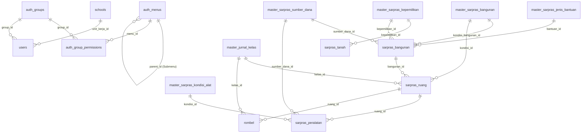

# Dokumentasi Kontrak API & Skema Database Lengkap (FastAPI + SQLAlchemy + PostgreSQL)
**Sistem Informasi Dinas Pendidikan & Kebudayaan Kabupaten Konawe Selatan (EduSetara)**

Dokumen ini merupakan **Single Source of Truth (SSOT)** kontrak RESTful API dan arsitektur database **PostgreSQL + SQLAlchemy 2.0 + Pydantic v2** untuk seluruh modul aplikasi **EduSetara** (Auth, Dashboard & Analytics, Operasional Sekolah, Verifikasi Kedinasan, Data Master, serta Portal Publik / Publish).

Seluruh spesifikasi di dalam dokumen ini disusun dari hasil audit menyeluruh terhadap:
1. Seluruh kode sumber *frontend* Next.js (`app/(auth)/**`, `app/(admin)/**`, `app/(publish)/**`, dan `app/(admin)/_data/admin-menu.json`).
2. Dokumen spesifikasi asli [`reff/Arsitektur Sistem.docx`](file:///Users/dinaskominfo/kiken/Project/next/edusetara/reff/Arsitektur%20Sistem.docx) dan [`reff/Peta Module Front-end.docx`](file:///Users/dinaskominfo/kiken/Project/next/edusetara/reff/Peta%20Module%20Front-end.docx).

---

## Daftar Isi

1. [Arsitektur Backend, Konvensi FastAPI + SQLAlchemy, & Standar Response](#1-arsitektur-backend-konvensi-fastapi--sqlalchemy--standar-response)
2. [Autentikasi, Sesi, RBAC, & Integrasi SIMPEG (`/login`, `/api/v1/auth/*`, `/api/v1/simpeg/*`)](#2-autentikasi-sesi-rbac--integrasi-simpeg)
3. [Dashboard Utama & Visual Analytics (`/admin`, `/api/v1/admin/dashboard/*`)](#3-dashboard-utama--visual-analytics)
4. [Modul Sarana & Prasarana (`/admin/sarpras/*`)](#4-modul-sarana--prasarana-adminsarpas)
   - 4.1 Tanah Sekolah (`/admin/sarpras/tanah`)
   - 4.2 Bangunan (`/admin/sarpras/bangunan`)
   - 4.3 Ruang (`/admin/sarpras/ruang`)
   - 4.4 Peralatan / Aset Sekolah (`/admin/sarpras/peralatan`)
5. [Modul Usulan Sekolah (`/admin/usulan/*`)](#5-modul-usulan-sekolah-adminusulan)
   - 5.1 Usulan Tunjangan Guru & Sub-Lampiran (`/admin/usulan/tunjangan-guru`)
   - 5.2 Usulan Bantuan PIP: Data Pendukung (`/admin/usulan/pip/data-pendukung`)
   - 5.3 Usulan Bantuan PIP: Data Penerima (`/admin/usulan/pip/data-penerima`)
   - 5.4 Usulan Data Assessment (`/admin/usulan/assessment`)
   - 5.5 Usulan Rekonsiliasi Dana BOSP, Sub-Lampiran, & Surat Rekomendasi (`/admin/usulan/rekonsiliasi-bosp`)
6. [Modul Kegiatan Sekolah (`/admin/kegiatan-sekolah`)](#6-modul-kegiatan-sekolah-adminkegiatan-sekolah)
7. [Modul Rombongan Belajar / Rombel (`/admin/rombel/{paud|sd|smp}`)](#7-modul-rombongan-belajar--rombel-adminrombel)
8. [Modul Komunitas Belajar & Struktur Pengurus (`/admin/komunitas-belajar`)](#8-modul-komunitas-belajar--struktur-pengurus-adminkomunitas-belajar)
9. [Modul Jurnal V2 (`/admin/jurnal/*`)](#9-modul-jurnal-v2-adminjurnal)
   - 9.1 Jurnal Guru Kelas (`/admin/jurnal/guru-kelas`)
   - 9.2 Jurnal Kepala Sekolah (`/admin/jurnal/kepala-sekolah`)
   - 9.3 Jurnal Pengawas (`/admin/jurnal/pengawas`)
   - 9.4 Jurnal Bimbingan & Konseling / BK (`/admin/jurnal/bk`)
10. [Modul Gallery & Video Testimoni (`/admin/gallery/*`)](#10-modul-gallery--video-testimoni-admingallery)
    - 10.1–10.8 8 Submodul Gallery Foto Kegiatan
    - 10.9 Video Testimoni (`/admin/gallery/video-testimoni`)
11. [Modul Piagam & Sertifikat PTK (`/admin/piagam-sertifikat`)](#11-modul-piagam--sertifikat-ptk-adminpiagam-sertifikat)
12. [Modul Verifikasi Kedinasan (`/admin/verifikasi/*`)](#12-modul-verifikasi-kedinasan-adminverifikasi)
    - 12.1 Verifikasi Usulan Tunjangan Guru (`/admin/verifikasi/tunjangan-guru`)
    - 12.2 Verifikasi Dual-Tahap Rekonsiliasi Dana BOSP (`/admin/verifikasi/rekonsiliasi-bosp`)
13. [Modul Regulasi & Info GTK (`/admin/regulasi-gtk/*`)](#13-modul-regulasi--info-gtk-adminregulasi-gtk)
    - 13.1 Pengumuman GTK (`/admin/regulasi-gtk/pengumuman`)
    - 13.2 Modul & Materi Pelatihan (`/admin/regulasi-gtk/modul-materi`)
    - 13.3 Regulasi Resmi (`/admin/regulasi-gtk/regulasi`)
14. [Modul PPDB & Kuota PPDB (`/admin/ppdb/*`, `/admin/kuota-ppdb`)](#14-modul-ppdb--kuota-ppdb)
    - 14.1–14.3 PPDB PAUD, SD, SMP (`/admin/ppdb/{paud|sd|smp}`)
    - 14.4 Kalkulasi & Manajemen Kuota PPDB (`/admin/kuota-ppdb`)
15. [Modul Profile Kelembagaan (`/admin/profile/{renstra|tugas-fungsi|visi-misi}`)](#15-modul-profile-kelembagaan-adminprofile)
16. [Modul Data Master (`/admin/master/*`)](#16-modul-data-master-adminmaster)
    - 16.1 Master Auth: Menu, Group & Matriks Akses, Registrasi ASN (`/admin/master/auth/*`)
    - 16.2 Master Siswa (`/admin/master/siswa`)
    - 16.3 Master Sekolah SD, SMP, TK, PKBM (`/admin/master/sekolah/*`)
    - 16.4 Master Usulan: Triwulan, Jenis Penerima, Kelas Penerima (`/admin/master/usulan/*`)
    - 16.5 Master Jurnal: Bahan Ajar, Materi Ajar, Kelas, Mata Pelajaran (`/admin/master/jurnal/*`)
    - 16.6 Master Jenjang (`/admin/master/jenjang`)
    - 16.7 Master PPDB: Agama, Tempat Tinggal, Transportasi, Pendidikan, Pekerjaan, Penghasilan (`/admin/master/ppdb/*`)
    - 16.8 Master Sarpras: Bangunan, Kepemilikan, Sumber Dana, Kondisi Alat, Jenis Bantuan (`/admin/master/sarpras/*`)
    - 16.9–16.14 Master Lainnya: BK Jenis Layanan, BK Kegiatan Layanan, Model Pembelajaran, Pendampingan, Tugas, Kategori
17. [Modul Publish / Portal Publik (`/admin/*` & `/api/v1/public/*`)](#17-modul-publish--portal-publik)
    - 17.1 Berita (`/admin/berita` & `/berita`)
    - 17.2 Pengumuman (`/admin/pengumuman` & `/pengumuman`)
    - 17.3 Pendidikan per Jenjang (`/admin/pendidikan` & `/pendidikan`)
    - 17.4 Direktori Sekolah (`/admin/sekolah` & `/sekolah`)
    - 17.5 Kebudayaan (`/admin/kebudayaan` & `/kebudayaan`)
    - 17.6 Layanan Publik (`/admin/layanan` & `/layanan`)
    - 17.7 Statistik Pendidikan (`/admin/statistik` & `/statistik`)
    - 17.8 Profil Dinas (`/admin/profil` & `/profil`)
    - 17.9 Banner Beranda (`/admin/banner` & `/`)
    - 17.10 Pesan Kontak & Pengaduan (`/admin/kontak` & `/kontak`)
18. [Spesifikasi Upload Berkas, Keamanan, & Rekomendasi Struktur Proyek FastAPI](#18-spesifikasi-upload-berkas-keamanan--rekomendasi-struktur-proyek-fastapi)
19. [Peta Relasi Data Lengkap (ERD, Relasi Data Master ke Tabel Operasional, & Implementasi SQLAlchemy)](#19-peta-relasi-data-lengkap-erd-relasi-data-master-ke-tabel-operasional--implementasi-sqlalchemy)

---

## 1. Arsitektur Backend, Konvensi FastAPI + SQLAlchemy, & Standar Response

### 1.1 Tech Stack & Base URL
- **Framework**: FastAPI (Python 3.11+)
- **ORM & Migrations**: SQLAlchemy 2.0 (`DeclarativeBase`, `Mapped`, `mapped_column`, `AsyncSession`) + Alembic
- **Database**: PostgreSQL 15+
- **Validation & Serialization**: Pydantic v2 (`ConfigDict(from_attributes=True, populate_by_name=True)`)
- **Base API Prefix**:
  - Endpoint Admin & Operasional: `/api/v1/admin/...`
  - Endpoint Autentikasi: `/api/v1/auth/...`
  - Endpoint Integrasi SIMPEG: `/api/v1/simpeg/...`
  - Endpoint Portal Publik (Tanpa Auth): `/api/v1/public/...`

### 1.2 Standar Envelope Response JSON
Seluruh endpoint FastAPI mengembalikan struktur *envelope* JSON yang seragam agar langsung kompatibel dengan komponen frontend (`ContractCrudPage`, `AdminPageScaffold`, dan modul kustom):

#### A. Response Sukses (Single Object / Mutation)
```json
{
  "success": true,
  "statusCode": 200,
  "message": "Data berhasil disimpan",
  "data": {
    "id": "uuid-atau-kode",
    "...": "..."
  }
}
```

#### B. Response Sukses Koleksi dengan Paginasi (List Data)
```json
{
  "success": true,
  "statusCode": 200,
  "message": "Data berhasil diambil",
  "data": [
    { "id": "1", "...": "..." }
  ],
  "meta": {
    "page": 1,
    "limit": 10,
    "totalItems": 142,
    "totalPages": 15,
    "hasNextPage": true,
    "hasPrevPage": false
  }
}
```

#### C. Response Error / Validasi Gagal (`400`, `401`, `403`, `404`, `422`, `500`)
```json
{
  "success": false,
  "statusCode": 422,
  "message": "Validasi data gagal",
  "errors": [
    {
      "field": "nisn",
      "message": "NISN wajib terdiri dari 10 digit angka"
    }
  ]
}
```

### 1.3 Standar Query Parameters (List & Filter)
Setiap endpoint `GET` koleksi wajib mendukung query parameter berikut di FastAPI (`Query(...)`):
| Parameter | Tipe | Default | Keterangan |
| :--- | :--- | :--- | :--- |
| `page` | `int` | `1` | Nomor halaman aktif (`>= 1`) |
| `limit` | `int` | `10` | Jumlah item per halaman (`1..100`, atau `all=true` untuk dropdown master) |
| `search` | `str \| None` | `None` | Kata kunci pencarian (`ILIKE %search%` pada kolom teks utama) |
| `sortBy` | `str` | `"created_at"` | Kolom pengurutan |
| `sortOrder` | `"asc" \| "desc"` | `"desc"` | Arah pengurutan |
| `unit_kerja` | `str \| None` | `None` | Filter nama/ID satuan pendidikan (khusus pengguna Level 1 / Dinas) |
| `tahun` | `int \| str \| None` | `None` | Filter tahun anggaran / tahun ajaran |
| `triwulan_id` | `str \| None` | `None` | Filter triwulan (pada modul Usulan & Verifikasi) |
| `status` | `str \| int \| None` | `None` | Filter status verifikasi atau status publikasi |

### 1.4 Mixin Kolom Audit & Scoping Otomatis di SQLAlchemy
Di seluruh modul operasional sekolah (`Sarpras`, `Usulan`, `Kegiatan Sekolah`, `Rombel`, `Komunitas Belajar`, `Jurnal V2`, `Gallery`, `Piagam`, `PPDB`), sistem wajib menyertakan kolom jejak audit dan identitas sekolah yang **diisi otomatis oleh Backend dari JWT Session user yang sedang login**:

```python
from datetime import datetime
from sqlalchemy import String, DateTime, func
from sqlalchemy.orm import Mapped, mapped_column

class AuditScopeMixin:
    """Mixin standar untuk tabel operasional EduSetara."""
    nip: Mapped[str | None] = mapped_column(String(30), index=True, nullable=True, comment="NIP ASN pembuat data (dari sesi login)")
    unit_kerja: Mapped[str | None] = mapped_column(String(150), index=True, nullable=True, comment="Nama Satuan Pendidikan / Unit Kerja")
    unit_kerja_id: Mapped[str | None] = mapped_column(String(50), index=True, nullable=True, comment="ID Unit Kerja SIMPEG / NPSN Sekolah")
    created_by: Mapped[str | None] = mapped_column(String(100), nullable=True, comment="Nama / Username pembuat data")
    created_at: Mapped[datetime] = mapped_column(DateTime(timezone=True), server_default=func.now(), index=True)
    updated_at: Mapped[datetime | None] = mapped_column(DateTime(timezone=True), onupdate=func.now(), nullable=True)
```

> **Catatan Kompatibilitas Penamaan Field (`snake_case` vs `camelCase`)**:
> Pada dokumen arsitektur lama terdapat sebagian penulisan `createAt` / `createBy` dan sebagian `created_at` / `created_by`. Di komponen frontend [`contract-crud-page.tsx`](file:///Users/dinaskominfo/kiken/Project/next/edusetara/app/(admin)/_components/contract-crud-page.tsx), nama field yang digunakan secara konsisten adalah **`created_at`** dan **`created_by`**. Gunakan nama kolom database `created_at` dan `created_by`, serta aktifkan `validation_alias` di Pydantic bila menerima payload legacy `createAt`/`createBy`.

### 1.5 Aturan Multi-Scope Data Access (Level 1 vs Level 2)
Berdasarkan modul **Data Master > Auth > Group** ([`group-management.tsx`](file:///Users/dinaskominfo/kiken/Project/next/edusetara/app/(admin)/admin/master/auth/group/group-management.tsx)):
1. **Level 1 (`level = 1` — Cakupan Semua Satuan Pendidikan / Dinas)**:
   - Contoh Group: *Super Admin Dinas*, *Verifikator BOSP & Tunjangan*, *Pengawas Sekolah Kabupaten*, *Redaktur Berita & Publikasi*.
   - **Perilaku Query**: Dapat melihat, memfilter, dan memverifikasi data dari **seluruh sekolah / unit kerja**.
2. **Level 2 (`level = 2` — Cakupan Unit Pendidikan Pengguna)**:
   - Contoh Group: *Operator Satuan Pendidikan*, *Kepala Satuan Pendidikan*, *Guru & Wali Kelas*.
   - **Perilaku Query**: Setiap query `SELECT`, `INSERT`, `UPDATE`, `DELETE` pada tabel operasional **wajib di-filter otomatis** oleh dependency FastAPI berdasarkan `unit_kerja_id` (atau `unit_kerja`) milik user yang login. Untuk *Guru*, pada modul Jurnal Guru Kelas atau Usulan Tunjangan pribadi, filter juga dapat dipersempit ke `nip == current_user.nip`.

---

## 2. Autentikasi, Sesi, RBAC, & Integrasi SIMPEG

Direferensikan oleh:
- [`app/(auth)/login/page.tsx`](file:///Users/dinaskominfo/kiken/Project/next/edusetara/app/(auth)/login/page.tsx)
- [`app/(admin)/admin/master/auth/menu/menu-management.tsx`](file:///Users/dinaskominfo/kiken/Project/next/edusetara/app/(admin)/admin/master/auth/menu/menu-management.tsx)
- [`app/(admin)/admin/master/auth/group/group-management.tsx`](file:///Users/dinaskominfo/kiken/Project/next/edusetara/app/(admin)/admin/master/auth/group/group-management.tsx)
- [`app/(admin)/admin/master/auth/registrasi/registration-management.tsx`](file:///Users/dinaskominfo/kiken/Project/next/edusetara/app/(admin)/admin/master/auth/registrasi/registration-management.tsx)

### 2.1 Skema Tabel Database Auth & RBAC
#### Tabel `auth_menus`
| Kolom | Tipe PostgreSQL | Constraints | Keterangan |
| :--- | :--- | :--- | :--- |
| `id` | `VARCHAR(30)` | `PRIMARY KEY` | Contoh: `"MNU-001"`, `"MNU-010-A"` |
| `parent_id` | `VARCHAR(30)` | `FK -> auth_menus.id ON DELETE CASCADE`, `NULLABLE` | `NULL` jika menu utama (Root) |
| `title` | `VARCHAR(100)` | `NOT NULL` | Judul menu di sidebar |
| `icon` | `VARCHAR(60)` | `NOT NULL` | Nama ikon Lucide (contoh: `"LayoutDashboard"`, `"Building2"`) |
| `path` | `VARCHAR(200)` | `NOT NULL` | Route Next.js (contoh: `"/admin/sarpras/tanah"`) |
| `index` | `INTEGER` | `NOT NULL DEFAULT 1` | Urutan tampil menu |
| `is_active` | `BOOLEAN` | `NOT NULL DEFAULT TRUE` | Status aktif menu |
| `created_at` | `TIMESTAMPTZ` | `DEFAULT NOW()` | Waktu pembuatan |
| `created_by` | `VARCHAR(100)` | `NULLABLE` | Pembuat |

#### Tabel `auth_groups`
| Kolom | Tipe PostgreSQL | Constraints | Keterangan |
| :--- | :--- | :--- | :--- |
| `id` | `VARCHAR(30)` | `PRIMARY KEY` | Contoh: `"GRP-001"` |
| `title` | `VARCHAR(100)` | `NOT NULL UNIQUE` | Nama Group (contoh: `"Super Admin Dinas"`) |
| `level` | `SMALLINT` | `NOT NULL CHECK (level IN (1, 2))` | `1` = Semua Satuan Pendidikan (Dinas), `2` = Unit Pendidikan Pengguna (Sekolah) |
| `created_at` | `TIMESTAMPTZ` | `DEFAULT NOW()` | Waktu pembuatan |
| `created_by` | `VARCHAR(100)` | `NULLABLE` | Pembuat |

#### Tabel `auth_group_permissions`
| Kolom | Tipe PostgreSQL | Constraints | Keterangan |
| :--- | :--- | :--- | :--- |
| `id` | `UUID / SERIAL` | `PRIMARY KEY` | ID baris matriks akses |
| `group_id` | `VARCHAR(30)` | `FK -> auth_groups.id ON DELETE CASCADE` | Relasi ke group |
| `menu_id` | `VARCHAR(30)` | `FK -> auth_menus.id ON DELETE CASCADE` | Relasi ke menu (`UNIQUE(group_id, menu_id)`) |
| `create` | `BOOLEAN` | `NOT NULL DEFAULT FALSE` | Hak tambah data (`C`) |
| `read` | `BOOLEAN` | `NOT NULL DEFAULT FALSE` | Hak lihat menu & baca data (`R`) |
| `update` | `BOOLEAN` | `NOT NULL DEFAULT FALSE` | Hak ubah data (`U`) |
| `delete` | `BOOLEAN` | `NOT NULL DEFAULT FALSE` | Hak hapus data (`D`) |
| `created_at` | `TIMESTAMPTZ` | `DEFAULT NOW()` | Waktu update hak akses |
| `created_by` | `VARCHAR(100)` | `NULLABLE` | Pembuat |

#### Tabel `users` & `auth_asn_registrations`
| Kolom | Tipe PostgreSQL | Constraints | Keterangan |
| :--- | :--- | :--- | :--- |
| `id` | `VARCHAR(30)` | `PRIMARY KEY` | Contoh: `"REG-001"` atau UUID |
| `nip` | `VARCHAR(30)` | `UNIQUE NOT NULL` | NIP ASN / Identitas Pegawai |
| `email` | `VARCHAR(150)` | `UNIQUE NULLABLE` | Email login (opsional, bisa login via NIP atau Email) |
| `password_hash` | `VARCHAR(255)` | `NOT NULL` | Bcrypt / Argon2 password hash |
| `name` | `VARCHAR(150)` | `NOT NULL` | Nama lengkap beserta gelar (sinkron SIMPEG) |
| `unit_kerja_id` | `VARCHAR(50)` | `INDEX NULLABLE` | ID Unit Kerja SIMPEG / NPSN Sekolah |
| `unit_kerja` | `VARCHAR(150)` | `INDEX NOT NULL` | Nama Unit Kerja / Sekolah |
| `position` | `VARCHAR(150)` | `NULLABLE` | Jabatan ASN di SIMPEG |
| `group_id` | `VARCHAR(30)` | `FK -> auth_groups.id ON DELETE RESTRICT` | Group RBAC pengguna |
| `avatar_url` | `TEXT` | `NULLABLE` | Foto profil |
| `is_active` | `BOOLEAN` | `NOT NULL DEFAULT TRUE` | Status akun aktif |
| `last_login_at` | `TIMESTAMPTZ` | `NULLABLE` | Waktu login terakhir |
| `created_at` | `TIMESTAMPTZ` | `DEFAULT NOW()` | Waktu registrasi |
| `created_by` | `VARCHAR(100)` | `NULLABLE` | Admin peregistrasi |

### 2.2 Kontrak Endpoint Autentikasi (`/api/v1/auth/*`)

#### 1. `POST /api/v1/auth/login`
Login menggunakan **Email kedinasan atau NIP** beserta password (sesuai form [`app/(auth)/login/page.tsx`](file:///Users/dinaskominfo/kiken/Project/next/edusetara/app/(auth)/login/page.tsx)).
- **Request Body**:
```json
{
  "identifier": "198208102008011009",
  "password": "PasswordRahasia123!",
  "remember_me": true
}
```
*(Catatan: Backend juga wajib menerima key `"email"` atau `"nip"` sebagai alias dari `"identifier"`).*
- **Response `200 OK`**:
```json
{
  "success": true,
  "statusCode": 200,
  "message": "Login berhasil",
  "data": {
    "access_token": "eyJhbGciOiJIUzI1NiIs...",
    "refresh_token": "eyJhbGciOiJIUzI1NiIs...",
    "token_type": "bearer",
    "expires_in": 86400,
    "user": {
      "id": "REG-003",
      "nip": "198208102008011009",
      "email": "operator@smpn1andoolo.sch.id",
      "name": "Budi Santoso, S.Kom",
      "unit_kerja_id": "40401821",
      "unit_kerja": "SMPN 1 Andoolo",
      "position": "Operator Dapodik & Bos",
      "group": {
        "id": "GRP-003",
        "title": "Operator Satuan Pendidikan",
        "level": 2
      }
    }
  }
}
```

#### 2. `GET /api/v1/auth/me`
Mengambil profil user aktif beserta pohon menu sidebar (`admin-menu.json`) yang sudah difilter sesuai `auth_group_permissions` (`read = true`).
- **Response `200 OK`**: Mengembalikan objek `user`, `permissions` (map `path -> {create, read, update, delete}`), dan `menus` (struktur hierarki `children`).

#### 3. `POST /api/v1/auth/refresh` & `POST /api/v1/auth/logout`
Memperbarui access token dari refresh token atau mencabut sesi aktif.

### 2.3 Kontrak Endpoint Integrasi SIMPEG (`/api/v1/simpeg/*`)
Banyak form di EduSetara memilih data pegawai/sekolah dari SIMPEG (Sistem Informasi Manajemen Kepegawaian):
1. `GET /api/v1/simpeg/asn?search=&unit_kerja_id=`
   - Mengembalikan daftar ASN (`nip`, `name`, `unit`, `unit_kerja_id`, `position`, `golongan`, `pangkat`) untuk modul **Registrasi ASN** dan **Komunitas Belajar**.
2. `GET /api/v1/simpeg/guru?unit_kerja_id=&search=`
   - Mengembalikan daftar Guru/PTK (`id`/`nip`, `nama`, `nip`, `nuptk`, `golongan`, `jabatan`, `unit_kerja`) untuk dropdown `guru_id`, `wali_kelas`, dan `nama_id` pada modul **Rombel**, **Usulan Tunjangan Guru**, **Piagam & Sertifikat**, dan **Jurnal Guru Kelas**.
3. `GET /api/v1/simpeg/kepsek?unit_kerja_id=`
   - Mengembalikan daftar Kepala Sekolah (`id`/`nip`, `nama`, `nip`, `unit_kerja`) untuk dropdown `kepsek_id` pada modul **Rombel**.
4. `GET /api/v1/simpeg/unit-kerja?jenjang=&search=`
   - Mengembalikan daftar Unit Kerja / Satuan Pendidikan (`id`/`npsn`, `nama_sekolah`, `jenjang`, `kecamatan`, `status`) untuk filter `unit_kerja` dan form **Kuota PPDB** / **Jurnal Pengawas**.

---

## 3. Dashboard Utama & Visual Analytics

Direferensikan oleh:
- [`app/(admin)/admin/page.tsx`](file:///Users/dinaskominfo/kiken/Project/next/edusetara/app/(admin)/admin/page.tsx)
- [`app/(admin)/_components/chart/dashboard-analytics.tsx`](file:///Users/dinaskominfo/kiken/Project/next/edusetara/app/(admin)/_components/chart/dashboard-analytics.tsx)

### 3.1 `GET /api/v1/admin/dashboard/summary`
Mengambil ringkasan 4 kartu statistik utama, berita terbaru, pengumuman aktif, dan log aktivitas terkini.
- **Response `200 OK`**:
```json
{
  "success": true,
  "statusCode": 200,
  "data": {
    "stats": {
      "totalSchools": { "value": 608, "change": "+4 unit", "note": "PAUD, SD, SMP & PKBM aktif" },
      "totalTeachers": { "value": 6540, "change": "+2.4%", "note": "ASN, PPPK, dan Non-ASN" },
      "totalStudents": { "value": 64320, "change": "+1.8%", "note": "Tahun ajaran 2025/2026" },
      "activeAnnouncements": { "value": 4, "change": "3 prioritas", "note": "Memerlukan tindak lanjut sekolah" }
    },
    "recentNews": [
      {
        "slug": "transformasi-pembelajaran-digital-konsel-2026",
        "title": "Transformasi Pembelajaran Digital...",
        "category": "Program Prioritas",
        "author": "Tim Humas Disdikbud",
        "readTime": "4 menit baca",
        "featured": true
      }
    ],
    "activeAnnouncements": [
      {
        "id": "PGM-2026-014",
        "title": "Jadwal Verifikasi Berkas Tunjangan Profesi Guru Triwulan II",
        "category": "Kepegawaian / PPPK",
        "number": "800/142/DISDIKBUD/2026",
        "deadline": "30 April 2026",
        "important": true
      }
    ],
    "activityLogs": [
      {
        "id": "LOG-01",
        "title": "Pengumuman jadwal verifikasi berkas PPPK tahap II dipublikasikan",
        "actor": "Subbag Kepegawaian",
        "time": "25 menit lalu",
        "type": "Pengumuman"
      }
    ]
  }
}
```

### 3.2 `GET /api/v1/admin/dashboard/analytics`
Mengambil seluruh dataset untuk 4 panel grafik interaktif Highcharts di [`dashboard-analytics.tsx`](file:///Users/dinaskominfo/kiken/Project/next/edusetara/app/(admin)/_components/chart/dashboard-analytics.tsx).
- **Query Params**: `?tahun=2026&unit_kerja_id=`
- **Response `200 OK`**:
```json
{
  "success": true,
  "statusCode": 200,
  "data": {
    "sarpras": {
      "categories": ["PAUD / TK", "SD Negeri/Swasta", "SMP Negeri/Swasta", "PKBM"],
      "ruang": {
        "baik": [285, 1640, 620, 48],
        "rusak_ringan": [68, 410, 145, 16],
        "rusak_sedang": [24, 165, 58, 9],
        "rusak_berat": [12, 78, 29, 4]
      },
      "bangunan": {
        "baik": [190, 980, 390, 32],
        "rusak_ringan": [42, 240, 88, 11],
        "rusak_sedang": [18, 95, 36, 5],
        "rusak_berat": [8, 44, 16, 2]
      },
      "peralatan": {
        "baik": [520, 3450, 1890, 140],
        "rusak_ringan": [95, 620, 310, 28],
        "rusak_sedang": [40, 230, 120, 12],
        "rusak_berat": [15, 110, 54, 6]
      }
    },
    "demografi": {
      "siswa": [
        { "name": "SD (Sekolah Dasar)", "y": 36840, "color": "#2563eb" },
        { "name": "SMP (Menengah Pertama)", "y": 17920, "color": "#0891b2" },
        { "name": "PAUD / TK", "y": 7650, "color": "#8b5cf6" },
        { "name": "PKBM / Kesetaraan", "y": 1910, "color": "#f59e0b" }
      ],
      "rombel": [
        { "name": "Rombel SD", "y": 1842, "color": "#2563eb" },
        { "name": "Rombel SMP", "y": 685, "color": "#0891b2" },
        { "name": "Rombel PAUD / TK", "y": 412, "color": "#8b5cf6" },
        { "name": "Rombel PKBM", "y": 96, "color": "#f59e0b" }
      ],
      "sekolah": [
        { "name": "Unit SD", "y": 342, "color": "#2563eb" },
        { "name": "Unit PAUD / TK", "y": 156, "color": "#8b5cf6" },
        { "name": "Unit SMP", "y": 88, "color": "#0891b2" },
        { "name": "Unit PKBM", "y": 22, "color": "#f59e0b" }
      ]
    },
    "usulan_verifikasi": {
      "categories": ["Triwulan I", "Triwulan II", "Triwulan III", "Triwulan IV"],
      "semua": {
        "diterima": [412, 468, 395, 310],
        "menunggu": [38, 64, 112, 185],
        "dikembalikan": [29, 22, 34, 19]
      },
      "tunjangan": {
        "diterima": [265, 290, 248, 195],
        "menunggu": [22, 39, 68, 110],
        "dikembalikan": [18, 14, 21, 11]
      },
      "bosp_pip": {
        "diterima": [147, 178, 147, 115],
        "menunggu": [16, 25, 44, 75],
        "dikembalikan": [11, 8, 13, 8]
      }
    },
    "activity": {
      "jurnal": {
        "categories": ["Jan", "Feb", "Mar", "Apr", "Mei", "Jun"],
        "guru_kelas": [1420, 1580, 1690, 1610, 1785, 1890],
        "kepala_sekolah": [310, 345, 360, 352, 388, 412],
        "pengawas": [92, 108, 115, 112, 128, 136],
        "bk": [240, 275, 310, 295, 340, 365]
      },
      "ppdb": {
        "categories": ["PAUD / TK", "SD Negeri", "SMP Negeri"],
        "daya_tampung": [4200, 11500, 6800],
        "terdaftar": [3680, 10940, 6590]
      }
    }
  }
}
```

---

## 4. Modul Sarana & Prasarana (`/admin/sarpras/*`)

Modul Sarana & Prasarana memiliki hierarki relasi berjenjang:
`Master Kepemilikan / Kondisi / Bantuan / Sumber Dana` $\rightarrow$ **`sarpras_tanah`** & **`sarpras_bangunan`** $\rightarrow$ **`sarpras_ruang`** $\rightarrow$ **`sarpras_peralatan`**.

### 4.1 Tanah Sekolah (`/admin/sarpras/tanah`)
- **File Frontend**: [`app/(admin)/admin/sarpras/tanah/page.tsx`](file:///Users/dinaskominfo/kiken/Project/next/edusetara/app/(admin)/admin/sarpras/tanah/page.tsx)
- **Endpoint CRUD**:
  - `GET /api/v1/admin/sarpras/tanah`
  - `GET /api/v1/admin/sarpras/tanah/{id}`
  - `POST /api/v1/admin/sarpras/tanah` (`multipart/form-data` atau JSON)
  - `PUT /api/v1/admin/sarpras/tanah/{id}`
  - `DELETE /api/v1/admin/sarpras/tanah/{id}`
- **Skema Tabel `sarpras_tanah`**:
| Kolom | Tipe PostgreSQL | Constraints | Keterangan |
| :--- | :--- | :--- | :--- |
| `id` | `VARCHAR(36)` | `PRIMARY KEY` | UUID / Kode (contoh: `"TNH-001"`) |
| `nama_tanah` | `VARCHAR(200)` | `NOT NULL` | Nama aset tanah (contoh: `"Tanah Kampus Utama SDN 1 Andoolo"`) |
| `no_sertifikat` | `VARCHAR(100)` | `NOT NULL` | Nomor sertifikat hak pakai / SHM |
| `panjang` | `NUMERIC(10,2)` | `NOT NULL` | Panjang lahan ($m$) |
| `lebar` | `NUMERIC(10,2)` | `NOT NULL` | Lebar lahan ($m$) |
| `luas` | `NUMERIC(12,2)` | `NOT NULL` | Total luas tanah ($m^2$) |
| `luas_tersedia` | `NUMERIC(12,2)` | `NOT NULL` | Luas lahan siap bangun / tersedia ($m^2$) |
| `kepemilikan_id` | `VARCHAR(50)` | `FK -> master_sarpras_kepemilikan.id` | Status kepemilikan (`Milik` / `Sewa` / `Pinjam` / `Bukan Milik`) |
| `ket_tanah` | `TEXT` | `NULLABLE` | Keterangan kondisi dan batas tanah |
| `file` | `TEXT` | `NULLABLE` | Path/URL scan PDF sertifikat tanah |
| `nip`, `unit_kerja`, `unit_kerja_id`, `created_by`, `created_at`, `updated_at` | *AuditScopeMixin* | Otomatis | Diisi otomatis dari session |

### 4.2 Bangunan (`/admin/sarpras/bangunan`)
- **File Frontend**: [`app/(admin)/admin/sarpras/bangunan/page.tsx`](file:///Users/dinaskominfo/kiken/Project/next/edusetara/app/(admin)/admin/sarpras/bangunan/page.tsx)
- **Endpoint CRUD**: `/api/v1/admin/sarpras/bangunan` (`GET`, `POST`, `PUT /{id}`, `DELETE /{id}`)
- **Skema Tabel `sarpras_bangunan`**:
| Kolom | Tipe PostgreSQL | Constraints | Keterangan |
| :--- | :--- | :--- | :--- |
| `id` | `VARCHAR(36)` | `PRIMARY KEY` | Contoh: `"BGN-001"` |
| `nama_bangunan` | `VARCHAR(200)` | `NOT NULL` | Nama gedung (contoh: `"Gedung Kelas Blok A"`) |
| `kd_bangunan` | `VARCHAR(50)` | `NOT NULL` | Kode bangunan |
| `panjang` | `NUMERIC(10,2)` | `NOT NULL` | Panjang bangunan ($m$) |
| `lebar` | `NUMERIC(10,2)` | `NOT NULL` | Lebar bangunan ($m$) |
| `luas_tapak_bangunan` | `NUMERIC(12,2)` | `NOT NULL` | Luas tapak bangunan ($m^2$) |
| `kepemilikan_id` | `VARCHAR(50)` | `FK -> master_sarpras_kepemilikan.id` | Kepemilikan bangunan |
| `peminjam_meminjamkan` | `VARCHAR(150)` | `NULLABLE` | Pihak peminjam / yang meminjamkan (`"-"`, `"Pemda"`, dll.) |
| `nilai_perolehan_aset` | `NUMERIC(18,2)` | `NOT NULL DEFAULT 0` | Nilai perolehan aset (Rp) |
| `jml_lantai` | `SMALLINT` | `NOT NULL DEFAULT 1` | Jumlah lantai |
| `thn_dibangun` | `SMALLINT` | `NOT NULL` | Tahun dibangun (contoh: `2018`) |
| `ket_bangunan` | `TEXT` | `NULLABLE` | Keterangan tambahan bangunan |
| `tgl_sk_pemakai` | `DATE` | `NULLABLE` | Tanggal SK pemakai |
| `kondisi_bangunan_id` | `VARCHAR(50)` | `FK -> master_sarpras_bangunan.id` | Kondisi (`Baik`, `Rusak Ringan`, `Rusak Sedang`, `Rusak Berat`) |
| `konstruksi_bertingkat` | `VARCHAR(20)` | `NOT NULL` | `"Ya"` atau `"Tidak"` |
| `konstruksi_beton` | `VARCHAR(20)` | `NOT NULL` | `"Ya"` atau `"Tidak"` |
| `luas_lantai` | `NUMERIC(12,2)` | `NOT NULL` | Total luas lantai ($m^2$) |
| `lokasi` | `VARCHAR(255)` | `NOT NULL` | Lokasi / alamat gedung |
| `tahun` | `SMALLINT` | `NOT NULL` | Tahun data anggaran |
| `no_sk_pemakai` | `VARCHAR(100)` | `NULLABLE` | Nomor SK pemakai |
| `bantuan_id` | `VARCHAR(50)` | `FK -> master_sarpras_jenis_bantuan.id` | Jenis bantuan |
| `sumber_dana_id` | `VARCHAR(50)` | `FK -> master_sarpras_sumber_dana.id` | Sumber dana (`DAK`, `APBD`, `BOS`, dll.) |
| `nilai_bantuan` | `NUMERIC(18,2)` | `NOT NULL DEFAULT 0` | Nilai dana bantuan (Rp) |
| `perolehan_aset` | `VARCHAR(150)` | `NULLABLE` | Cara perolehan aset |
| `file` | `TEXT` | `NULLABLE` | Foto kondisi fisik bangunan (JPG/PNG) |
| `nip`, `unit_kerja`, `unit_kerja_id`, `created_by`, `created_at`, `updated_at` | *AuditScopeMixin* | Otomatis | Diisi otomatis dari session |

### 4.3 Ruang (`/admin/sarpras/ruang`)
- **File Frontend**: [`app/(admin)/admin/sarpras/ruang/page.tsx`](file:///Users/dinaskominfo/kiken/Project/next/edusetara/app/(admin)/admin/sarpras/ruang/page.tsx)
- **Endpoint CRUD**: `/api/v1/admin/sarpras/ruang` (`GET`, `POST`, `PUT /{id}`, `DELETE /{id}`)
- **Relasi Penting**: Data pada `sarpras_ruang` (khususnya `jns_ruang = 'Ruang Kelas'`) juga dikalkulasi secara agregat pada modul **Kuota PPDB (`/admin/kuota-ppdb`)**.
- **Skema Tabel `sarpras_ruang`**:
| Kolom | Tipe PostgreSQL | Constraints | Keterangan |
| :--- | :--- | :--- | :--- |
| `id` | `VARCHAR(36)` | `PRIMARY KEY` | Contoh: `"RNG-001"` |
| `jns_ruang` | `VARCHAR(100)` | `NOT NULL` | Jenis ruang (`Ruang Kelas`, `Laboratorium IPA`, `Perpustakaan`, `Ruang Guru`, `UKS`) |
| `bangunan_id` | `VARCHAR(36)` | `FK -> sarpras_bangunan.id ON DELETE RESTRICT` | Relasi ke Bangunan induk |
| `kd_ruang` | `VARCHAR(50)` | `NOT NULL` | Kode ruang |
| `nm_ruang` | `VARCHAR(150)` | `NOT NULL` | Nama ruang |
| `lantai_ke` | `SMALLINT` | `NOT NULL DEFAULT 1` | Posisi lantai ke- |
| `panjang` | `NUMERIC(10,2)` | `NOT NULL` | Panjang ruang ($m$) |
| `lebar` | `NUMERIC(10,2)` | `NOT NULL` | Lebar ruang ($m$) |
| `luas` | `NUMERIC(12,2)` | `NOT NULL` | Luas ruang ($m^2$) |
| `kapasitas` | `INTEGER` | `NOT NULL DEFAULT 0` | Kapasitas siswa/orang |
| `luas_plester` | `NUMERIC(10,2)` | `DEFAULT 0` | Luas plesteran ($m^2$) |
| `luas_plafon` | `NUMERIC(10,2)` | `DEFAULT 0` | Luas plafon ($m^2$) |
| `luas_dinding` | `NUMERIC(10,2)` | `DEFAULT 0` | Luas dinding ($m^2$) |
| `luas_daun_jendela` | `NUMERIC(10,2)` | `DEFAULT 0` | Luas daun jendela ($m^2$) |
| `luas_daun_pintu` | `NUMERIC(10,2)` | `DEFAULT 0` | Luas daun pintu ($m^2$) |
| `panjang_kuseng` | `NUMERIC(10,2)` | `DEFAULT 0` | Panjang kusen ($m$) |
| `luas_tutup_lantai` | `NUMERIC(10,2)` | `DEFAULT 0` | Luas tutup lantai ($m^2$) |
| `luas_instalasi_listrik` | `NUMERIC(10,2)` | `DEFAULT 0` | Titik/luas instalasi listrik |
| `jml_instalasi_listrik` | `INTEGER` | `DEFAULT 0` | Jumlah instalasi listrik |
| `panjang_instalasi_air` | `NUMERIC(10,2)` | `DEFAULT 0` | Panjang instalasi air ($m$) |
| `jml_instalasi_air` | `INTEGER` | `DEFAULT 0` | Jumlah titik air |
| `panjang_drainase` | `NUMERIC(10,2)` | `DEFAULT 0` | Panjang saluran drainase ($m$) |
| `luas_finish_struktur` | `NUMERIC(10,2)` | `DEFAULT 0` | Luas finishing struktur ($m^2$) |
| `luas_finish_plafon` | `NUMERIC(10,2)` | `DEFAULT 0` | Luas finishing plafon ($m^2$) |
| `luas_finish_dinding` | `NUMERIC(10,2)` | `DEFAULT 0` | Luas finishing dinding ($m^2$) |
| `luas_finish_kjp` | `NUMERIC(10,2)` | `DEFAULT 0` | Luas finishing KJP (Kusen, Jendela, Pintu) ($m^2$) |
| `file` | `TEXT` | `NULLABLE` | Foto bagian dalam ruang |
| `kondisi_id` | `VARCHAR(50)` | `FK -> master_sarpras_bangunan.id` | Kondisi ruang (`Baik`, `Rusak Ringan`, `Rusak Sedang`, `Rusak Berat`) |
| `kelas_id` | `VARCHAR(50)` | `FK -> master_jurnal_kelas.id NULLABLE` | Relasi ke Master Kelas |
| `nip`, `unit_kerja`, `unit_kerja_id`, `created_by`, `created_at`, `updated_at` | *AuditScopeMixin* | Otomatis | Diisi otomatis dari session |

### 4.4 Peralatan / Aset Sekolah (`/admin/sarpras/peralatan`)
- **File Frontend**: [`app/(admin)/admin/sarpras/peralatan/page.tsx`](file:///Users/dinaskominfo/kiken/Project/next/edusetara/app/(admin)/admin/sarpras/peralatan/page.tsx)
- **Endpoint CRUD**: `/api/v1/admin/sarpras/peralatan` (`GET`, `POST`, `PUT /{id}`, `DELETE /{id}`)
- **Skema Tabel `sarpras_peralatan`**:
| Kolom | Tipe PostgreSQL | Constraints | Keterangan |
| :--- | :--- | :--- | :--- |
| `id` | `VARCHAR(36)` | `PRIMARY KEY` | Contoh: `"ALT-001"` |
| `ruang_id` | `VARCHAR(36)` | `FK -> sarpras_ruang.id ON DELETE RESTRICT` | Ruang penempatan alat |
| `nm_alat` | `VARCHAR(200)` | `NOT NULL` | Nama peralatan / mobiler / TIK |
| `jumlah` | `INTEGER` | `NOT NULL DEFAULT 1` | Jumlah unit |
| `kondisi_id` | `VARCHAR(50)` | `FK -> master_sarpras_kondisi_alat.id` | Kondisi alat (`Baik`, `Rusak Ringan`, `Rusak Berat`) |
| `sumber_dana_id` | `VARCHAR(50)` | `FK -> master_sarpras_sumber_dana.id` | Sumber anggaran pengadaan |
| `tahun` | `SMALLINT` | `NOT NULL` | Tahun pengadaan |
| `file` | `TEXT` | `NULLABLE` | Foto peralatan / aset |
| `nip`, `unit_kerja`, `unit_kerja_id`, `created_by`, `created_at`, `updated_at` | *AuditScopeMixin* | Otomatis | Diisi otomatis dari session |

---

## 5. Modul Usulan Sekolah (`/admin/usulan/*`)

### 5.1 Usulan Tunjangan Guru & Sub-Lampiran (`/admin/usulan/tunjangan-guru`)
- **File Frontend**: [`app/(admin)/admin/usulan/tunjangan-guru/page.tsx`](file:///Users/dinaskominfo/kiken/Project/next/edusetara/app/(admin)/admin/usulan/tunjangan-guru/page.tsx)
- **Alur Bisnis Penting (Sesuai `Arsitektur Sistem.docx` & Modul Verifikasi)**:
  1. Guru/Operator membuat header usulan pada tabel `usulan_tunjangan_guru`.
  2. Setiap usulan memiliki **Sub-Form / Tabel Anak `usulan_tunjangan_lampiran`** untuk mengunggah berkas-berkas syarat (SKTP, SPTJM, SK Pembagian Tugas 24 Jam, Buku Rekening Bank Sultra).
  3. Verifikator Dinas memverifikasi usulan ini di `/admin/verifikasi/tunjangan-guru` dengan mengubah `status` (`0` = Menunggu, `1` = Diterima, `2` = Dikembalikan) dan mengisi `pesan`.

#### Skema Tabel Utama `usulan_tunjangan_guru`
| Kolom | Tipe PostgreSQL | Constraints | Keterangan |
| :--- | :--- | :--- | :--- |
| `id` | `VARCHAR(36)` | `PRIMARY KEY` | Contoh: `"UTG-001"` |
| `tahun` | `SMALLINT` | `NOT NULL` | Tahun anggaran (contoh: `2026`) |
| `triwulan_id` | `VARCHAR(50)` | `FK -> master_usulan_triwulan.id` | Triwulan (`Triwulan I` s/d `Triwulan IV`) |
| `jenis_id` | `VARCHAR(50)` | `FK -> master_usulan_jenis_penerima.id` | Jenis tunjangan (`TPG`, `Tamsil`, `TKG`, `Insentif Non-ASN`) |
| `guru_id` | `VARCHAR(100)` | `NOT NULL` | ID / Nama Guru dari SIMPEG |
| `uraian` | `TEXT` | `NOT NULL` | Uraian pengajuan |
| `status` | `SMALLINT` | `NOT NULL DEFAULT 0` | `0` = Menunggu Verifikasi, `1` = Disetujui/Diterima, `2` = Dikembalikan/Perbaikan |
| `pesan` | `TEXT` | `NULLABLE` | Catatan hasil verifikasi dari Dinas |
| `verified_by` | `VARCHAR(100)` | `NULLABLE` | NIP/Nama Verifikator Dinas |
| `verified_at` | `TIMESTAMPTZ` | `NULLABLE` | Waktu diverifikasi |
| `nip`, `unit_kerja`, `unit_kerja_id`, `created_by`, `created_at`, `updated_at` | *AuditScopeMixin* | Otomatis | Diisi otomatis dari session |

#### Skema Tabel Anak `usulan_tunjangan_lampiran`
| Kolom | Tipe PostgreSQL | Constraints | Keterangan |
| :--- | :--- | :--- | :--- |
| `id` | `VARCHAR(36)` | `PRIMARY KEY` | Contoh: `"UTL-001"` |
| `usulan_id` | `VARCHAR(36)` | `FK -> usulan_tunjangan_guru.id ON DELETE CASCADE` | Relasi ke header usulan |
| `uraian` | `VARCHAR(255)` | `NOT NULL` | Nama dokumen (contoh: `"SKTP Semester Genap"`, `"SPTJM Kepala Sekolah"`) |
| `file` | `TEXT` | `NOT NULL` | URL/Path file PDF lampiran |
| `created_at` | `TIMESTAMPTZ` | `DEFAULT NOW()` | Waktu unggah |
| `created_by` | `VARCHAR(100)` | `NULLABLE` | Pengunggah |

#### Endpoint Usulan Tunjangan Guru
- `GET /api/v1/admin/usulan/tunjangan-guru` (Mengembalikan list usulan beserta array `lampiran: [...]` dan `jumlah_lampiran`)
- `POST /api/v1/admin/usulan/tunjangan-guru`
- `PUT /api/v1/admin/usulan/tunjangan-guru/{id}`
- `DELETE /api/v1/admin/usulan/tunjangan-guru/{id}`
- **Endpoint Sub-Lampiran**:
  - `GET /api/v1/admin/usulan/tunjangan-guru/{usulan_id}/lampiran`
  - `POST /api/v1/admin/usulan/tunjangan-guru/{usulan_id}/lampiran` (`multipart/form-data`: `uraian`, `file`)
  - `PUT /api/v1/admin/usulan/tunjangan-guru/{usulan_id}/lampiran/{lampiran_id}`
  - `DELETE /api/v1/admin/usulan/tunjangan-guru/{usulan_id}/lampiran/{lampiran_id}`

---

### 5.2 Usulan Bantuan PIP: Data Pendukung (`/admin/usulan/pip/data-pendukung`)
- **File Frontend**: [`app/(admin)/admin/usulan/pip/data-pendukung/page.tsx`](file:///Users/dinaskominfo/kiken/Project/next/edusetara/app/(admin)/admin/usulan/pip/data-pendukung/page.tsx)
- **Endpoint CRUD**: `/api/v1/admin/usulan/pip/data-pendukung` (`GET`, `POST`, `PUT /{id}`, `DELETE /{id}`)
- **Skema Tabel `pip_data_pendukung`**:
| Kolom | Tipe PostgreSQL | Constraints | Keterangan |
| :--- | :--- | :--- | :--- |
| `id` | `VARCHAR(36)` | `PRIMARY KEY` | Contoh: `"PIP-DOC-001"` |
| `uraian` | `VARCHAR(255)` | `NOT NULL` | Uraian berkas kolektif (contoh: `"Berkas Kolektif Usulan PIP Fase 1 Tahun 2026"`) |
| `sptjm` | `TEXT` | `NOT NULL` | File PDF SPTJM Kepala Sekolah |
| `sktm` | `TEXT` | `NOT NULL` | File PDF Kolektif SKTM / KIP / PKH |
| `rekomendasi` | `TEXT` | `NOT NULL` | File PDF Surat Rekomendasi Pengajuan PIP |
| `nip`, `unit_kerja`, `unit_kerja_id`, `created_by`, `created_at`, `updated_at` | *AuditScopeMixin* | Otomatis | Diisi otomatis dari session |

---

### 5.3 Usulan Bantuan PIP: Data Penerima (`/admin/usulan/pip/data-penerima`)
- **File Frontend**: [`app/(admin)/admin/usulan/pip/data-penerima/page.tsx`](file:///Users/dinaskominfo/kiken/Project/next/edusetara/app/(admin)/admin/usulan/pip/data-penerima/page.tsx)
- **Endpoint CRUD**: `/api/v1/admin/usulan/pip/data-penerima` (`GET`, `POST`, `PUT /{id}`, `DELETE /{id}`)
- **Dukungan Payload Ganda (Single & Batch sesuai `Arsitektur Sistem.docx`)**:
  - **Mode Single (UI `ContractCrudPage`)**:
    ```json
    {
      "pendukung_id": "PIP-DOC-001",
      "siswa_id": "SIS-001",
      "nisn": "0128491021",
      "kelas": "Kelas V"
    }
    ```
  - **Mode Batch (`POST /api/v1/admin/usulan/pip/data-penerima/batch`)**:
    ```json
    {
      "form": { "pendukung_id": "PIP-DOC-001" },
      "lokasi": [
        { "id": "SIS-001", "nama": "La Ode Muhammad Farhan", "nisn": "0128491021", "kelas": "Kelas V" },
        { "id": "SIS-002", "nama": "Wa Ode Siti Aisyah", "nisn": "0119482714", "kelas": "Kelas VIII" }
      ]
    }
    ```
- **Skema Tabel `pip_data_penerima`**:
| Kolom | Tipe PostgreSQL | Constraints | Keterangan |
| :--- | :--- | :--- | :--- |
| `id` | `VARCHAR(36)` | `PRIMARY KEY` | Contoh: `"PIP-SIS-001"` |
| `pendukung_id` | `VARCHAR(36)` | `FK -> pip_data_pendukung.id ON DELETE CASCADE` | Relasi ke paket berkas pendukung PIP |
| `siswa_id` | `VARCHAR(50)` | `FK -> master_siswa.id ON DELETE RESTRICT` | Relasi ke Master Siswa (atau teks nama siswa) |
| `nama_siswa` | `VARCHAR(150)` | `NOT NULL` | Nama siswa penerima |
| `nisn` | `VARCHAR(20)` | `NOT NULL` | NISN siswa |
| `kelas` | `VARCHAR(50)` | `NOT NULL` | Kelas aktif siswa |
| `nip`, `unit_kerja`, `unit_kerja_id`, `created_by`, `created_at`, `updated_at` | *AuditScopeMixin* | Otomatis | Diisi otomatis dari session |

---

### 5.4 Usulan Data Assessment (`/admin/usulan/assessment`)
- **File Frontend**: [`app/(admin)/admin/usulan/assessment/page.tsx`](file:///Users/dinaskominfo/kiken/Project/next/edusetara/app/(admin)/admin/usulan/assessment/page.tsx)
- **Endpoint CRUD**: `/api/v1/admin/usulan/assessment` (`GET`, `POST`, `PUT /{id}`, `DELETE /{id}`)
- **Skema Tabel `usulan_assessment`**:
| Kolom | Tipe PostgreSQL | Constraints | Keterangan |
| :--- | :--- | :--- | :--- |
| `id` | `VARCHAR(36)` | `PRIMARY KEY` | Contoh: `"ASM-001"` |
| `uraian` | `VARCHAR(255)` | `NOT NULL` | Judul dokumen assessment (contoh: `"Laporan Kesiapan ANBK & Asesmen Diagnostik"`) |
| `tahun` | `SMALLINT` | `NOT NULL` | Tahun pelaksanaan |
| `file` | `TEXT` | `NOT NULL` | File PDF dokumen assessment |
| `nip`, `unit_kerja`, `unit_kerja_id`, `created_by`, `created_at`, `updated_at` | *AuditScopeMixin* | Otomatis | Diisi otomatis dari session |

---

### 5.5 Usulan Rekonsiliasi Dana BOSP, Sub-Lampiran, & Surat Rekomendasi (`/admin/usulan/rekonsiliasi-bosp`)
- **File Frontend**: [`app/(admin)/admin/usulan/rekonsiliasi-bosp/page.tsx`](file:///Users/dinaskominfo/kiken/Project/next/edusetara/app/(admin)/admin/usulan/rekonsiliasi-bosp/page.tsx)
- **Alur Bisnis Penting (Sesuai `Arsitektur Sistem.docx` & Modul Verifikasi BOSP)**:
  1. Sekolah membuat pengajuan per Triwulan pada tabel induk `usulan_rekon_bosp`.
  2. Sekolah mengunggah dokumen per kategori (BKU, Rekening Koran, SPTJM, Faktur Pajak, Berita Acara Pemeriksaan Kas) pada tabel anak **`usulan_rekon_bosp_lampiran`** yang berelasi ke `master_kategori`.
  3. Di modul `/admin/verifikasi/rekonsiliasi-bosp`, Verifikator melakukan **Verifikasi 2 Tahap**:
     - **Tahap 1 (Cek Kebenaran)**: mengisi `status_1` (`0` = Proses, `1` = Diterima, `2` = Dikembalikan) & `pesan_1`.
     - **Tahap 2 (Cek Kelengkapan)**: mengisi `status_2` (`0` = Proses, `1` = Diterima, `2` = Dikembalikan) & `pesan_2`.
  4. Apabila Tahap 1 dan Tahap 2 telah disetujui (`status_1 = 1` dan `status_2 = 1`), Dinas menerbitkan **Surat Rekomendasi Pencairan / Bebas Rekon** pada tabel **`rekomendasi_bosp`** (`rekon_id`, `uraian`, `file`) yang dapat diunduh oleh sekolah.

#### Skema Tabel Induk `usulan_rekon_bosp`
| Kolom | Tipe PostgreSQL | Constraints | Keterangan |
| :--- | :--- | :--- | :--- |
| `id` | `VARCHAR(36)` | `PRIMARY KEY` | Contoh: `"BOSP-001"` |
| `tahun` | `SMALLINT` | `NOT NULL` | Tahun anggaran |
| `triwulan_id` | `VARCHAR(50)` | `FK -> master_usulan_triwulan.id` | Triwulan rekonsiliasi |
| `uraian` | `TEXT` | `NOT NULL` | Uraian pengajuan rekonsiliasi BOSP |
| `status_1` | `SMALLINT` | `NOT NULL DEFAULT 0` | Status Tahap 1 (Cek Benar): `0`=Proses, `1`=Diterima, `2`=Dikembalikan |
| `pesan_1` | `TEXT` | `NULLABLE` | Catatan Verifikator Tahap 1 |
| `status_2` | `SMALLINT` | `NOT NULL DEFAULT 0` | Status Tahap 2 (Cek Lengkap): `0`=Proses, `1`=Diterima, `2`=Dikembalikan |
| `pesan_2` | `TEXT` | `NULLABLE` | Catatan Verifikator Tahap 2 |
| `nip`, `unit_kerja`, `unit_kerja_id`, `created_by`, `created_at`, `updated_at` | *AuditScopeMixin* | Otomatis | Diisi otomatis dari session |

#### Skema Tabel Anak `usulan_rekon_bosp_lampiran`
| Kolom | Tipe PostgreSQL | Constraints | Keterangan |
| :--- | :--- | :--- | :--- |
| `id` | `VARCHAR(36)` | `PRIMARY KEY` | Contoh: `"BOSPL-001"` |
| `usulan_id` | `VARCHAR(36)` | `FK -> usulan_rekon_bosp.id ON DELETE CASCADE` | Relasi ke pengajuan BOSP |
| `kategori_id` | `VARCHAR(50)` | `FK -> master_kategori.id` | Kategori berkas (`Laporan BOSP`, `SP2D`, `BKU`, dll.) |
| `uraian` | `VARCHAR(255)` | `NOT NULL` | Uraian lampiran |
| `file` | `TEXT` | `NOT NULL` | File PDF dokumen lampiran |
| `status_1` | `SMALLINT` | `NOT NULL DEFAULT 0` | Status Cek Benar per berkas (`0`/`1`/`2`) |
| `pesan_1` | `TEXT` | `NULLABLE` | Catatan Cek Benar per berkas |
| `status_2` | `SMALLINT` | `NOT NULL DEFAULT 0` | Status Cek Lengkap per berkas (`0`/`1`/`2`) |
| `pesan_2` | `TEXT` | `NULLABLE` | Catatan Cek Lengkap per berkas |
| `created_at` | `TIMESTAMPTZ` | `DEFAULT NOW()` | Waktu unggah |
| `created_by` | `VARCHAR(100)` | `NULLABLE` | Pengunggah |

#### Skema Tabel Output `rekomendasi_bosp`
| Kolom | Tipe PostgreSQL | Constraints | Keterangan |
| :--- | :--- | :--- | :--- |
| `id` | `VARCHAR(36)` | `PRIMARY KEY` | Contoh: `"REK-BOSP-001"` |
| `rekon_id` | `VARCHAR(36)` | `FK -> usulan_rekon_bosp.id ON DELETE CASCADE` | Relasi ke usulan rekon BOSP |
| `uraian` | `VARCHAR(255)` | `NOT NULL` | Nomor / Judul Surat Rekomendasi BOSP |
| `file` | `TEXT` | `NOT NULL` | File PDF Surat Rekomendasi resmi bertanda tangan |
| `created_at` | `TIMESTAMPTZ` | `DEFAULT NOW()` | Waktu terbit |
| `created_by` | `VARCHAR(100)` | `NULLABLE` | Pejabat/Admin penerbit |

#### Endpoint Rekonsiliasi BOSP
- `GET /api/v1/admin/usulan/rekonsiliasi-bosp`
- `POST /api/v1/admin/usulan/rekonsiliasi-bosp`
- `PUT /api/v1/admin/usulan/rekonsiliasi-bosp/{id}`
- `DELETE /api/v1/admin/usulan/rekonsiliasi-bosp/{id}`
- **Sub-Lampiran BOSP**:
  - `GET /api/v1/admin/usulan/rekonsiliasi-bosp/{usulan_id}/lampiran`
  - `POST /api/v1/admin/usulan/rekonsiliasi-bosp/{usulan_id}/lampiran`
  - `PUT /api/v1/admin/usulan/rekonsiliasi-bosp/{usulan_id}/lampiran/{lampiran_id}`
  - `DELETE /api/v1/admin/usulan/rekonsiliasi-bosp/{usulan_id}/lampiran/{lampiran_id}`
- **Surat Rekomendasi BOSP**:
  - `GET /api/v1/admin/usulan/rekonsiliasi-bosp/{usulan_id}/rekomendasi`
  - `POST /api/v1/admin/usulan/rekonsiliasi-bosp/{usulan_id}/rekomendasi`

---

## 6. Modul Kegiatan Sekolah (`/admin/kegiatan-sekolah`)

- **File Frontend**: [`app/(admin)/admin/kegiatan-sekolah/page.tsx`](file:///Users/dinaskominfo/kiken/Project/next/edusetara/app/(admin)/admin/kegiatan-sekolah/page.tsx)
- **Endpoint CRUD**: `/api/v1/admin/kegiatan-sekolah` (`GET`, `POST`, `PUT /{id}`, `DELETE /{id}`)
- **Skema Tabel `kegiatan_sekolah`**:
| Kolom | Tipe PostgreSQL | Constraints | Keterangan |
| :--- | :--- | :--- | :--- |
| `id` | `VARCHAR(36)` | `PRIMARY KEY` | Contoh: `"KEG-001"` |
| `uraian` | `VARCHAR(255)` | `NOT NULL` | Judul kegiatan sekolah |
| `deskripsi` | `TEXT` | `NOT NULL` | Deskripsi lengkap pelaksanaan kegiatan |
| `file` | `TEXT` | `NULLABLE` | File dokumentasi foto / PDF laporan |
| `type` | `VARCHAR(30)` | `NOT NULL DEFAULT 'image'` | Tipe media (`image` atau `pdf`) — terdeteksi otomatis dari MIME/ekstensi saat upload |
| `nip`, `unit_kerja`, `unit_kerja_id`, `created_by`, `created_at`, `updated_at` | *AuditScopeMixin* | Otomatis | Diisi otomatis dari session |

---

## 7. Modul Rombongan Belajar / Rombel (`/admin/rombel/*`)

Direferensikan oleh 3 rute jenjang yang menggunakan tabel yang sama (`rombel`) dengan discriminator `jenjang`:
- [`app/(admin)/admin/rombel/paud/page.tsx`](file:///Users/dinaskominfo/kiken/Project/next/edusetara/app/(admin)/admin/rombel/paud/page.tsx) (`jenjang = "PAUD"`)
- [`app/(admin)/admin/rombel/sd/page.tsx`](file:///Users/dinaskominfo/kiken/Project/next/edusetara/app/(admin)/admin/rombel/sd/page.tsx) (`jenjang = "SD"`)
- [`app/(admin)/admin/rombel/smp/page.tsx`](file:///Users/dinaskominfo/kiken/Project/next/edusetara/app/(admin)/admin/rombel/smp/page.tsx) (`jenjang = "SMP"`)

### Endpoint CRUD Rombel
- `GET /api/v1/admin/rombel/{jenjang}` (`jenjang` $\in$ `paud`, `sd`, `smp`)
- `POST /api/v1/admin/rombel/{jenjang}`
- `PUT /api/v1/admin/rombel/{jenjang}/{id}`
- `DELETE /api/v1/admin/rombel/{jenjang}/{id}`

### Skema Tabel `rombel`
| Kolom | Tipe PostgreSQL | Constraints | Keterangan |
| :--- | :--- | :--- | :--- |
| `id` | `VARCHAR(36)` | `PRIMARY KEY` | Contoh: `"RMB-PAUD-01"`, `"RMB-SD-01"`, `"RMB-SMP-01"` |
| `jenjang` | `VARCHAR(20)` | `NOT NULL INDEX` | `"PAUD"`, `"SD"`, atau `"SMP"` |
| `kepsek_id` | `VARCHAR(100)` | `NOT NULL` | ID/Nama Kepala Sekolah dari SIMPEG |
| `Kemampuan` | `VARCHAR(150)` | `NOT NULL` | Kompetensi / Kurikulum Rombel (contoh: `"Kurikulum Merdeka - Fase A"`) — *Gunakan alias Pydantic `kemampuan` & `Kemampuan`* |
| `kelas_id` | `VARCHAR(50)` | `FK -> master_jurnal_kelas.id` | Tingkat Kelas (`Kelompok A`, `Kelas I`, `Kelas VII`, dll.) |
| `laki_laki` | `INTEGER` | `NOT NULL DEFAULT 0` | Jumlah siswa laki-laki (`L`) |
| `perempuan` | `INTEGER` | `NOT NULL DEFAULT 0` | Jumlah siswa perempuan (`P`) |
| `jumlah_siswa` | `INTEGER` | `GENERATED ALWAYS AS (laki_laki + perempuan) STORED` | Total siswa dalam rombel |
| `wali_kelas` | `VARCHAR(100)` | `NOT NULL` | ID/Nama Guru Wali Kelas dari SIMPEG |
| `ruang_id` | `VARCHAR(36)` | `FK -> sarpras_ruang.id NULLABLE` | Ruang kelas yang ditempati |
| `nip`, `unit_kerja`, `unit_kerja_id`, `created_by`, `created_at`, `updated_at` | *AuditScopeMixin* | Otomatis | Diisi otomatis dari session |

---

## 8. Modul Komunitas Belajar & Struktur Pengurus (`/admin/komunitas-belajar`)

- **File Frontend**: [`app/(admin)/admin/komunitas-belajar/page.tsx`](file:///Users/dinaskominfo/kiken/Project/next/edusetara/app/(admin)/admin/komunitas-belajar/page.tsx)
- **Spesifikasi Dua Tabel (`Arsitektur Sistem.docx`)**:
  1. **Tabel Utama `komunitas_belajar`**: Menyimpan aktivitas/dokumen kegiatan Komunitas Belajar.
  2. **Tabel Pengurus `komunitas_belajar_pengurus`**: Menyimpan struktur pengurus Komunitas Belajar (`Ketua`, `Wakil`, `Sekretaris`, `Koordinator`) yang diambil dari data ASN SIMPEG.

### 8.1 Skema Tabel `komunitas_belajar`
| Kolom | Tipe PostgreSQL | Constraints | Keterangan |
| :--- | :--- | :--- | :--- |
| `id` | `VARCHAR(36)` | `PRIMARY KEY` | Contoh: `"KBL-001"` |
| `uraian` | `VARCHAR(255)` | `NOT NULL` | Nama Komunitas Belajar & Judul Kegiatan |
| `jns_kegiatan` | `SMALLINT` | `NOT NULL DEFAULT 0` | `0`=Kombel Internal Sekolah, `1`=KKG Gugus/Kecamatan, `2`=MGMP Kabupaten, `3`=Komunitas Praktisi/Webinar |
| `deskripsi` | `TEXT` | `NOT NULL` | Ringkasan materi dan hasil refleksi |
| `file` | `TEXT` | `NULLABLE` | File dokumentasi kegiatan |
| `type` | `VARCHAR(30)` | `DEFAULT 'image'` | Tipe file (`image` / `pdf`) |
| `nip`, `unit_kerja`, `unit_kerja_id`, `created_by`, `created_at`, `updated_at` | *AuditScopeMixin* | Otomatis | Diisi otomatis dari session |

### 8.2 Skema Tabel `komunitas_belajar_pengurus`
| Kolom | Tipe PostgreSQL | Constraints | Keterangan |
| :--- | :--- | :--- | :--- |
| `id` | `VARCHAR(36)` | `PRIMARY KEY` | Contoh: `"KBP-001"` |
| `kombel_id` | `VARCHAR(36)` | `FK -> komunitas_belajar.id ON DELETE CASCADE NULLABLE` | Relasi ke Kombel (atau per `unit_kerja_id`) |
| `nama_id` | `VARCHAR(100)` | `NOT NULL` | NIP / Nama Guru dari SIMPEG |
| `jabatan` | `VARCHAR(50)` | `NOT NULL` | `"Ketua"`, `"Wakil"`, `"Sekretaris"`, atau `"Koordinator"` |
| `nip`, `unit_kerja`, `unit_kerja_id`, `created_by`, `created_at`, `updated_at` | *AuditScopeMixin* | Otomatis | Diisi otomatis dari session |

### 8.3 Endpoint Komunitas Belajar
- `GET /api/v1/admin/komunitas-belajar`
- `POST /api/v1/admin/komunitas-belajar`
- `PUT /api/v1/admin/komunitas-belajar/{id}`
- `DELETE /api/v1/admin/komunitas-belajar/{id}`
- **Endpoint Struktur Pengurus Kombel**:
  - `GET /api/v1/admin/komunitas-belajar/pengurus`
  - `POST /api/v1/admin/komunitas-belajar/pengurus`
  - `PUT /api/v1/admin/komunitas-belajar/pengurus/{id}`
  - `DELETE /api/v1/admin/komunitas-belajar/pengurus/{id}`

---

## 9. Modul Jurnal V2 (`/admin/jurnal/*`)

### 9.1 Jurnal Guru Kelas (`/admin/jurnal/guru-kelas`)
- **File Frontend**: [`app/(admin)/admin/jurnal/guru-kelas/page.tsx`](file:///Users/dinaskominfo/kiken/Project/next/edusetara/app/(admin)/admin/jurnal/guru-kelas/page.tsx)
- **Endpoint CRUD**: `/api/v1/admin/jurnal/guru-kelas` (`GET`, `POST`, `PUT /{id}`, `DELETE /{id}`)
- **Karakteristik Pembelajaran**: Pembelajaran tematik terpadu oleh Guru Kelas, mencakup integrasi tema/subtema materi pokok, nomor urut pertemuan, model dan metode pembelajaran, sintaks kegiatan belajar, instrumen penilaian, rekapitulasi presensi siswa terperinci (hadir, izin, sakit, alpa beserta persentase), catatan refleksi, dan foto dokumentasi kegiatan.
- **Skema Tabel `jurnal_guru_kelas`**:
| Kolom | Tipe PostgreSQL | Constraints | Keterangan |
| :--- | :--- | :--- | :--- |
| `id` | `VARCHAR(36)` | `PRIMARY KEY` | Contoh: `"JGK-001"` |
| `tema` | `VARCHAR(255)` | `NOT NULL` | Tema Pembelajaran (contoh: `"Tema 1: Indahnya Kebersamaan"`) |
| `materi_pokok` | `TEXT` | `NOT NULL` | Materi Pokok / Subtema Pembelajaran |
| `pertemuan_ke` | `INTEGER` | `NOT NULL DEFAULT 1` | Nomor urut pertemuan pembelajaran |
| `tgl` | `DATE` | `NOT NULL` | Tanggal pelaksanaan pembelajaran |
| `model_pembelajaran` | `VARCHAR(100)` | `NOT NULL` | Model Pembelajaran (`PBL`, `PjBL`, `Discovery Learning`, dll., sinkron dengan `master_model_pembelajaran`) |
| `metode_pembelajaran` | `VARCHAR(100)` | `NOT NULL` | Metode Pembelajaran (`Ceramah`, `Diskusi`, `Tanya Jawab`, `Demonstrasi`, `Penugasan`) |
| `kegiatan` | `TEXT` | `NOT NULL` | Uraian tahapan/sintaks kegiatan belajar mengajar |
| `penilaian` | `VARCHAR(100)` | `NOT NULL` | Bentuk penilaian (`Penilaian Sikap`, `Penilaian Pengetahuan`, `Penilaian Keterampilan`) |
| `siswa_hadir` | `INTEGER` | `NOT NULL DEFAULT 0` | Jumlah peserta didik yang hadir |
| `siswa_izin` | `INTEGER` | `NOT NULL DEFAULT 0` | Jumlah peserta didik izin |
| `siswa_sakit` | `INTEGER` | `NOT NULL DEFAULT 0` | Jumlah peserta didik sakit |
| `siswa_alpa` | `INTEGER` | `NOT NULL DEFAULT 0` | Jumlah peserta didik tanpa keterangan (alpa) |
| `persentase` | `NUMERIC(5,2)` | `NOT NULL DEFAULT 0.0` | Persentase kehadiran siswa (contoh: `95.00`%) |
| `keterangan` | `TEXT` | `NULLABLE` | Catatan refleksi atau kendala saat pembelajaran berlangsung |
| `file` | `TEXT` | `NULLABLE` | Path / URL foto dokumentasi kegiatan belajar di kelas |
| `nip`, `unit_kerja`, `unit_kerja_id`, `created_by`, `created_at`, `updated_at` | *AuditScopeMixin* | Otomatis | Diisi otomatis dari sesi login guru |

### 9.2 Jurnal Kepala Sekolah (`/admin/jurnal/kepala-sekolah`)
- **File Frontend**: [`app/(admin)/admin/jurnal/kepala-sekolah/page.tsx`](file:///Users/dinaskominfo/kiken/Project/next/edusetara/app/(admin)/admin/jurnal/kepala-sekolah/page.tsx)
- **Endpoint CRUD**: `/api/v1/admin/jurnal/kepala-sekolah` (`GET`, `POST`, `PUT /{id}`, `DELETE /{id}`)
- **Skema Tabel `jurnal_kepala_sekolah`**:
| Kolom | Tipe PostgreSQL | Constraints | Keterangan |
| :--- | :--- | :--- | :--- |
| `id` | `VARCHAR(36)` | `PRIMARY KEY` | Contoh: `"JKS-001"` |
| `hari` | `VARCHAR(20)` | `NOT NULL` | Hari kegiatan |
| `tgl_pelaksanaan` | `DATE` | `NOT NULL` | Tanggal kegiatan |
| `tugas_id` | `VARCHAR(50)` | `FK -> master_tugas.id` | Dimensi Tugas Pokok Kepsek (`Manajerial`, `Supervisi Guru & Tendik`, `Pengembangan Kewirausahaan`) |
| `uraian_kegiatan` | `TEXT` | `NOT NULL` | Uraian kegiatan kepemimpinan sekolah |
| `tindak_lanjut` | `TEXT` | `NOT NULL` | Rencana tindak lanjut |
| `file` | `TEXT` | `NULLABLE` | Foto bukti kegiatan |
| `nip`, `unit_kerja`, `unit_kerja_id`, `created_by`, `created_at`, `updated_at` | *AuditScopeMixin* | Otomatis | Diisi otomatis dari session |

### 9.3 Jurnal Pengawas (`/admin/jurnal/pengawas`)
- **File Frontend**: [`app/(admin)/admin/jurnal/pengawas/page.tsx`](file:///Users/dinaskominfo/kiken/Project/next/edusetara/app/(admin)/admin/jurnal/pengawas/page.tsx)
- **Endpoint CRUD**: `/api/v1/admin/jurnal/pengawas` (`GET`, `POST`, `PUT /{id}`, `DELETE /{id}`)
- **Skema Tabel `jurnal_pengawas`**:
| Kolom | Tipe PostgreSQL | Constraints | Keterangan |
| :--- | :--- | :--- | :--- |
| `id` | `VARCHAR(36)` | `PRIMARY KEY` | Contoh: `"JPG-001"` |
| `hari` | `VARCHAR(20)` | `NOT NULL` | Hari kunjungan kepengawasan |
| `tgl_pelaksanaan` | `DATE` | `NOT NULL` | Tanggal pelaksanaan |
| `pendampingan_id` | `VARCHAR(50)` | `FK -> master_pendampingan.id` | Jenis pendampingan (`Pendampingan Perencanaan Program`, `Supervisi Akademik`, `Supervisi Manajerial`, `Evaluasi Kinerja`) |
| `unit_kerja_id` | `VARCHAR(100)` | `NOT NULL` | Sekolah sasaran binaan yang dikunjungi |
| `materi_pendampingan` | `TEXT` | `NOT NULL` | Materi pembinaan/pendampingan |
| `permasalahan` | `TEXT` | `NOT NULL` | Temuan permasalahan di sekolah binaan |
| `solusi` | `TEXT` | `NOT NULL` | Rekomendasi solusi & tindak lanjut |
| `file` | `TEXT` | `NULLABLE` | Foto dokumentasi supervisi |
| `nip`, `unit_kerja`, `created_by`, `created_at`, `updated_at` | *AuditScopeMixin* | Otomatis | Diisi otomatis dari session |

### 9.4 Jurnal Bimbingan & Konseling / BK (`/admin/jurnal/bk`)
- **File Frontend**: [`app/(admin)/admin/jurnal/bk/page.tsx`](file:///Users/dinaskominfo/kiken/Project/next/edusetara/app/(admin)/admin/jurnal/bk/page.tsx)
- **Endpoint CRUD**: `/api/v1/admin/jurnal/bk` (`GET`, `POST`, `PUT /{id}`, `DELETE /{id}`)
- **Skema Tabel `jurnal_bk`**:
| Kolom | Tipe PostgreSQL | Constraints | Keterangan |
| :--- | :--- | :--- | :--- |
| `id` | `VARCHAR(36)` | `PRIMARY KEY` | Contoh: `"JBK-001"` |
| `hari` | `VARCHAR(20)` | `NOT NULL` | Hari layanan konseling |
| `tgl_pelaksanaan` | `DATE` | `NOT NULL` | Tanggal layanan |
| `sasaran_kegiatan` | `VARCHAR(255)` | `NOT NULL` | Siswa / kelompok sasaran konseling |
| `jns_layanan_id` | `VARCHAR(50)` | `FK -> master_bk_jenis_layanan.id` | Jenis layanan BK (`Layanan Orientasi`, `Konseling Perorangan`, `Bimbingan Kelompok`, `Mediasi`) |
| `kegiatan_layanan_id` | `VARCHAR(50)` | `FK -> master_bk_kegiatan_layanan.id` | Kegiatan layanan BK |
| `uraian_kegiatan` | `TEXT` | `NOT NULL` | Uraian permasalahan dan proses konseling |
| `hasil_dicapai` | `TEXT` | `NOT NULL` | Hasil yang dicapai pasca layanan |
| `file` | `TEXT` | `NULLABLE` | Foto / bukti kegiatan layanan |
| `nip`, `unit_kerja`, `unit_kerja_id`, `created_by`, `created_at`, `updated_at` | *AuditScopeMixin* | Otomatis | Diisi otomatis dari session |

---

## 10. Modul Gallery & Video Testimoni (`/admin/gallery/*`)

### 10.1–10.8 8 Submodul Gallery Foto Kegiatan
Kedelapan rute berikut memiliki skema kolom yang identik dan dapat disimpan dalam satu tabel **`galleries`** dengan kolom discriminator `kategori_slug`:
1. `/admin/gallery/sekolah-penggerak` (`kategori_slug = "sekolah-penggerak"`)
2. `/admin/gallery/guru-penggerak` (`kategori_slug = "guru-penggerak"`)
3. `/admin/gallery/organisasi-penggerak` (`kategori_slug = "organisasi-penggerak"`)
4. `/admin/gallery/kegiatan-kepala-sekolah` (`kategori_slug = "kegiatan-kepala-sekolah"`)
5. `/admin/gallery/kegiatan-kkg-sd` (`kategori_slug = "kegiatan-kkg-sd"`)
6. `/admin/gallery/kegiatan-guru-mgmp` (`kategori_slug = "kegiatan-guru-mgmp"`)
7. `/admin/gallery/kegiatan-tk-paud` (`kategori_slug = "kegiatan-tk-paud"`)
8. `/admin/gallery/kegiatan-pengawas` (`kategori_slug = "kegiatan-pengawas"`)

#### Endpoint CRUD Gallery Foto
- `GET /api/v1/admin/gallery/{kategori_slug}`
- `POST /api/v1/admin/gallery/{kategori_slug}`
- `PUT /api/v1/admin/gallery/{kategori_slug}/{id}`
- `DELETE /api/v1/admin/gallery/{kategori_slug}/{id}`

#### Skema Tabel `galleries`
| Kolom | Tipe PostgreSQL | Constraints | Keterangan |
| :--- | :--- | :--- | :--- |
| `id` | `VARCHAR(36)` | `PRIMARY KEY` | Contoh: `"GAL-SP-001"` |
| `kategori_slug` | `VARCHAR(60)` | `NOT NULL INDEX` | Slug kategori (1 dari 8 submodul di atas) |
| `uraian` | `VARCHAR(255)` | `NOT NULL` | Judul dokumentasi kegiatan |
| `deskripsi` | `TEXT` | `NOT NULL` | Deskripsi lengkap kegiatan |
| `file` | `TEXT` | `NOT NULL` | URL/Path foto kegiatan (`image/*`) |
| `nip`, `unit_kerja`, `unit_kerja_id`, `created_by`, `created_at`, `updated_at` | *AuditScopeMixin* | Otomatis | Diisi otomatis dari session |

### 10.9 Video Testimoni (`/admin/gallery/video-testimoni`)
- **File Frontend**: [`app/(admin)/admin/gallery/video-testimoni/page.tsx`](file:///Users/dinaskominfo/kiken/Project/next/edusetara/app/(admin)/admin/gallery/video-testimoni/page.tsx)
- **Endpoint CRUD**: `/api/v1/admin/gallery/video-testimoni` (`GET`, `POST`, `PUT /{id}`, `DELETE /{id}`)
- **Skema Tabel `gallery_video_testimoni`**:
| Kolom | Tipe PostgreSQL | Constraints | Keterangan |
| :--- | :--- | :--- | :--- |
| `id` | `VARCHAR(36)` | `PRIMARY KEY` | Contoh: `"VID-001"` |
| `uraian` | `VARCHAR(255)` | `NOT NULL` | Judul video testimoni |
| `deskripsi` | `TEXT` | `NOT NULL` | Ringkasan isi testimoni |
| `url` | `TEXT` | `NOT NULL` | Tautan video YouTube (`https://www.youtube.com/watch?v=...`) |
| `nip`, `unit_kerja`, `unit_kerja_id`, `created_by`, `created_at`, `updated_at` | *AuditScopeMixin* | Otomatis | Diisi otomatis dari session |


---

## 11. Modul Piagam & Sertifikat PTK (`/admin/piagam-sertifikat`)

- **File Frontend**: [`app/(admin)/admin/piagam-sertifikat/page.tsx`](file:///Users/dinaskominfo/kiken/Project/next/edusetara/app/(admin)/admin/piagam-sertifikat/page.tsx)
- **Endpoint CRUD**: `/api/v1/admin/piagam-sertifikat` (`GET`, `POST`, `PUT /{id}`, `DELETE /{id}`)
- **Skema Tabel `piagam_sertifikat`**:
| Kolom | Tipe PostgreSQL | Constraints | Keterangan |
| :--- | :--- | :--- | :--- |
| `id` | `VARCHAR(36)` | `PRIMARY KEY` | Contoh: `"SRT-001"` |
| `guru_id` | `VARCHAR(100)` | `NOT NULL` | ID/Nama Guru atau Tenaga Kependidikan dari SIMPEG |
| `uraian` | `VARCHAR(255)` | `NOT NULL` | Nama Piagam / Sertifikat & Penyelenggara |
| `tahun` | `SMALLINT` | `NOT NULL` | Tahun penerbitan |
| `file` | `TEXT` | `NOT NULL` | File PDF scan piagam / sertifikat |
| `nip`, `unit_kerja`, `unit_kerja_id`, `created_by`, `created_at`, `updated_at` | *AuditScopeMixin* | Otomatis | Diisi otomatis dari session |

---

## 12. Modul Verifikasi Kedinasan (`/admin/verifikasi/*`)

Modul ini khusus diakses oleh Verifikator Dinas / Super Admin (`level = 1`) untuk memvalidasi berkas usulan dari seluruh satuan pendidikan.

### 12.1 Verifikasi Usulan Tunjangan Guru (`/admin/verifikasi/tunjangan-guru`)
- **File Frontend**: [`app/(admin)/admin/verifikasi/tunjangan-guru/page.tsx`](file:///Users/dinaskominfo/kiken/Project/next/edusetara/app/(admin)/admin/verifikasi/tunjangan-guru/page.tsx)
- **Tabel Target**: Memperbarui kolom `status`, `pesan`, `verified_by`, dan `verified_at` pada tabel **`usulan_tunjangan_guru`** (Bagian 5.1).
- **Endpoint**:
  - `GET /api/v1/admin/verifikasi/tunjangan-guru?tahun=&triwulan_id=&jenis_id=&status=&unit_kerja=`
  - `PATCH /api/v1/admin/verifikasi/tunjangan-guru/{id}` (atau `PUT`)
- **Request Payload Verifikasi**:
```json
{
  "status": 1,
  "pesan": "Berkas SKTP, SPTJM, dan Info GTK telah sesuai. Disetujui untuk pencairan Triwulan II."
}
```
*(Keterangan `status`: `0` = Menunggu Verifikasi, `1` = Diterima / Disetujui, `2` = Dikembalikan / Perbaikan).*

### 12.2 Verifikasi Dual-Tahap Rekonsiliasi Dana BOSP (`/admin/verifikasi/rekonsiliasi-bosp`)
- **File Frontend**: [`app/(admin)/admin/verifikasi/rekonsiliasi-bosp/page.tsx`](file:///Users/dinaskominfo/kiken/Project/next/edusetara/app/(admin)/admin/verifikasi/rekonsiliasi-bosp/page.tsx)
- **Tabel Target**: Memperbarui tabel **`usulan_rekon_bosp`**, **`usulan_rekon_bosp_lampiran`**, dan menerbitkan surat di **`rekomendasi_bosp`** (Bagian 5.5).
- **Endpoint**:
  - `GET /api/v1/admin/verifikasi/rekonsiliasi-bosp?tahun=&triwulan_id=&status_1=&status_2=&unit_kerja=`
  - `PATCH /api/v1/admin/verifikasi/rekonsiliasi-bosp/{id}/tahap-1` (Verifikasi Tahap 1: Cek Kebenaran Nominal & Pajak)
  - `PATCH /api/v1/admin/verifikasi/rekonsiliasi-bosp/{id}/tahap-2` (Verifikasi Tahap 2: Cek Kelengkapan Dokumen Fisik/Digital)
  - `PATCH /api/v1/admin/verifikasi/rekonsiliasi-bosp/{id}` (Update sekaligus `status_1`, `pesan_1`, `status_2`, `pesan_2` dari modal UI)
  - `POST /api/v1/admin/verifikasi/rekonsiliasi-bosp/{id}/rekomendasi` (Unggah PDF Surat Rekomendasi BOSP setelah `status_1 = 1` dan `status_2 = 1`)
- **Request Payload Verifikasi Dual-Tahap**:
```json
{
  "status_1": 1,
  "pesan_1": "Saldo BKU, rekening koran, dan setoran pajak telah sesuai.",
  "status_2": 1,
  "pesan_2": "Seluruh lampiran BKU, SPTJM, dan BAP Kas lengkap. Surat rekomendasi diterbitkan.",
  "file": "/uploads/bosp/rekomendasi-smpn1-tw1-2026.pdf"
}
```

---

## 13. Modul Regulasi & Info GTK (`/admin/regulasi-gtk/*`)

### 13.1 Pengumuman GTK (`/admin/regulasi-gtk/pengumuman`)
- **File Frontend**: [`app/(admin)/admin/regulasi-gtk/pengumuman/page.tsx`](file:///Users/dinaskominfo/kiken/Project/next/edusetara/app/(admin)/admin/regulasi-gtk/pengumuman/page.tsx)
- **Endpoint CRUD**: `/api/v1/admin/regulasi-gtk/pengumuman` (`GET`, `POST`, `PUT /{id}`, `DELETE /{id}`)
- **Skema Tabel `gtk_pengumuman`**:
| Kolom | Tipe PostgreSQL | Constraints | Keterangan |
| :--- | :--- | :--- | :--- |
| `id` | `VARCHAR(36)` | `PRIMARY KEY` | Contoh: `"GTK-PGM-001"` |
| `judul` | `VARCHAR(255)` | `NOT NULL` | Judul pengumuman GTK |
| `isi` | `TEXT` | `NOT NULL` | Isi pengumuman lengkap |
| `file` | `TEXT` | `NULLABLE` | Lampiran surat edaran (PDF/Gambar) |
| `type` | `VARCHAR(30)` | `DEFAULT 'pdf'` | Tipe lampiran (`pdf` / `image`) |
| `nip`, `unit_kerja`, `unit_kerja_id`, `created_by`, `created_at`, `updated_at` | *AuditScopeMixin* | Otomatis | Diisi otomatis dari session |

### 13.2 Modul & Materi Pelatihan (`/admin/regulasi-gtk/modul-materi`)
- **File Frontend**: [`app/(admin)/admin/regulasi-gtk/modul-materi/page.tsx`](file:///Users/dinaskominfo/kiken/Project/next/edusetara/app/(admin)/admin/regulasi-gtk/modul-materi/page.tsx)
- **Endpoint CRUD**: `/api/v1/admin/regulasi-gtk/modul-materi` (`GET`, `POST`, `PUT /{id}`, `DELETE /{id}`)
- **Skema Tabel `gtk_modul_materi`**:
| Kolom | Tipe PostgreSQL | Constraints | Keterangan |
| :--- | :--- | :--- | :--- |
| `id` | `VARCHAR(36)` | `PRIMARY KEY` | Contoh: `"GTK-MOD-001"` |
| `judul` | `VARCHAR(255)` | `NOT NULL` | Judul modul / materi pelatihan |
| `isi` | `TEXT` | `NOT NULL` | Ringkasan materi dan panduan penggunaan |
| `file` | `TEXT` | `NOT NULL` | File PDF / PPT modul |
| `type` | `VARCHAR(30)` | `DEFAULT 'pdf'` | Tipe berkas |
| `nip`, `unit_kerja`, `unit_kerja_id`, `created_by`, `created_at`, `updated_at` | *AuditScopeMixin* | Otomatis | Diisi otomatis dari session |

### 13.3 Regulasi Resmi (`/admin/regulasi-gtk/regulasi`)
- **File Frontend**: [`app/(admin)/admin/regulasi-gtk/regulasi/page.tsx`](file:///Users/dinaskominfo/kiken/Project/next/edusetara/app/(admin)/admin/regulasi-gtk/regulasi/page.tsx)
- **Endpoint CRUD**: `/api/v1/admin/regulasi-gtk/regulasi` (`GET`, `POST`, `PUT /{id}`, `DELETE /{id}`)
- **Skema Tabel `gtk_regulasi`**:
| Kolom | Tipe PostgreSQL | Constraints | Keterangan |
| :--- | :--- | :--- | :--- |
| `id` | `VARCHAR(36)` | `PRIMARY KEY` | Contoh: `"GTK-REG-001"` |
| `no_regulasi` | `VARCHAR(100)` | `NOT NULL` | Nomor produk hukum / regulasi |
| `uraian` | `TEXT` | `NOT NULL` | Tentang / pokok bahasan regulasi |
| `tahun` | `SMALLINT` | `NOT NULL` | Tahun penetapan |
| `file` | `TEXT` | `NOT NULL` | File PDF salinan regulasi resmi |
| `nip`, `unit_kerja`, `unit_kerja_id`, `created_by`, `created_at`, `updated_at` | *AuditScopeMixin* | Otomatis | Diisi otomatis dari session |

---

## 14. Modul PPDB & Kuota PPDB

### 14.1–14.3 PPDB PAUD, SD, & SMP (`/admin/ppdb/{paud|sd|smp}`)
Direferensikan oleh:
- [`app/(admin)/admin/ppdb/paud/page.tsx`](file:///Users/dinaskominfo/kiken/Project/next/edusetara/app/(admin)/admin/ppdb/paud/page.tsx)
- [`app/(admin)/admin/ppdb/sd/page.tsx`](file:///Users/dinaskominfo/kiken/Project/next/edusetara/app/(admin)/admin/ppdb/sd/page.tsx)
- [`app/(admin)/admin/ppdb/smp/page.tsx`](file:///Users/dinaskominfo/kiken/Project/next/edusetara/app/(admin)/admin/ppdb/smp/page.tsx)

> **Catatan Penting Desain Skema `ppdb_pendaftar`**:
> Di dokumen spesifikasi [`reff/Arsitektur Sistem.docx`](file:///Users/dinaskominfo/kiken/Project/next/edusetara/reff/Arsitektur%20Sistem.docx), formulir lengkap PPDB mencakup 38 kolom (biodata peserta didik, alamat detail wilayah, data Ayah, data Ibu, dan data Wali), sedangkan UI [`ContractCrudPage`](file:///Users/dinaskominfo/kiken/Project/next/edusetara/app/(admin)/_components/contract-crud-page.tsx) saat ini menampilkan 16 kolom inti agar ringkas.
> **Solusi di SQLAlchemy & Pydantic**: Sediakan ke-38 kolom pada tabel `ppdb_pendaftar`, namun set kolom detail tambahan (seperti `nm_panggilan`, `anak_keberapa`, `jml_saudara`, `nik_ayah`, `nik_ibu`, data `wali`, dll.) menjadi **`NULLABLE / Optional`** dengan sinkronisasi alias `nama_ayah` $\leftrightarrow$ `nm_ayah` dan `nama_ibu` $\leftrightarrow$ `nm_ibu`. Dengan demikian baik form ringkas di Admin maupun form lengkap PPDB publik/import Dapodik berjalan 100% tanpa error!

#### Endpoint CRUD PPDB
- `GET /api/v1/admin/ppdb/{jenjang}` (`jenjang` $\in$ `paud`, `sd`, `smp`)
- `POST /api/v1/admin/ppdb/{jenjang}`
- `PUT /api/v1/admin/ppdb/{jenjang}/{id}`
- `DELETE /api/v1/admin/ppdb/{jenjang}/{id}`

#### Skema Tabel Lengkap `ppdb_pendaftar`
| Kolom | Tipe PostgreSQL | Constraints | Keterangan |
| :--- | :--- | :--- | :--- |
| `id` | `VARCHAR(36)` | `PRIMARY KEY` | Contoh: `"PPDB-SD-001"` |
| `jenjang` | `VARCHAR(20)` | `NOT NULL INDEX` | `"PAUD"`, `"SD"`, atau `"SMP"` |
| `nama` | `VARCHAR(150)` | `NOT NULL` | Nama lengkap calon peserta didik |
| `nm_panggilan` | `VARCHAR(80)` | `NULLABLE` | Nama panggilan |
| `jns_kelamin` | `VARCHAR(20)` | `NOT NULL` | `"Laki-laki"` (`"L"`) atau `"Perempuan"` (`"P"`) |
| `nisn` | `VARCHAR(20)` | `NULLABLE INDEX` | NISN (`"-" ` untuk PAUD/SD jika belum ada) |
| `nik` | `VARCHAR(20)` | `NOT NULL INDEX` | NIK calon siswa (16 digit) |
| `tmp_lahir` | `VARCHAR(100)` | `NOT NULL` | Tempat lahir |
| `tgl_lahir` | `DATE` | `NOT NULL` | Tanggal lahir |
| `agama` | `VARCHAR(50)` | `FK -> master_ppdb_agama.id` | Agama |
| `anak_keberapa` | `SMALLINT` | `NULLABLE` | Anak ke- |
| `jml_saudara` | `SMALLINT` | `NULLABLE` | Jumlah saudara kandung |
| `kecamatan_id` | `VARCHAR(50)` | `NULLABLE` | ID/Nama Kecamatan domisili |
| `des_kel_id` | `VARCHAR(50)` | `NULLABLE` | ID/Nama Desa/Kelurahan domisili |
| `alamat` | `TEXT` | `NOT NULL` | Alamat lengkap tempat tinggal |
| `rt_rw` | `VARCHAR(20)` | `NULLABLE` | RT / RW |
| `dusun` | `VARCHAR(100)` | `NULLABLE` | Nama Dusun / Lingkungan |
| `kode_pos` | `VARCHAR(10)` | `NULLABLE` | Kode Pos |
| `tmp_tinggal` | `VARCHAR(100)` | `FK -> master_ppdb_tempat_tinggal.id` | Jenis tempat tinggal (`Bersama Orang Tua`, `Wali`, `Kos`, `Asrama`) |
| `lainnya` | `VARCHAR(150)` | `NULLABLE` | Keterangan tempat tinggal lainnya |
| `moda_transportasi` | `VARCHAR(100)` | `FK -> master_ppdb_transportasi.id` | Moda transportasi ke sekolah |
| `nama_ayah` | `VARCHAR(150)` | `NULLABLE` | Nama lengkap Ayah kandung (alias: `nm_ayah`) |
| `nik_ayah` | `VARCHAR(20)` | `NULLABLE` | NIK Ayah |
| `thn_lahir_ayah` | `SMALLINT` | `NULLABLE` | Tahun lahir Ayah |
| `pendidikan_ayah` | `VARCHAR(100)` | `FK -> master_ppdb_pendidikan.id NULLABLE` | Pendidikan terakhir Ayah |
| `pekerjaan_ayah` | `VARCHAR(100)` | `FK -> master_ppdb_pekerjaan.id NULLABLE` | Pekerjaan Ayah |
| `penghasilan_ayah` | `VARCHAR(100)` | `FK -> master_ppdb_penghasilan.id NULLABLE` | Rentang penghasilan Ayah |
| `nama_ibu` | `VARCHAR(150)` | `NULLABLE` | Nama lengkap Ibu kandung (alias: `nm_ibu`) |
| `nik_ibu` | `VARCHAR(20)` | `NULLABLE` | NIK Ibu |
| `thn_lahir_ibu` | `SMALLINT` | `NULLABLE` | Tahun lahir Ibu |
| `pendidikan_ibu` | `VARCHAR(100)` | `FK -> master_ppdb_pendidikan.id NULLABLE` | Pendidikan terakhir Ibu |
| `pekerjaan_ibu` | `VARCHAR(100)` | `FK -> master_ppdb_pekerjaan.id NULLABLE` | Pekerjaan Ibu |
| `penghasilan_ibu` | `VARCHAR(100)` | `FK -> master_ppdb_penghasilan.id NULLABLE` | Rentang penghasilan Ibu |
| `nama_wali` | `VARCHAR(150)` | `NULLABLE` | Nama Wali (opsional) |
| `nik_wali` | `VARCHAR(20)` | `NULLABLE` | NIK Wali |
| `thn_lahir_wali` | `SMALLINT` | `NULLABLE` | Tahun lahir Wali |
| `pendidikan_wali` | `VARCHAR(100)` | `NULLABLE` | Pendidikan Wali |
| `pekerjaan_wali` | `VARCHAR(100)` | `NULLABLE` | Pekerjaan Wali |
| `penghasilan_wali` | `VARCHAR(100)` | `NULLABLE` | Penghasilan Wali |
| `kategori` | `VARCHAR(50)` | `NOT NULL DEFAULT 'Zonasi'` | Jalur pendaftaran (`Zonasi`, `Afirmasi`, `Perpindahan Tugas Orang Tua`, `Prestasi`, `Reguler`) |
| `file` | `TEXT` | `NULLABLE` | File PDF berkas pendaftaran (KK, Akta Lahir, SKL/Ijazah) |
| `status_penerimaan` | `VARCHAR(30)` | `DEFAULT 'Terdaftar'` | `"Terdaftar"`, `"Diterima"`, `"Cadangan"`, `"Ditolak"` |
| `nip`, `unit_kerja`, `unit_kerja_id`, `created_by`, `created_at`, `updated_at` | *AuditScopeMixin* | Otomatis | Diisi otomatis dari session |

---

### 14.4 Kalkulasi & Manajemen Kuota PPDB (`/admin/kuota-ppdb`)
- **File Frontend**: [`app/(admin)/admin/kuota-ppdb/page.tsx`](file:///Users/dinaskominfo/kiken/Project/next/edusetara/app/(admin)/admin/kuota-ppdb/page.tsx)
- **Rumus Bisnis Kuota PPDB (`Arsitektur Sistem.docx` & Frontend)**:
  - Standar maksimal siswa per ruang kelas (`standar_maks_rombel`):
    - **PAUD / TK**: `22` siswa/ruang
    - **SD**: `28` siswa/ruang
    - **SMP**: `32` siswa/ruang
  - $\text{Total Daya Tampung} = \text{jml\_ruang\_tersedia} \times \text{standar\_maks\_rombel}$
  - $\text{Sisa Kuota} = \text{total\_daya\_tampung} - \text{siswa\_terdaftar}$
  - `status_kuota`:
    - `"tersedia"` jika $\text{sisa\_kuota} > 0$
    - `"penuh"` jika $\text{sisa\_kuota} = 0$
    - `"over"` jika $\text{sisa\_kuota} < 0$ (Melebihi Kapasitas)
- **Endpoint**:
  - `GET /api/v1/admin/kuota-ppdb?jenjang=&unit_kerja_id=&status_kuota=`
  - `POST /api/v1/admin/kuota-ppdb`
  - `PUT /api/v1/admin/kuota-ppdb/{id}`
  - `DELETE /api/v1/admin/kuota-ppdb/{id}`
  - `POST /api/v1/admin/kuota-ppdb/sync` (Rekalkulasi otomatis dari tabel `sarpras_ruang` dan `ppdb_pendaftar`)
- **Skema Tabel `kuota_ppdb`**:
| Kolom | Tipe PostgreSQL | Constraints | Keterangan |
| :--- | :--- | :--- | :--- |
| `id` | `VARCHAR(36)` | `PRIMARY KEY` | Contoh: `"KTA-001"` |
| `unit_kerja_id` | `VARCHAR(50)` | `NOT NULL UNIQUE` | ID / NPSN Sekolah |
| `nama_sekolah` | `VARCHAR(150)` | `NOT NULL` | Nama satuan pendidikan |
| `jenjang` | `VARCHAR(20)` | `NOT NULL` | `"PAUD"`, `"SD"`, atau `"SMP"` |
| `jml_ruang_tersedia` | `INTEGER` | `NOT NULL DEFAULT 0` | Jumlah ruang kelas layak pakai (dari `sarpras_ruang`) |
| `standar_maks_rombel` | `INTEGER` | `NOT NULL DEFAULT 28` | `22` (PAUD), `28` (SD), `32` (SMP) |
| `total_daya_tampung` | `INTEGER` | `NOT NULL DEFAULT 0` | `jml_ruang_tersedia * standar_maks_rombel` |
| `siswa_terdaftar` | `INTEGER` | `NOT NULL DEFAULT 0` | Jumlah pendaftar PPDB aktif |
| `sisa_kuota` | `INTEGER` | `NOT NULL DEFAULT 0` | `total_daya_tampung - siswa_terdaftar` |
| `status_kuota` | `VARCHAR(20)` | `NOT NULL DEFAULT 'tersedia'` | `"tersedia"`, `"penuh"`, atau `"over"` |
| `nip`, `unit_kerja`, `created_by`, `created_at`, `updated_at` | *AuditScopeMixin* | Otomatis | Diisi otomatis dari session |

---

## 15. Modul Profile Kelembagaan (`/admin/profile/*`)

Direferensikan oleh 3 rute:
- [`app/(admin)/admin/profile/renstra/page.tsx`](file:///Users/dinaskominfo/kiken/Project/next/edusetara/app/(admin)/admin/profile/renstra/page.tsx) (`kategori_slug = "renstra"`)
- [`app/(admin)/admin/profile/tugas-fungsi/page.tsx`](file:///Users/dinaskominfo/kiken/Project/next/edusetara/app/(admin)/admin/profile/tugas-fungsi/page.tsx) (`kategori_slug = "tugas-fungsi"`)
- [`app/(admin)/admin/profile/visi-misi/page.tsx`](file:///Users/dinaskominfo/kiken/Project/next/edusetara/app/(admin)/admin/profile/visi-misi/page.tsx) (`kategori_slug = "visi-misi"`)

### Endpoint CRUD Profile Kelembagaan
- `GET /api/v1/admin/profile/{kategori_slug}` (`kategori_slug` $\in$ `renstra`, `tugas-fungsi`, `visi-misi`)
- `POST /api/v1/admin/profile/{kategori_slug}`
- `PUT /api/v1/admin/profile/{kategori_slug}/{id}`
- `DELETE /api/v1/admin/profile/{kategori_slug}/{id}`

### Skema Tabel `profile_kelembagaan`
| Kolom | Tipe PostgreSQL | Constraints | Keterangan |
| :--- | :--- | :--- | :--- |
| `id` | `VARCHAR(36)` | `PRIMARY KEY` | Contoh: `"PRF-REN-001"`, `"PRF-TF-001"`, `"PRF-VM-001"` |
| `kategori_slug` | `VARCHAR(40)` | `NOT NULL INDEX` | `"renstra"`, `"tugas-fungsi"`, atau `"visi-misi"` |
| `uraian` | `VARCHAR(255)` | `NOT NULL` | Judul dokumen / uraian |
| `tahun` | `SMALLINT` | `NULLABLE` | Tahun penetapan (wajib untuk `renstra`, opsional untuk `tugas-fungsi` & `visi-misi`) |
| `file` | `TEXT` | `NOT NULL` | File PDF / Gambar dokumen resmi |
| `type` | `VARCHAR(30)` | `DEFAULT 'pdf'` | Tipe berkas (`pdf` / `image`) |
| `nip`, `unit_kerja`, `unit_kerja_id`, `created_by`, `created_at`, `updated_at` | *AuditScopeMixin* | Otomatis | Diisi otomatis dari session |

---

## 16. Modul Data Master (`/admin/master/*`)

Seluruh modul Data Master digunakan sebagai tabel referensi (*foreign key*) bagi modul-modul operasional.

### 16.1 Master Auth: Menu, Group & Matriks Akses, Registrasi ASN (`/admin/master/auth/*`)
Skema tabel database telah dijabarkan di **Bagian 2.1** (`auth_menus`, `auth_groups`, `auth_group_permissions`, `users`/`auth_asn_registrations`). Berikut kontrak endpoint CRUD-nya:

#### A. Manajemen Menu (`/admin/master/auth/menu` — [`menu-management.tsx`](file:///Users/dinaskominfo/kiken/Project/next/edusetara/app/(admin)/admin/master/auth/menu/menu-management.tsx))
- `GET /api/v1/admin/master/auth/menu` — Mengembalikan pohon menu berjenjang (`children: MenuNode[]`) terurut berdasarkan `index ASC`.
- `POST /api/v1/admin/master/auth/menu`
  - Payload: `{ "parent_id": null, "title": "Sarana & Prasarana", "icon": "Building2", "path": "/admin/sarpras", "index": 3 }`
- `PUT /api/v1/admin/master/auth/menu/{id}`
- `DELETE /api/v1/admin/master/auth/menu/{id}` (Menghapus menu beserta sub-menu & relasi permission-nya).

#### B. Manajemen Group & Matriks Hak Akses (`/admin/master/auth/group` — [`group-management.tsx`](file:///Users/dinaskominfo/kiken/Project/next/edusetara/app/(admin)/admin/master/auth/group/group-management.tsx))
- `GET /api/v1/admin/master/auth/group` — Mengembalikan daftar `groups` beserta jumlah menu yang diizinkan dan ringkasan matriksnya.
- `POST /api/v1/admin/master/auth/group`
  - Payload: `{ "title": "Operator Satuan Pendidikan", "level": 2 }` (`level`: `1` = Semua Satuan Pendidikan, `2` = Unit Pendidikan Pengguna).
- `PUT /api/v1/admin/master/auth/group/{id}`
- `DELETE /api/v1/admin/master/auth/group/{id}`
- `GET /api/v1/admin/master/auth/group/{group_id}/permissions` — Mengembalikan daftar seluruh `menu_id` dengan boolean `{ create, read, update, delete }`.
- `PUT /api/v1/admin/master/auth/group/{group_id}/permissions` — Menyimpan perubahan matriks hak akses secara *bulk upsert*:
```json
{
  "permissions": [
    { "menu_id": "MNU-001", "create": true, "read": true, "update": true, "delete": false },
    { "menu_id": "MNU-002", "create": false, "read": true, "update": false, "delete": false }
  ]
}
```

#### C. Registrasi Pengguna ASN (`/admin/master/auth/registrasi` — [`registration-management.tsx`](file:///Users/dinaskominfo/kiken/Project/next/edusetara/app/(admin)/admin/master/auth/registrasi/registration-management.tsx))
- `GET /api/v1/admin/master/auth/registrasi?search=&group_id=&unit=` — Mengembalikan daftar registrasi ASN beserta objek SIMPEG (`name`, `unit`, `position`) dan `group` (`title`, `level`).
- `POST /api/v1/admin/master/auth/registrasi`
  - Payload: `{ "nip": "198208102008011009", "group_id": "GRP-003", "password": " OptionalDefaultNIP" }`
- `PUT /api/v1/admin/master/auth/registrasi/{id}`
  - Payload: `{ "nip": "198208102008011009", "group_id": "GRP-002" }`
- `DELETE /api/v1/admin/master/auth/registrasi/{id}`

---

### 16.2 Master Siswa (`/admin/master/siswa`)
- **File Frontend**: [`app/(admin)/admin/master/siswa/page.tsx`](file:///Users/dinaskominfo/kiken/Project/next/edusetara/app/(admin)/admin/master/siswa/page.tsx)
- **Endpoint CRUD**: `/api/v1/admin/master/siswa` (`GET`, `POST`, `PUT /{id}`, `DELETE /{id}`)
- **Skema Tabel `master_siswa`**:
  - Mencakup 7 kolom ringkas yang tampil di UI (`id`, `nama`, `nisn`, `nik`, `jns_kelamin`, `kelas_id`, `tgl_lahir`, `alamat`) **plus** kolom opsional biodata lengkap orang tua/wali seperti pada tabel `ppdb_pendaftar` agar proses **Promosi Calon Siswa PPDB Diterima $\rightarrow$ Master Siswa Aktif** dapat dilakukan secara otomatis (`POST /api/v1/admin/master/siswa/import-from-ppdb`).

| Kolom Inti UI | Tipe PostgreSQL | Constraints | Keterangan |
| :--- | :--- | :--- | :--- |
| `id` | `VARCHAR(36)` | `PRIMARY KEY` | Contoh: `"SIS-001"` |
| `nama` | `VARCHAR(150)` | `NOT NULL` | Nama lengkap peserta didik |
| `nisn` | `VARCHAR(20)` | `UNIQUE NOT NULL` | NISN (10 digit) |
| `nik` | `VARCHAR(20)` | `UNIQUE NOT NULL` | NIK Kependudukan (16 digit) |
| `jns_kelamin` | `VARCHAR(20)` | `NOT NULL` | `"Laki-laki"` atau `"Perempuan"` |
| `kelas_id` | `VARCHAR(50)` | `FK -> master_jurnal_kelas.id` | Tingkat kelas aktif (`Kelas I` s/d `Kelas IX`, `Kelompok A/B`) |
| `tmp_lahir` | `VARCHAR(100)` | `NULLABLE` | Tempat lahir |
| `tgl_lahir` | `DATE` | `NOT NULL` | Tanggal lahir |
| `agama` | `VARCHAR(50)` | `NULLABLE` | Agama |
| `alamat` | `TEXT` | `NOT NULL` | Alamat domisili siswa |
| `nama_ayah`, `nama_ibu`, `nama_wali`, `file` | `VARCHAR / TEXT` | `NULLABLE` | Kolom pelengkap dari kontrak arsitektur |
| `nip`, `unit_kerja`, `unit_kerja_id`, `created_by`, `created_at`, `updated_at` | *AuditScopeMixin* | Otomatis | Diisi otomatis dari session |

---

### 16.3 Master Sekolah per Jenjang (`/admin/master/sekolah/{sd|smp|tk|pkbm}`)
Direferensikan oleh:
- [`app/(admin)/admin/master/sekolah/sd/page.tsx`](file:///Users/dinaskominfo/kiken/Project/next/edusetara/app/(admin)/admin/master/sekolah/sd/page.tsx)
- [`app/(admin)/admin/master/sekolah/smp/page.tsx`](file:///Users/dinaskominfo/kiken/Project/next/edusetara/app/(admin)/admin/master/sekolah/smp/page.tsx)
- [`app/(admin)/admin/master/sekolah/tk/page.tsx`](file:///Users/dinaskominfo/kiken/Project/next/edusetara/app/(admin)/admin/master/sekolah/tk/page.tsx)
- [`app/(admin)/admin/master/sekolah/pkbm/page.tsx`](file:///Users/dinaskominfo/kiken/Project/next/edusetara/app/(admin)/admin/master/sekolah/pkbm/page.tsx)

Keempat halaman ini menggunakan komponen manajemen direktori sekolah yang terintegrasi langsung dengan tabel **`schools`** (lihat detail lengkap skema tabel `schools` pada **Bagian 17.4 Direktori Sekolah**), dengan filter otomatis `level`:
- `/admin/master/sekolah/sd` $\rightarrow$ `GET /api/v1/admin/sekolah?level=SD`
- `/admin/master/sekolah/smp` $\rightarrow$ `GET /api/v1/admin/sekolah?level=SMP`
- `/admin/master/sekolah/tk` $\rightarrow$ `GET /api/v1/admin/sekolah?level=PAUD/TK`
- `/admin/master/sekolah/pkbm` $\rightarrow$ `GET /api/v1/admin/sekolah?level=PKBM`

---

### 16.4 Master Usulan (`/admin/master/usulan/*`)
Direferensikan oleh [`app/(admin)/admin/master/usulan/master-usulan-management.tsx`](file:///Users/dinaskominfo/kiken/Project/next/edusetara/app/(admin)/admin/master/usulan/master-usulan-management.tsx):
1. **Master Triwulan (`/admin/master/usulan/triwulan`)**
   - **Endpoint**: `/api/v1/admin/master/usulan/triwulan` (`GET`, `POST`, `PUT /{id}`, `DELETE /{id}`)
   - **Tabel `master_usulan_triwulan`**: `id` (`VARCHAR(36)` PK, contoh `"TW-01"`), `uraian` (`VARCHAR(150)` NOT NULL, contoh `"Triwulan I (Januari - Maret)"`), `created_at`, `created_by`.
2. **Master Jenis Penerima (`/admin/master/usulan/jenis-penerima`)**
   - **Endpoint**: `/api/v1/admin/master/usulan/jenis-penerima` (`GET`, `POST`, `PUT /{id}`, `DELETE /{id}`)
   - **Tabel `master_usulan_jenis_penerima`**: `id` (`VARCHAR(36)` PK, contoh `"JP-01"`), `uraian` (`VARCHAR(150)` NOT NULL, contoh `"Tunjangan Profesi Guru (TPG) Sertifikasi"`), `created_at`, `created_by`.
3. **Master Kelas Penerima (`/admin/master/usulan/kelas-penerima`)**
   - **Endpoint**: `/api/v1/admin/master/usulan/kelas-penerima` (`GET`, `POST`, `PUT /{id}`, `DELETE /{id}`)
   - **Tabel `master_usulan_kelas_penerima`**: `id` (`VARCHAR(36)` PK, contoh `"KP-01"`), `uraian` (`VARCHAR(150)` NOT NULL, contoh `"Golongan IV / Pembina (ASN Senior)"`), `created_at`, `created_by`.

---

### 16.5 Master Jurnal (`/admin/master/jurnal/*`)
1. **Master Bahan Ajar (`/admin/master/jurnal/bahan-ajar`)**
   - **Endpoint**: `/api/v1/admin/master/jurnal/bahan-ajar`
   - **Tabel `master_jurnal_bahan_ajar`**: `id` (`VARCHAR(36)` PK), `uraian` (`VARCHAR(200)` NOT NULL), `nip`, `unit_kerja`, `created_by`, `created_at`.
2. **Master Materi Ajar (`/admin/master/jurnal/materi-ajar`)**
   - **Endpoint**: `/api/v1/admin/master/jurnal/materi-ajar`
   - **Tabel `master_jurnal_materi_ajar`**: `id` (`VARCHAR(36)` PK), `uraian` (`VARCHAR(200)` NOT NULL), `nip`, `unit_kerja`, `created_by`, `created_at`.
3. **Master Kelas (`/admin/master/jurnal/kelas`)**
   - **Endpoint**: `/api/v1/admin/master/jurnal/kelas`
   - **Tabel `master_jurnal_kelas`**: `id` (`VARCHAR(36)` PK), `uraian` (`VARCHAR(150)` NOT NULL, contoh `"Kelas I (Satu) - Fase A"`), `nip`, `unit_kerja`, `created_by`, `created_at`.
4. **Master Mata Pelajaran (`/admin/master/jurnal/mata-pelajaran`)**
   - **Endpoint**: `/api/v1/admin/master/jurnal/mata-pelajaran`
   - **Tabel `master_jurnal_mata_pelajaran`**:
     - `id` (`VARCHAR(36)` PK)
     - `kelas_id` (`VARCHAR(50)` FK -> `master_jurnal_kelas.id`, NOT NULL)
     - `uraian` (`VARCHAR(150)` NOT NULL, contoh `"Matematika"`)
     - `nip`, `unit_kerja`, `created_by`, `created_at`.

---

### 16.6 Master Jenjang (`/admin/master/jenjang`)
- **File Frontend**: [`app/(admin)/admin/master/jenjang/page.tsx`](file:///Users/dinaskominfo/kiken/Project/next/edusetara/app/(admin)/admin/master/jenjang/page.tsx)
- **Endpoint CRUD**: `/api/v1/admin/master/jenjang` (`GET`, `POST`, `PUT /{id}`, `DELETE /{id}`)
- **Tabel `master_jenjang`**: `id` (`VARCHAR(36)` PK), `uraian` (`VARCHAR(100)` NOT NULL: `"PAUD / TK"`, `"SD (Sekolah Dasar)"`, `"SMP (Sekolah Menengah Pertama)"`, `"PKBM / Kesetaraan"`), `nip`, `unit_kerja`, `created_by`, `created_at`.

---

### 16.7 Master PPDB (`/admin/master/ppdb/*`)
Seluruh 6 submodul Master PPDB memiliki struktur tabel standar (`id`, `uraian`, `nip`, `unit_kerja`, `created_by`, `created_at`):
| Submodul | Route Frontend | Endpoint API | Nama Tabel PostgreSQL | Contoh Seed Data (`uraian`) |
| :--- | :--- | :--- | :--- | :--- |
| **Agama** | `/admin/master/ppdb/agama` | `/api/v1/admin/master/ppdb/agama` | `master_ppdb_agama` | `Islam`, `Kristen Protestan`, `Katolik`, `Hindu`, `Buddha`, `Konghucu` |
| **Tempat Tinggal** | `/admin/master/ppdb/tempat-tinggal` | `/api/v1/admin/master/ppdb/tempat-tinggal` | `master_ppdb_tempat_tinggal` | `Bersama Orang Tua`, `Wali / Kerabat`, `Kos / Kontrakan`, `Asrama / Panti Asuhan` |
| **Moda Transportasi** | `/admin/master/ppdb/transportasi` | `/api/v1/admin/master/ppdb/transportasi` | `master_ppdb_transportasi` | `Jalan Kaki`, `Sepeda`, `Kendaraan Pribadi / Antar Jemput`, `Angkutan Umum` |
| **Pendidikan** | `/admin/master/ppdb/pendidikan` | `/api/v1/admin/master/ppdb/pendidikan` | `master_ppdb_pendidikan` | `SD / Sederajat`, `SMP / Sederajat`, `SMA / SMK / Sederajat`, `D3 / D4 / S1`, `S2 / S3` |
| **Pekerjaan** | `/admin/master/ppdb/pekerjaan` | `/api/v1/admin/master/ppdb/pekerjaan` | `master_ppdb_pekerjaan` | `PNS / TNI / Polri`, `Karyawan Swasta`, `Wiraswasta / Pedagang`, `Petani / Pekebun`, `Nelayan` |
| **Penghasilan** | `/admin/master/ppdb/penghasilan` | `/api/v1/admin/master/ppdb/penghasilan` | `master_ppdb_penghasilan` | `< Rp 1.000.000`, `Rp 1.000.000 - Rp 2.500.000`, `Rp 2.500.000 - Rp 5.000.000`, `> Rp 5.000.000` |

---

### 16.8 Master Sarpras (`/admin/master/sarpras/*`)
Seluruh 5 submodul Master Sarpras memiliki struktur tabel standar (`id`, `uraian`, `nip`, `unit_kerja`, `created_by`, `created_at`):
| Submodul | Route Frontend | Endpoint API | Nama Tabel PostgreSQL | Seed Data Wajib (`Arsitektur Sistem.docx`) |
| :--- | :--- | :--- | :--- | :--- |
| **Kondisi Bangunan** | `/admin/master/sarpras/bangunan` | `/api/v1/admin/master/sarpras/bangunan` | `master_sarpras_bangunan` | `Baik`, `Rusak Ringan`, `Rusak Sedang`, `Rusak Berat` |
| **Kepemilikan** | `/admin/master/sarpras/kepemilikan` | `/api/v1/admin/master/sarpras/kepemilikan` | `master_sarpras_kepemilikan` | `Milik`, `Sewa`, `Pinjam`, `Bukan Milik` |
| **Sumber Dana** | `/admin/master/sarpras/sumber-dana` | `/api/v1/admin/master/sarpras/sumber-dana` | `master_sarpras_sumber_dana` | `DAU`, `DAK`, `APBD`, `APBN`, `BOS`, `Lainnya` |
| **Kondisi Alat** | `/admin/master/sarpras/kondisi-alat` | `/api/v1/admin/master/sarpras/kondisi-alat` | `master_sarpras_kondisi_alat` | `Baik`, `Rusak Ringan`, `Rusak Sedang`, `Rusak Berat` |
| **Jenis Bantuan** | `/admin/master/sarpras/jenis-bantuan` | `/api/v1/admin/master/sarpras/jenis-bantuan` | `master_sarpras_jenis_bantuan` | `Rehabilitasi Ruang Kelas`, `Pembangunan RKB`, `Bantuan TIK`, `Pengadaan Mobiler` |

---

### 16.9–16.14 Master Pelengkap Lainnya (`/admin/master/*`)
Enam tabel master pelengkap berikut juga memiliki struktur kolom standar (`id`, `uraian`, `nip`, `unit_kerja`, `created_by`, `created_at`):
| No | Submodul | Route Frontend | Endpoint API | Nama Tabel PostgreSQL | Contoh Seed Data (`uraian`) |
| :--- | :--- | :--- | :--- | :--- | :--- |
| **16.9** | **BK Jenis Layanan** | `/admin/master/bk-jenis-layanan` | `/api/v1/admin/master/bk-jenis-layanan` | `master_bk_jenis_layanan` | `Layanan Orientasi`, `Konseling Perorangan`, `Bimbingan Kelompok`, `Layanan Mediasi` |
| **16.10** | **BK Kegiatan Layanan** | `/admin/master/bk-kegiatan-layanan` | `/api/v1/admin/master/bk-kegiatan-layanan` | `master_bk_kegiatan_layanan` | `Asesmen Diagnostik Non-Kognitif`, `Konseling Regulasi Emosi`, `Konsultasi Karir`, `Home Visit` |
| **16.11** | **Model Pembelajaran** | `/admin/master/model-pembelajaran` | `/api/v1/admin/master/model-pembelajaran` | `master_model_pembelajaran` | `Problem Based Learning (PBL)`, `Project Based Learning (PjBL)`, `Discovery Learning`, `Diferensiasi` |
| **16.12** | **Pendampingan** | `/admin/master/pendampingan` | `/api/v1/admin/master/pendampingan` | `master_pendampingan` | `Pendampingan Perencanaan Program`, `Supervisi Akademik`, `Supervisi Manajerial`, `Evaluasi Kinerja` |
| **16.13** | **Tugas Pokok** | `/admin/master/tugas` | `/api/v1/admin/master/tugas` | `master_tugas` | `Manajerial Satuan Pendidikan`, `Supervisi Guru dan Tendik`, `Pengembangan Kewirausahaan` |
| **16.14** | **Kategori Berkas** | `/admin/master/kategori` | `/api/v1/admin/master/kategori` | `master_kategori` | `Laporan BOSP (BKU & Pajak)`, `SK Pembagian Tugas`, `Sertifikat Pendidik`, `Rekomendasi Dinas` |


---

## 17. Modul Publish / Portal Publik (`/admin/*` & `/api/v1/public/*`)

Bagian ini mengatur konten yang dikelola melalui menu **Publish** di panel Admin dan ditampilkan pada halaman publik (`app/(publish)/**`). Setiap modul menyediakan:
- **Endpoint Admin (`/api/v1/admin/...`)**: Memerlukan JWT Auth & Permission RBAC.
- **Endpoint Publik (`/api/v1/public/...`)**: Tanpa Auth (`GET` untuk pembacaan portal publik, serta `POST /api/v1/public/kontak` untuk pengiriman pesan pengunjung).

---

### 17.1 Berita (`/admin/berita` & `/berita`)
- **File Frontend**:
  - Admin: [`app/(admin)/admin/berita/news-management.tsx`](file:///Users/dinaskominfo/kiken/Project/next/edusetara/app/(admin)/admin/berita/news-management.tsx)
  - Publik: [`app/(publish)/berita/news-data.ts`](file:///Users/dinaskominfo/kiken/Project/next/edusetara/app/(publish)/berita/news-data.ts), [`app/(publish)/berita/page.tsx`](file:///Users/dinaskominfo/kiken/Project/next/edusetara/app/(publish)/berita/page.tsx), [`app/(publish)/berita/[slug]/page.tsx`](file:///Users/dinaskominfo/kiken/Project/next/edusetara/app/(publish)/berita/%5Bslug%5D/page.tsx)
- **Endpoint**:
  - Admin: `GET /api/v1/admin/berita`, `POST /api/v1/admin/berita`, `PUT /api/v1/admin/berita/{id}`, `DELETE /api/v1/admin/berita/{id}`
  - Publik: `GET /api/v1/public/berita?category=&search=&featured=`, `GET /api/v1/public/berita/{slug}`
- **Skema Tabel `publish_news` (Kompatibel Penuh dengan Admin RichText, Portal Publik, & Kontrak Legacy)**:
| Kolom | Tipe PostgreSQL | Constraints | Keterangan |
| :--- | :--- | :--- | :--- |
| `id` | `VARCHAR(36)` | `PRIMARY KEY` | UUID / Kode Berita |
| `slug` | `VARCHAR(255)` | `UNIQUE NOT NULL INDEX` | URL slug otomatis/manual dari `title` |
| `title` | `VARCHAR(255)` | `NOT NULL` | Judul berita (alias Pydantic legacy: `judul`) |
| `category` | `VARCHAR(80)` | `NOT NULL INDEX` | `"Program Prioritas"`, `"Kurikulum & Pembelajaran"`, `"Prestasi Siswa"`, `"Kebudayaan"`, `"Sarana Prasarana"` |
| `author` | `VARCHAR(120)` | `NOT NULL` | Nama penulis / redaktur (alias legacy: `sumber`) |
| `author_role` | `VARCHAR(120)` | `DEFAULT 'Tim Humas Disdikbud'` | Jabatan penulis di halaman detail (`authorRole`) |
| `excerpt` | `TEXT` | `NOT NULL` | Ringkasan berita di kartu berita (alias legacy: `deskripsi`) |
| `content` | `TEXT` | `NOT NULL` | Konten artikel HTML dari RichTextEditor (alias legacy: `isi`) |
| `lead` | `TEXT` | `NULLABLE` | Paragraf pembuka halaman detail (otomatis diekstrak dari `excerpt` jika kosong) |
| `paragraphs` | `JSONB` | `DEFAULT '[]'` | Array paragraf teks (opsional untuk kompatibilitas `news-data.ts`) |
| `quote` | `JSONB` | `NULLABLE` | Objek `{ "text": "...", "speaker": "...", "role": "..." }` |
| `highlights` | `JSONB` | `DEFAULT '[]'` | Array poin sorotan utama (`string[]`) |
| `tags` | `JSONB` | `DEFAULT '[]'` | Array tag topik (`string[]`) |
| `image` | `TEXT` | `NOT NULL` | URL gambar sampul utama (alias legacy: `foto`) |
| `image_caption` | `VARCHAR(255)` | `NULLABLE` | Keterangan foto (`imageCaption`) |
| `read_time` | `VARCHAR(40)` | `DEFAULT '4 menit baca'` | Estimasi waktu baca (`readTime`) |
| `status` | `VARCHAR(20)` | `NOT NULL DEFAULT 'Terbit'` | `"Terbit"` atau `"Draft"` |
| `featured` | `BOOLEAN` | `NOT NULL DEFAULT FALSE` | Berita utama / sorotan (`true` / `false`) |
| `views_count` | `INTEGER` | `NOT NULL DEFAULT 0` | Jumlah pembaca |
| `date` | `VARCHAR(40)` | `NOT NULL` | Tanggal publikasi terformat / ISO (`published_at`) |
| `nip`, `unit_kerja`, `unit_kerja_id`, `created_by`, `created_at`, `updated_at` | *AuditScopeMixin* | Otomatis | Diisi otomatis dari session |

---

### 17.2 Pengumuman (`/admin/pengumuman` & `/pengumuman`)
- **File Frontend**:
  - Admin: [`app/(admin)/admin/pengumuman/announcements-management.tsx`](file:///Users/dinaskominfo/kiken/Project/next/edusetara/app/(admin)/admin/pengumuman/announcements-management.tsx)
  - Publik: [`app/(publish)/pengumuman/announcements-data.ts`](file:///Users/dinaskominfo/kiken/Project/next/edusetara/app/(publish)/pengumuman/announcements-data.ts), [`app/(publish)/pengumuman/page.tsx`](file:///Users/dinaskominfo/kiken/Project/next/edusetara/app/(publish)/pengumuman/page.tsx)
- **Endpoint**:
  - Admin: `GET /api/v1/admin/pengumuman`, `POST /api/v1/admin/pengumuman`, `PUT /api/v1/admin/pengumuman/{id}`, `DELETE /api/v1/admin/pengumuman/{id}`
  - Publik: `GET /api/v1/public/pengumuman?category=&important=&search=`, `GET /api/v1/public/pengumuman/{id}`
- **Skema Tabel `publish_announcements`**:
| Kolom | Tipe PostgreSQL | Constraints | Keterangan |
| :--- | :--- | :--- | :--- |
| `id` | `VARCHAR(36)` | `PRIMARY KEY` | Contoh: `"PGM-2026-014"` |
| `number` | `VARCHAR(100)` | `NOT NULL` | Nomor surat edaran resmi (contoh: `"800/142/DISDIKBUD/2026"`) |
| `title` | `VARCHAR(255)` | `NOT NULL` | Judul pengumuman |
| `category` | `VARCHAR(80)` | `NOT NULL INDEX` | `"Akademik & ANBK"`, `"Kepegawaian / PPPK"`, `"Pendataan & Dapodik"`, `"Kebudayaan & Event"` |
| `summary` | `TEXT` | `NOT NULL` | Ringkasan / isi pengumuman |
| `target_audience` | `VARCHAR(150)` | `NOT NULL` | Sasaran penerima (`targetAudience`, contoh: `"Kepala SD & SMP se-Konawe Selatan"`) |
| `date` | `VARCHAR(50)` | `NOT NULL` | Tanggal surat diterbitkan |
| `deadline` | `VARCHAR(50)` | `NOT NULL` | Batas waktu tindak lanjut |
| `attachment_name` | `VARCHAR(255)` | `NULLABLE` | Nama dokumen lampiran PDF (`attachmentName`) |
| `attachment_url` | `TEXT` | `NULLABLE` | URL unduhan file PDF lampiran (`attachmentUrl`) |
| `attachment_size` | `VARCHAR(30)` | `DEFAULT '1.4 MB'` | Ukuran berkas (`attachmentSize`) |
| `signatory` | `VARCHAR(150)` | `DEFAULT 'Kepala Dinas Pendidikan dan Kebudayaan'` | Pejabat penandatangan |
| `key_points` | `JSONB` | `DEFAULT '[]'` | Array poin penting (`keyPoints: string[]`) |
| `important` | `BOOLEAN` | `NOT NULL DEFAULT FALSE` | Penanda pengumuman prioritas (`true` / `false`) |
| `status` | `VARCHAR(20)` | `NOT NULL DEFAULT 'Aktif'` | `"Aktif"`, `"Draft"`, atau `"Selesai"` |
| `nip`, `unit_kerja`, `unit_kerja_id`, `created_by`, `created_at`, `updated_at` | *AuditScopeMixin* | Otomatis | Diisi otomatis dari session |

---

### 17.3 Pendidikan per Jenjang (`/admin/pendidikan` & `/pendidikan`)
- **File Frontend**: [`app/(admin)/admin/pendidikan/education-management.tsx`](file:///Users/dinaskominfo/kiken/Project/next/edusetara/app/(admin)/admin/pendidikan/education-management.tsx) & [`app/(publish)/pendidikan/page.tsx`](file:///Users/dinaskominfo/kiken/Project/next/edusetara/app/(publish)/pendidikan/page.tsx)
- **Endpoint**:
  - Admin: `GET /api/v1/admin/pendidikan`, `POST /api/v1/admin/pendidikan`, `PUT /api/v1/admin/pendidikan/{id}`, `DELETE /api/v1/admin/pendidikan/{id}`
  - Publik: `GET /api/v1/public/pendidikan`
- **Skema Tabel `publish_education_levels`**:
| Kolom | Tipe PostgreSQL | Constraints | Keterangan |
| :--- | :--- | :--- | :--- |
| `id` | `VARCHAR(36)` | `PRIMARY KEY` | Contoh: `"paud"`, `"sd"`, `"smp"`, `"pkbm"` |
| `code` | `VARCHAR(30)` | `NOT NULL` | Kode singkat (`"PAUD / TK"`, `"SD"`, `"SMP"`, `"PKBM"`) |
| `title` | `VARCHAR(150)` | `NOT NULL` | Nama lengkap jenjang layanan |
| `age_range` | `VARCHAR(60)` | `NOT NULL` | Rentang usia (`ageRange`, contoh: `"Usia 7 - 12 Tahun"`) |
| `schools_count` | `VARCHAR(40)` | `NOT NULL` | Jumlah sekolah (`schoolsCount`, contoh: `"342 Sekolah"`) |
| `students_count` | `VARCHAR(40)` | `NOT NULL` | Jumlah peserta didik (`studentsCount`) |
| `teachers_count` | `VARCHAR(40)` | `NOT NULL` | Jumlah pendidik (`teachersCount`) |
| `lead_division` | `VARCHAR(150)` | `NOT NULL` | Bidang penanggung jawab (`leadDivision`) |
| `description` | `TEXT` | `NOT NULL` | Deskripsi layanan pendidikan |
| `programs` | `JSONB` | `DEFAULT '[]'` | Daftar program unggulan (`string[]` atau dipisah baris di UI) |
| `status` | `VARCHAR(20)` | `DEFAULT 'Aktif'` | `"Aktif"` atau `"Draft"` |
| `created_at`, `updated_at` | `TIMESTAMPTZ` | Otomatis | Waktu pembaruan |

---

### 17.4 Direktori Sekolah (`/admin/sekolah`, `/admin/master/sekolah/*` & `/sekolah`)
- **File Frontend**:
  - Admin: [`app/(admin)/admin/sekolah/schools-management.tsx`](file:///Users/dinaskominfo/kiken/Project/next/edusetara/app/(admin)/admin/sekolah/schools-management.tsx)
  - Publik: [`app/(publish)/sekolah/schools-data.ts`](file:///Users/dinaskominfo/kiken/Project/next/edusetara/app/(publish)/sekolah/schools-data.ts), [`app/(publish)/sekolah/page.tsx`](file:///Users/dinaskominfo/kiken/Project/next/edusetara/app/(publish)/sekolah/page.tsx), [`app/(publish)/sekolah/[npsn]/page.tsx`](file:///Users/dinaskominfo/kiken/Project/next/edusetara/app/(publish)/sekolah/%5Bnpsn%5D/page.tsx)
- **Endpoint**:
  - Admin: `GET /api/v1/admin/sekolah?level=&status=&accreditation=&district=&search=`, `POST /api/v1/admin/sekolah`, `PUT /api/v1/admin/sekolah/{npsn}`, `DELETE /api/v1/admin/sekolah/{npsn}`
  - Publik: `GET /api/v1/public/sekolah`, `GET /api/v1/public/sekolah/{npsn}`
- **Skema Tabel `schools`**:
| Kolom | Tipe PostgreSQL | Constraints | Keterangan |
| :--- | :--- | :--- | :--- |
| `npsn` | `VARCHAR(20)` | `PRIMARY KEY` | Nomor Pokok Sekolah Nasional (8 digit, contoh: `"40401821"`) |
| `name` | `VARCHAR(200)` | `NOT NULL INDEX` | Nama satuan pendidikan |
| `level` | `VARCHAR(30)` | `NOT NULL INDEX` | `"PAUD/TK"`, `"SD"`, `"SMP"`, atau `"PKBM"` |
| `status` | `VARCHAR(20)` | `NOT NULL INDEX` | `"Negeri"` atau `"Swasta"` |
| `accreditation` | `VARCHAR(5)` | `NOT NULL` | `"A"`, `"B"`, `"C"`, atau `"TT"` |
| `district` | `VARCHAR(100)` | `NOT NULL INDEX` | Kecamatan (25 Kecamatan di Konawe Selatan) |
| `village` | `VARCHAR(100)` | `NULLABLE` | Desa / Kelurahan |
| `address` | `TEXT` | `NOT NULL` | Alamat lengkap jalan |
| `postal_code` | `VARCHAR(10)` | `NULLABLE` | Kode pos (`postalCode`) |
| `principal` | `VARCHAR(150)` | `NOT NULL` | Nama Kepala Sekolah / Ketua PKBM |
| `operator_name` | `VARCHAR(150)` | `NULLABLE` | Nama Operator Dapodik (`operatorName`) |
| `curriculum` | `VARCHAR(100)` | `DEFAULT 'Kurikulum Merdeka'` | Kurikulum yang digunakan |
| `students` | `INTEGER` | `NOT NULL DEFAULT 0` | Total peserta didik |
| `teachers` | `INTEGER` | `NOT NULL DEFAULT 0` | Total guru & tendik |
| `rombel` | `INTEGER` | `NOT NULL DEFAULT 0` | Total rombongan belajar |
| `classrooms` | `INTEGER` | `NOT NULL DEFAULT 0` | Jumlah ruang kelas |
| `laboratories` | `INTEGER` | `NOT NULL DEFAULT 0` | Jumlah laboratorium |
| `library_count` | `INTEGER` | `NOT NULL DEFAULT 1` | Jumlah perpustakaan (`libraryCount`) |
| `land_area` | `VARCHAR(50)` | `NULLABLE` | Luas tanah (`landArea`, contoh: `"12.500 m²"`) |
| `building_area` | `VARCHAR(50)` | `NULLABLE` | Luas bangunan (`buildingArea`) |
| `electricity` | `VARCHAR(50)` | `DEFAULT 'PLN'` | Sumber listrik |
| `internet_provider` | `VARCHAR(100)` | `NULLABLE` | Layanan internet (`internetProvider`) |
| `phone` | `VARCHAR(50)` | `NOT NULL` | Nomor telepon / kontak |
| `email` | `VARCHAR(150)` | `NOT NULL` | Email resmi sekolah |
| `website` | `VARCHAR(200)` | `NULLABLE` | Website sekolah |
| `latitude` | `NUMERIC(10,7)` | `NULLABLE` | Titik koordinat lintang |
| `longitude` | `NUMERIC(10,7)` | `NULLABLE` | Titik koordinat bujur |
| `image` | `TEXT` | `NULLABLE` | Foto profil sekolah |
| `description` | `TEXT` | `NULLABLE` | Deskripsi profil sekolah |
| `programs` | `JSONB` | `DEFAULT '[]'` | Program unggulan (`string[]`) |
| `extracurriculars` | `JSONB` | `DEFAULT '[]'` | Daftar ekstrakurikuler (`string[]`) |
| `facilities` | `JSONB` | `DEFAULT '[]'` | Daftar fasilitas (`string[]`) |
| `achievements` | `JSONB` | `DEFAULT '[]'` | Daftar prestasi sekolah (`string[]`) |
| `created_at`, `updated_at` | `TIMESTAMPTZ` | Otomatis | Waktu pembaruan |

---

### 17.5 Kebudayaan (`/admin/kebudayaan` & `/kebudayaan`)
- **File Frontend**: [`app/(admin)/admin/kebudayaan/culture-management.tsx`](file:///Users/dinaskominfo/kiken/Project/next/edusetara/app/(admin)/admin/kebudayaan/culture-management.tsx) & [`app/(publish)/kebudayaan/page.tsx`](file:///Users/dinaskominfo/kiken/Project/next/edusetara/app/(publish)/kebudayaan/page.tsx)
- **Endpoint**:
  - Admin: `GET /api/v1/admin/kebudayaan`, `POST /api/v1/admin/kebudayaan`, `PUT /api/v1/admin/kebudayaan/{id}`, `DELETE /api/v1/admin/kebudayaan/{id}`
  - Publik: `GET /api/v1/public/kebudayaan?category=&search=`
- **Skema Tabel `publish_culture_items`**:
| Kolom | Tipe PostgreSQL | Constraints | Keterangan |
| :--- | :--- | :--- | :--- |
| `id` | `VARCHAR(36)` | `PRIMARY KEY` | Contoh: `"BUD-001"` |
| `title` | `VARCHAR(200)` | `NOT NULL` | Nama objek budaya / cagar budaya / sanggar / festival |
| `category` | `VARCHAR(80)` | `NOT NULL INDEX` | `"Warisan Budaya Takbenda"`, `"Cagar Budaya"`, `"Sanggar Seni"`, `"Agenda & Festival"`, `"Bahasa & Aksara Daerah"` |
| `regNumber` | `VARCHAR(100)` | `NOT NULL` | Nomor registrasi / SK penetapan (`reg_number`) |
| `district` | `VARCHAR(100)` | `NOT NULL` | Kecamatan lokasi / sebaran |
| `custodian` | `VARCHAR(150)` | `NOT NULL` | Pengelola / maestro / komunitas pelestari |
| `description` | `TEXT` | `NOT NULL` | Deskripsi sejarah dan nilai budaya |
| `scheduleOrCondition` | `VARCHAR(150)` | `NULLABLE` | Jadwal pelaksanaan atau kondisi keterawatan (`schedule_or_condition`) |
| `image` | `TEXT` | `NULLABLE` | Foto dokumentasi budaya |
| `status` | `VARCHAR(40)` | `DEFAULT 'Terdaftar Resmi'` | `"Terdaftar Resmi"`, `"Proses Verifikasi"`, atau `"Aktif"` |
| `created_at`, `updated_at` | `TIMESTAMPTZ` | Otomatis | Waktu pembaruan |

---

### 17.6 Layanan Publik (`/admin/layanan` & `/layanan`)
- **File Frontend**: [`app/(admin)/admin/layanan/services-management.tsx`](file:///Users/dinaskominfo/kiken/Project/next/edusetara/app/(admin)/admin/layanan/services-management.tsx) & [`app/(publish)/layanan/page.tsx`](file:///Users/dinaskominfo/kiken/Project/next/edusetara/app/(publish)/layanan/page.tsx)
- **Endpoint**:
  - Admin: `GET /api/v1/admin/layanan`, `POST /api/v1/admin/layanan`, `PUT /api/v1/admin/layanan/{id}`, `DELETE /api/v1/admin/layanan/{id}`
  - Publik: `GET /api/v1/public/layanan?category=&search=`
- **Skema Tabel `publish_services`**:
| Kolom | Tipe PostgreSQL | Constraints | Keterangan |
| :--- | :--- | :--- | :--- |
| `id` | `VARCHAR(36)` | `PRIMARY KEY` | Contoh: `"LAY-001"` |
| `title` | `VARCHAR(200)` | `NOT NULL` | Nama standar pelayanan publik |
| `category` | `VARCHAR(80)` | `NOT NULL INDEX` | `"Kesiswaan & Ijazah"`, `"PTK & Kepegawaian"`, `"Kelembagaan & Perizinan"`, `"Kebudayaan"`, `"Bantuan & Beasiswa"` |
| `sla` | `VARCHAR(80)` | `NOT NULL` | Estimasi waktu penyelesaian (contoh: `"1 - 2 Hari Kerja"`) |
| `cost` | `VARCHAR(80)` | `DEFAULT 'Gratis (Rp 0)'` | Biaya layanan |
| `channel` | `VARCHAR(80)` | `NOT NULL` | Kanal layanan (`"Loket Terpadu & Daring"`, `"Daring Penuh"`, `"Loket Pelayanan Dinas"`) |
| `unit` | `VARCHAR(150)` | `NOT NULL` | Bidang / Seksi pelaksana |
| `description` | `TEXT` | `NOT NULL` | Deskripsi layanan |
| `requirements` | `TEXT` | `NOT NULL` | Daftar persyaratan berkas |
| `steps` | `TEXT` | `NOT NULL` | Alur / tahapan prosedur layanan |
| `status` | `VARCHAR(20)` | `DEFAULT 'Aktif'` | `"Aktif"` atau `"Pemeliharaan"` |
| `created_at`, `updated_at` | `TIMESTAMPTZ` | Otomatis | Waktu pembaruan |

---

### 17.7 Statistik Pendidikan (`/admin/statistik` & `/statistik`)
- **File Frontend**: [`app/(admin)/admin/statistik/statistics-management.tsx`](file:///Users/dinaskominfo/kiken/Project/next/edusetara/app/(admin)/admin/statistik/statistics-management.tsx) & [`app/(publish)/statistik/page.tsx`](file:///Users/dinaskominfo/kiken/Project/next/edusetara/app/(publish)/statistik/page.tsx)
- **Endpoint**:
  - Admin: `GET /api/v1/admin/statistik`, `POST /api/v1/admin/statistik`, `PUT /api/v1/admin/statistik/{id}`, `DELETE /api/v1/admin/statistik/{id}`
  - Publik: `GET /api/v1/public/statistik?category=&period=`
- **Skema Tabel `publish_statistics`**:
| Kolom | Tipe PostgreSQL | Constraints | Keterangan |
| :--- | :--- | :--- | :--- |
| `id` | `VARCHAR(36)` | `PRIMARY KEY` | Contoh: `"STAT-001"` |
| `indicatorName` | `VARCHAR(200)` | `NOT NULL` | Nama indikator (`indicator_name`, contoh: `"Angka Partisipasi Murni (APM) SD"`) |
| `category` | `VARCHAR(80)` | `NOT NULL INDEX` | `"Capaian Makro (APM/APK)"`, `"Satuan Pendidikan"`, `"Pendidik & Tendik"`, `"Peserta Didik"`, `"Sarana & Prasarana"` |
| `level` | `VARCHAR(50)` | `NOT NULL` | `"Semua Jenjang"`, `"PAUD/TK"`, `"SD"`, `"SMP"`, `"PKBM"` |
| `value` | `VARCHAR(60)` | `NOT NULL` | Nilai capaian aktual |
| `unit` | `VARCHAR(40)` | `NOT NULL` | Satuan (`"%"`, `"Sekolah"`, `"Orang"`, `"Ruang"`) |
| `target` | `VARCHAR(60)` | `NOT NULL` | Target Renstra |
| `trend` | `VARCHAR(40)` | `NOT NULL` | Pertumbuhan YoY (contoh: `"+1.4%"`) |
| `period` | `VARCHAR(60)` | `NOT NULL` | Periode semester / tahun ajaran |
| `source` | `VARCHAR(150)` | `NOT NULL` | Sumber data (`"Dapodik Kemendikdasmen"`, `"BPS"`, dll.) |
| `notes` | `TEXT` | `NULLABLE` | Catatan analisis capaian |
| `status` | `VARCHAR(30)` | `DEFAULT 'Terverifikasi'` | `"Terverifikasi"` atau `"Sementara"` |
| `created_at`, `updated_at` | `TIMESTAMPTZ` | Otomatis | Waktu pembaruan |

---

### 17.8 Profil Dinas (`/admin/profil` & `/profil`)
- **File Frontend**: [`app/(admin)/admin/profil/profile-management.tsx`](file:///Users/dinaskominfo/kiken/Project/next/edusetara/app/(admin)/admin/profil/profile-management.tsx) & [`app/(publish)/profil/page.tsx`](file:///Users/dinaskominfo/kiken/Project/next/edusetara/app/(publish)/profil/page.tsx)
- **Endpoint**:
  - Admin: `GET /api/v1/admin/profil`, `POST /api/v1/admin/profil`, `PUT /api/v1/admin/profil/{id}`, `DELETE /api/v1/admin/profil/{id}`
  - Publik: `GET /api/v1/public/profil`
- **Skema Tabel `publish_agency_profiles`**:
| Kolom | Tipe PostgreSQL | Constraints | Keterangan |
| :--- | :--- | :--- | :--- |
| `id` | `VARCHAR(36)` | `PRIMARY KEY` | Contoh: `"PRF-PUB-001"` |
| `sectionType` | `VARCHAR(80)` | `NOT NULL INDEX` | `"Visi & Misi"`, `"Pimpinan & Pejabat"`, `"Struktur Bidang / UPTD"`, `"Tugas Pokok & Fungsi"`, `"Sejarah & Identitas"` (`section_type`) |
| `title` | `VARCHAR(200)` | `NOT NULL` | Judul bagian / Nama jabatan struktural |
| `officialName` | `VARCHAR(150)` | `NULLABLE` | Nama pejabat & gelar (`official_name`) |
| `nipOrPeriod` | `VARCHAR(100)` | `NULLABLE` | NIP / Pangkat / Periode jabatan (`nip_or_period`) |
| `order` | `INTEGER` | `NOT NULL DEFAULT 1` | Urutan tampil |
| `summary` | `TEXT` | `NOT NULL` | Ringkasan / kutipan |
| `content` | `TEXT` | `NOT NULL` | Uraian lengkap tupoksi / misi / profil |
| `image` | `TEXT` | `NULLABLE` | Foto pejabat / bagan organisasi |
| `status` | `VARCHAR(20)` | `DEFAULT 'Aktif'` | `"Aktif"` atau `"Draft"` |
| `created_at`, `updated_at` | `TIMESTAMPTZ` | Otomatis | Waktu pembaruan |

---

### 17.9 Banner Beranda (`/admin/banner` & `/`)
- **File Frontend**: [`app/(admin)/admin/banner/banner-management.tsx`](file:///Users/dinaskominfo/kiken/Project/next/edusetara/app/(admin)/admin/banner/banner-management.tsx)
- **Endpoint**:
  - Admin: `GET /api/v1/admin/banner`, `POST /api/v1/admin/banner`, `PUT /api/v1/admin/banner/{id}`, `DELETE /api/v1/admin/banner/{id}`
  - Publik: `GET /api/v1/public/banner` (Hanya mengembalikan `status = 'Aktif'` terurut `order ASC`)
- **Skema Tabel `publish_banners`**:
| Kolom | Tipe PostgreSQL | Constraints | Keterangan |
| :--- | :--- | :--- | :--- |
| `id` | `VARCHAR(36)` | `PRIMARY KEY` | Contoh: `"BNR-001"` |
| `title` | `VARCHAR(200)` | `NOT NULL` | Judul utama hero banner |
| `subtitle` | `TEXT` | `NOT NULL` | Sub-judul / deskripsi pendek banner |
| `badgeText` | `VARCHAR(100)` | `NULLABLE` | Teks lencana atas (`badge_text`) |
| `primaryButtonLabel` | `VARCHAR(80)` | `NULLABLE` | Label tombol aksi utama (`primary_button_label`) |
| `primaryButtonLink` | `VARCHAR(255)` | `NULLABLE` | Tautan tujuan tombol (`primary_button_link`) |
| `image` | `TEXT` | `NOT NULL` | URL gambar banner resolusi tinggi (`1920x800`) |
| `order` | `INTEGER` | `NOT NULL DEFAULT 1` | Urutan slide |
| `status` | `VARCHAR(20)` | `NOT NULL DEFAULT 'Aktif'` | `"Aktif"` atau `"Nonaktif"` |
| `created_at`, `updated_at` | `TIMESTAMPTZ` | Otomatis | Waktu pembaruan |

---

### 17.10 Pesan Kontak & Pengaduan (`/admin/kontak` & `/kontak`)
- **File Frontend**: [`app/(admin)/admin/kontak/contact-management.tsx`](file:///Users/dinaskominfo/kiken/Project/next/edusetara/app/(admin)/admin/kontak/contact-management.tsx) & [`app/(publish)/kontak/page.tsx`](file:///Users/dinaskominfo/kiken/Project/next/edusetara/app/(publish)/kontak/page.tsx)
- **Endpoint**:
  - Publik: `POST /api/v1/public/kontak` (Pengunjung mengirim pesan/aspirasi dari halaman `/kontak`)
  - Admin:
    - `GET /api/v1/admin/kontak?category=&status=&search=`
    - `POST /api/v1/admin/kontak` (Pencatatan tiket manual dari loket/WhatsApp)
    - `PUT /api/v1/admin/kontak/{id}` (Update status & kirim tanggapan `replyText`)
    - `DELETE /api/v1/admin/kontak/{id}`
- **Skema Tabel `publish_contacts`**:
| Kolom | Tipe PostgreSQL | Constraints | Keterangan |
| :--- | :--- | :--- | :--- |
| `id` | `VARCHAR(36)` | `PRIMARY KEY` | Contoh: `"MSG-001"` |
| `senderName` | `VARCHAR(150)` | `NOT NULL` | Nama lengkap pengirim (`sender_name`) |
| `email` | `VARCHAR(150)` | `NOT NULL` | Alamat email pengirim |
| `phone` | `VARCHAR(40)` | `NOT NULL` | Nomor telepon / WhatsApp |
| `subject` | `VARCHAR(255)` | `NOT NULL` | Subjek pesan |
| `category` | `VARCHAR(60)` | `NOT NULL INDEX` | `"Pengaduan"`, `"Permohonan Informasi"`, `"Aspirasi / Saran"`, `"Umum"` |
| `message` | `TEXT` | `NOT NULL` | Isi pesan lengkap |
| `date` | `VARCHAR(40)` | `NOT NULL` | Tanggal pesan masuk |
| `status` | `VARCHAR(30)` | `NOT NULL DEFAULT 'Belum Dibalas'` | `"Belum Dibalas"`, `"Diproses"`, atau `"Selesai"` |
| `replyText` | `TEXT` | `NULLABLE` | Isi tanggapan/balasan resmi dari admin (`reply_text`) |
| `replied_by` | `VARCHAR(100)` | `NULLABLE` | Admin penjawab |
| `replied_at` | `TIMESTAMPTZ` | `NULLABLE` | Waktu dibalas |
| `created_at`, `updated_at` | `TIMESTAMPTZ` | Otomatis | Waktu dibuat |

---

## 18. Spesifikasi Upload Berkas, Keamanan, & Rekomendasi Struktur Proyek FastAPI

### 18.1 Endpoint & Aturan Upload Berkas (`/api/v1/admin/upload`)
Seluruh form yang memiliki field bertipe `file` (`application/pdf` atau `image/*`) dapat dikirim secara langsung melalui `multipart/form-data` pada endpoint modul masing-masing **atau** melalui endpoint upload terpusat:
- **Endpoint Terpusat**: `POST /api/v1/admin/upload`
- **Form Data**:
  - `file`: `UploadFile`
  - `folder`: `str` (contoh: `"sarpras"`, `"usulan-tunjangan"`, `"bosp"`, `"jurnal"`, `"gallery"`, `"ppdb"`, `"berita"`)
- **Validasi File**:
  - Dokumen (`accept: "application/pdf"`): Maksimal `10 MB`, validasi *magic bytes* `%PDF-`.
  - Gambar (`accept: "image/*"`): Format `.jpg`, `.jpeg`, `.png`, `.webp`, maksimal `5 MB`.
- **Response `200 OK`**:
```json
{
  "success": true,
  "statusCode": 200,
  "message": "Berkas berhasil diunggah",
  "data": {
    "url": "/uploads/usulan-tunjangan/2026/04/sktp-198208102008011009.pdf",
    "filename": "sktp-198208102008011009.pdf",
    "mime_type": "application/pdf",
    "type": "pdf",
    "size": 1458290
  }
}
```

### 18.2 Rekomendasi Struktur Direktori Backend FastAPI + SQLAlchemy
```text
edusetara-backend/
├── alembic/                        # Migrasi database PostgreSQL
├── app/
│   ├── main.py                     # Inisialisasi FastAPI, CORS, StaticFiles (/uploads)
│   ├── core/
│   │   ├── config.py               # Pydantic BaseSettings (DATABASE_URL, JWT_SECRET, SIMPEG_URL)
│   │   ├── database.py             # AsyncEngine, AsyncSessionLocal, DeclarativeBase
│   │   ├── security.py             # JWT encode/decode, password hashing (passlib/bcrypt)
│   │   └── deps.py                 # get_current_user, require_permission(menu_path, action), apply_unit_scope()
│   ├── models/                     # Model SQLAlchemy 2.0
│   │   ├── base.py                 # AuditScopeMixin
│   │   ├── auth.py                 # AuthMenu, AuthGroup, AuthGroupPermission, User
│   │   ├── master.py               # Seluruh 26 tabel master_*
│   │   ├── sarpras.py              # SarprasTanah, SarprasBangunan, SarprasRuang, SarprasPeralatan
│   │   ├── usulan.py               # UsulanTunjanganGuru (+Lampiran), PipDataPendukung, PipDataPenerima, UsulanAssessment, UsulanRekonBosp (+Lampiran, +Rekomendasi)
│   │   ├── operasional.py          # KegiatanSekolah, Rombel, KomunitasBelajar (+Pengurus), PiagamSertifikat
│   │   ├── jurnal.py               # JurnalGuruKelas, JurnalKepalaSekolah, JurnalPengawas, JurnalBk
│   │   ├── gallery.py              # Gallery, GalleryVideoTestimoni
│   │   ├── gtk_profile.py          # GtkPengumuman, GtkModulMateri, GtkRegulasi, ProfileKelembagaan
│   │   ├── ppdb.py                 # PpdbPendaftar, KuotaPpdb
│   │   └── publish.py              # PublishNews, PublishAnnouncement, PublishEducationLevel, School, PublishCultureItem, PublishService, PublishStatistic, PublishAgencyProfile, PublishBanner, PublishContact
│   ├── schemas/                    # Pydantic v2 Request/Response Schemas & Envelope
│   ├── api/
│   │   └── v1/
│   │       ├── router.py           # Menggabungkan seluruh router modul
│   │       ├── auth.py             # /api/v1/auth/* & /api/v1/simpeg/*
│   │       ├── dashboard.py        # /api/v1/admin/dashboard/*
│   │       ├── sarpras.py          # /api/v1/admin/sarpras/*
│   │       ├── usulan.py           # /api/v1/admin/usulan/* & /api/v1/admin/verifikasi/*
│   │       ├── operasional.py      # /api/v1/admin/{kegiatan-sekolah,rombel,komunitas-belajar,piagam-sertifikat}
│   │       ├── jurnal.py           # /api/v1/admin/jurnal/*
│   │       ├── gallery.py          # /api/v1/admin/gallery/*
│   │       ├── gtk_profile.py      # /api/v1/admin/{regulasi-gtk,profile}/*
│   │       ├── ppdb.py             # /api/v1/admin/{ppdb,kuota-ppdb}/*
│   │       ├── master.py           # /api/v1/admin/master/*
│   │       └── publish.py          # /api/v1/admin/{berita..kontak} & /api/v1/public/*
│   └── seed/
│       └── initial_data.py         # Seeder untuk Menu Sidebar (admin-menu.json), Group RBAC, & Data Master
├── pyproject.toml / requirements.txt
└── .env
```

### 18.3 Rekapitulasi Seluruh Tabel PostgreSQL (Total: 61 Tabel)
1. **Auth & RBAC (4 Tabel)**: `auth_menus`, `auth_groups`, `auth_group_permissions`, `users` (`auth_asn_registrations`).
2. **Sarana & Prasarana (4 Tabel)**: `sarpras_tanah`, `sarpras_bangunan`, `sarpras_ruang`, `sarpras_peralatan`.
3. **Usulan & Verifikasi (8 Tabel)**: `usulan_tunjangan_guru`, `usulan_tunjangan_lampiran`, `pip_data_pendukung`, `pip_data_penerima`, `usulan_assessment`, `usulan_rekon_bosp`, `usulan_rekon_bosp_lampiran`, `rekomendasi_bosp`.
4. **Operasional Sekolah (5 Tabel)**: `kegiatan_sekolah`, `rombel`, `komunitas_belajar`, `komunitas_belajar_pengurus`, `piagam_sertifikat`.
5. **Jurnal V2 (4 Tabel)**: `jurnal_guru_kelas`, `jurnal_kepala_sekolah`, `jurnal_pengawas`, `jurnal_bk`.
6. **Gallery (2 Tabel)**: `galleries`, `gallery_video_testimoni`.
7. **Regulasi GTK & Profile Kelembagaan (4 Tabel)**: `gtk_pengumuman`, `gtk_modul_materi`, `gtk_regulasi`, `profile_kelembagaan`.
8. **PPDB & Kuota (2 Tabel)**: `ppdb_pendaftar`, `kuota_ppdb`.
9. **Data Master (22 Tabel)**:
   - Siswa: `master_siswa`
   - Usulan (3): `master_usulan_triwulan`, `master_usulan_jenis_penerima`, `master_usulan_kelas_penerima`
   - Jurnal (4): `master_jurnal_bahan_ajar`, `master_jurnal_materi_ajar`, `master_jurnal_kelas`, `master_jurnal_mata_pelajaran`
   - Jenjang (1): `master_jenjang`
   - PPDB (6): `master_ppdb_agama`, `master_ppdb_tempat_tinggal`, `master_ppdb_transportasi`, `master_ppdb_pendidikan`, `master_ppdb_pekerjaan`, `master_ppdb_penghasilan`
   - Sarpras (5): `master_sarpras_bangunan`, `master_sarpras_kepemilikan`, `master_sarpras_sumber_dana`, `master_sarpras_kondisi_alat`, `master_sarpras_jenis_bantuan`
   - Pelengkap (6): `master_bk_jenis_layanan`, `master_bk_kegiatan_layanan`, `master_model_pembelajaran`, `master_pendampingan`, `master_tugas`, `master_kategori`
10. **Publish & Portal Publik (10 Tabel)**: `publish_news`, `publish_announcements`, `publish_education_levels`, `schools`, `publish_culture_items`, `publish_services`, `publish_statistics`, `publish_agency_profiles`, `publish_banners`, `publish_contacts`.


---

## 19. Peta Relasi Data Lengkap (ERD, Relasi Data Master ke Tabel Operasional, & Implementasi SQLAlchemy)

Bagian ini menjelaskan secara eksplisit **bagaimana seluruh 26+ tabel Data Master, tabel Auth/RBAC, referensi SIMPEG, dan tabel Induk-Anak saling berelasi** di PostgreSQL dan SQLAlchemy 2.0.

---

### 19.1 Matriks Lengkap Relasi **Data Master $\rightarrow$ Tabel Operasional (`1 : N`)**

Setiap tabel di menu **Data Master (`/admin/master/*`)** berfungsi sebagai *Parent / Lookup Table* (`1`) yang direferensikan melalui *Foreign Key* oleh satu atau lebih *Child / Operational Table* (`N`). Aturan penghapusan default pada seluruh referensi Data Master adalah **`ON DELETE RESTRICT` / `ON UPDATE CASCADE`** (agar data master yang sudah dipakai di transaksi sekolah tidak bisa terhapus secara tidak sengaja).

| No | Kelompok Master | Tabel Data Master (`PK`) | Tabel Operasional Pemakai (Child) | Kolom Foreign Key (`FK`) | Kardinalitas & Aturan `ON DELETE` |
| :--- | :--- | :--- | :--- | :--- | :--- |
| **1** | **Master Auth** | `auth_menus (id)` | `auth_menus` *(Self-Referential)*<br>`auth_group_permissions` | `parent_id`<br>`menu_id` | `1 : N` (`CASCADE`)<br>`1 : N` (`CASCADE`) |
| **2** | **Master Auth** | `auth_groups (id)` | `auth_group_permissions`<br>`users` (`auth_asn_registrations`) | `group_id`<br>`group_id` | `1 : N` (`CASCADE`)<br>`1 : N` (`RESTRICT`) |
| **3** | **Master Sekolah** | `schools (npsn)` | Seluruh Tabel Operasional (`AuditScopeMixin`)<br>`users`<br>`kuota_ppdb`<br>`jurnal_pengawas` | `unit_kerja_id`<br>`unit_kerja_id`<br>`unit_kerja_id`<br>`unit_kerja_id` | `1 : N` (`RESTRICT`)<br>`1 : N` (`RESTRICT`)<br>`1 : 1` (`CASCADE`)<br>`1 : N` (`RESTRICT`) |
| **4** | **Master Siswa** | `master_siswa (id)` | `pip_data_penerima` | `siswa_id` | `1 : N` (`RESTRICT`) |
| **5** | **Master Jenjang** | `master_jenjang (id)` | `schools`<br>`rombel`<br>`ppdb_pendaftar`<br>`kuota_ppdb` | `level` / `jenjang_id`<br>`jenjang`<br>`jenjang`<br>`jenjang` | `1 : N` (`RESTRICT`) |
| **6** | **Master Usulan** | `master_usulan_triwulan (id)` | `usulan_tunjangan_guru`<br>`usulan_rekon_bosp` | `triwulan_id`<br>`triwulan_id` | `1 : N` (`RESTRICT`) |
| **7** | **Master Usulan** | `master_usulan_jenis_penerima (id)` | `usulan_tunjangan_guru` | `jenis_id` | `1 : N` (`RESTRICT`) |
| **8** | **Master Usulan** | `master_usulan_kelas_penerima (id)` | `usulan_tunjangan_guru` *(opsional filter golongan)* | `kelas_penerima_id` | `1 : N` (`RESTRICT`) |
| **9** | **Master Jurnal** | `master_jurnal_kelas (id)` | `master_jurnal_mata_pelajaran`<br>`sarpras_ruang`<br>`rombel`<br>`jurnal_guru_kelas`<br>`master_siswa`<br>`pip_data_penerima` | `kelas_id`<br>`kelas_id`<br>`kelas_id`<br>`kelas_id`<br>`kelas_id`<br>`kelas` / `kelas_id` | `1 : N` (`RESTRICT`) — **Tabel Master paling banyak direferensikan (6 tabel)** |
| **10** | **Master Jurnal** | `master_jurnal_mata_pelajaran (id)` | `jurnal_guru_kelas` | `mapel_id` | `1 : N` (`RESTRICT`) — *Berjenjang dari `master_jurnal_kelas`* |
| **11** | **Master Jurnal** | `master_jurnal_materi_ajar (id)` | `jurnal_guru_kelas` | `materi_id` | `1 : N` (`RESTRICT`) |
| **12** | **Master Jurnal** | `master_jurnal_bahan_ajar (id)` | `jurnal_guru_kelas` | `bahan_id` | `1 : N` (`RESTRICT`) |
| **13** | **Master Sarpras** | `master_sarpras_kepemilikan (id)` | `sarpras_tanah`<br>`sarpras_bangunan` | `kepemilikan_id`<br>`kepemilikan_id` | `1 : N` (`RESTRICT`) |
| **14** | **Master Sarpras** | `master_sarpras_bangunan (id)` *(Kondisi)* | `sarpras_bangunan`<br>`sarpras_ruang` | `kondisi_bangunan_id`<br>`kondisi_id` | `1 : N` (`RESTRICT`) |
| **15** | **Master Sarpras** | `master_sarpras_jenis_bantuan (id)` | `sarpras_bangunan` | `bantuan_id` | `1 : N` (`RESTRICT`) |
| **16** | **Master Sarpras** | `master_sarpras_sumber_dana (id)` | `sarpras_bangunan`<br>`sarpras_peralatan` | `sumber_dana_id`<br>`sumber_dana_id` | `1 : N` (`RESTRICT`) |
| **17** | **Master Sarpras** | `master_sarpras_kondisi_alat (id)` | `sarpras_peralatan` | `kondisi_id` | `1 : N` (`RESTRICT`) |
| **18** | **Master PPDB** | `master_ppdb_agama (id)` | `ppdb_pendaftar`<br>`master_siswa` | `agama`<br>`agama` | `1 : N` (`RESTRICT`) |
| **19** | **Master PPDB** | `master_ppdb_tempat_tinggal (id)` | `ppdb_pendaftar`<br>`master_siswa` | `tmp_tinggal`<br>`tmp_tinggal` | `1 : N` (`RESTRICT`) |
| **20** | **Master PPDB** | `master_ppdb_transportasi (id)` | `ppdb_pendaftar`<br>`master_siswa` | `moda_transportasi`<br>`moda_transportasi` | `1 : N` (`RESTRICT`) |
| **21** | **Master PPDB** | `master_ppdb_pendidikan (id)` | `ppdb_pendaftar`<br>`master_siswa` *(3 kolom sekaligus)* | `pendidikan_ayah`<br>`pendidikan_ibu`<br>`pendidikan_wali` | `1 : N` (`RESTRICT`) — *Triple Foreign Key ke 1 tabel master* |
| **22** | **Master PPDB** | `master_ppdb_pekerjaan (id)` | `ppdb_pendaftar`<br>`master_siswa` *(3 kolom sekaligus)* | `pekerjaan_ayah`<br>`pekerjaan_ibu`<br>`pekerjaan_wali` | `1 : N` (`RESTRICT`) — *Triple Foreign Key ke 1 tabel master* |
| **23** | **Master PPDB** | `master_ppdb_penghasilan (id)` | `ppdb_pendaftar`<br>`master_siswa` *(3 kolom sekaligus)* | `penghasilan_ayah`<br>`penghasilan_ibu`<br>`penghasilan_wali` | `1 : N` (`RESTRICT`) — *Triple Foreign Key ke 1 tabel master* |
| **24** | **Master Pelengkap** | `master_model_pembelajaran (id)` | `jurnal_guru_kelas` | `model_pembelajaran_id` | `1 : N` (`RESTRICT`) |
| **25** | **Master Pelengkap** | `master_tugas (id)` | `jurnal_kepala_sekolah` | `tugas_id` | `1 : N` (`RESTRICT`) |
| **26** | **Master Pelengkap** | `master_pendampingan (id)` | `jurnal_pengawas` | `pendampingan_id` | `1 : N` (`RESTRICT`) |
| **27** | **Master Pelengkap** | `master_bk_jenis_layanan (id)` | `jurnal_bk` | `jns_layanan_id` | `1 : N` (`RESTRICT`) |
| **28** | **Master Pelengkap** | `master_bk_kegiatan_layanan (id)` | `jurnal_bk` | `kegiatan_layanan_id` | `1 : N` (`RESTRICT`) |
| **29** | **Master Pelengkap** | `master_kategori (id)` | `usulan_rekon_bosp_lampiran` | `kategori_id` | `1 : N` (`RESTRICT`) |

---

### 19.2 Matriks Relasi Berjenjang Antar Tabel Operasional (Parent $\rightarrow$ Child)

Selain berelasi ke Data Master, beberapa tabel operasional memiliki **relasi berjenjang (Parent-Child) dengan sesama tabel operasional**:

| No | Domain | Tabel Induk (Parent) | Tabel Anak (Child) | Kolom FK di Tabel Anak | Kardinalitas & `ON DELETE` | Penjelasan Alur Relasi |
| :--- | :--- | :--- | :--- | :--- | :--- | :--- |
| **1** | **Sarpras & Rombel** | `sarpras_bangunan` | `sarpras_ruang` | `bangunan_id` | `1 : N` (`RESTRICT`) | Satu Gedung/Bangunan memiliki banyak Ruang (Ruang Kelas, Lab, Perpustakaan). |
| **2** | **Sarpras** | `sarpras_ruang` | `sarpras_peralatan` | `ruang_id` | `1 : N` (`RESTRICT`) | Satu Ruang menyimpan banyak Peralatan / Aset Mobiler / TIK. |
| **3** | **Sarpras & Rombel** | `sarpras_ruang` | `rombel` | `ruang_id` | `1 : N` (`SET NULL`) | Satu Ruang Kelas ditempati oleh Rombongan Belajar (`rombel`). |
| **4** | **Sarpras & PPDB** | `sarpras_ruang` + `ppdb_pendaftar` | `kuota_ppdb` | `unit_kerja_id` *(Agregasi)* | `N : 1` (Rekalkulasi) | Jumlah ruang kelas di `sarpras_ruang` dikali standar rombel dikurangi pendaftar di `ppdb_pendaftar` menghasilkan `kuota_ppdb`. |
| **5** | **Usulan Tunjangan** | `usulan_tunjangan_guru` | `usulan_tunjangan_lampiran` | `usulan_id` | `1 : N` (`CASCADE`) | Satu pengajuan tunjangan guru memiliki banyak file PDF lampiran syarat (SKTP, SPTJM, Rekening). |
| **6** | **Usulan PIP** | `pip_data_pendukung` | `pip_data_penerima` | `pendukung_id` | `1 : N` (`CASCADE`) | Satu paket berkas kolektif PIP (SPTJM, SKTM, Rekomendasi) menaungi banyak siswa penerima (`pip_data_penerima`). |
| **7** | **Usulan & Verifikasi BOSP** | `usulan_rekon_bosp` | `usulan_rekon_bosp_lampiran`<br>`rekomendasi_bosp` | `usulan_id`<br>`rekon_id` | `1 : N` (`CASCADE`)<br>`1 : 1 / 1 : N` (`CASCADE`) | Satu pengajuan rekon BOSP memiliki banyak lampiran per `kategori_id` dan menghasilkan Surat Rekomendasi BOSP pasca verifikasi Tahap 1 & 2. |
| **8** | **Komunitas Belajar** | `komunitas_belajar` | `komunitas_belajar_pengurus` | `kombel_id` | `1 : N` (`CASCADE`) | Satu Komunitas Belajar memiliki daftar pengurus (`Ketua`, `Wakil`, `Sekretaris`, `Koordinator`). |

---

### 19.3 Diagram Entity-Relationship (ERD) Utama dengan Mermaid

#### A. ERD Domain Auth, RBAC, Sekolah, Sarpras, & Rombel


#### B. ERD Domain Usulan, Verifikasi, Jurnal V2, & PPDB

```mermaid
erDiagram
    master_usulan_triwulan ||--o{ usulan_tunjangan_guru : "triwulan_id"
    master_usulan_jenis_penerima ||--o{ usulan_tunjangan_guru : "jenis_id"
    usulan_tunjangan_guru ||--o{ usulan_tunjangan_lampiran : "usulan_id"

    master_usulan_triwulan ||--o{ usulan_rekon_bosp : "triwulan_id"
    usulan_rekon_bosp ||--o{ usulan_rekon_bosp_lampiran : "usulan_id"
    master_kategori ||--o{ usulan_rekon_bosp_lampiran : "kategori_id"
    usulan_rekon_bosp ||--o| rekomendasi_bosp : "rekon_id"

    pip_data_pendukung ||--o{ pip_data_penerima : "pendukung_id"
    master_siswa ||--o{ pip_data_penerima : "siswa_id"
    master_jurnal_kelas ||--o{ master_siswa : "kelas_id"

    master_jurnal_kelas ||--o{ master_jurnal_mata_pelajaran : "kelas_id"
    master_model_pembelajaran ||--o{ jurnal_guru_kelas : "model_pembelajaran"

    master_tugas ||--o{ jurnal_kepala_sekolah : "tugas_id"
    master_pendampingan ||--o{ jurnal_pengawas : "pendampingan_id"
    master_bk_jenis_layanan ||--o{ jurnal_bk : "jns_layanan_id"
    master_bk_kegiatan_layanan ||--o{ jurnal_bk : "kegiatan_layanan_id"

    master_ppdb_agama ||--o{ ppdb_pendaftar : "agama"
    master_ppdb_tempat_tinggal ||--o{ ppdb_pendaftar : "tmp_tinggal"
    master_ppdb_transportasi ||--o{ ppdb_pendaftar : "moda_transportasi"
    master_ppdb_pendidikan ||--o{ ppdb_pendaftar : "pendidikan_ayah/ibu/wali"
    master_ppdb_pekerjaan ||--o{ ppdb_pendaftar : "pekerjaan_ayah/ibu/wali"
    master_ppdb_penghasilan ||--o{ ppdb_pendaftar : "penghasilan_ayah/ibu/wali"
```


---

### 19.4 Pola Implementasi SQLAlchemy 2.0 & Strategi Resolusi `ID` vs `Uraian` untuk Frontend

> **Penting untuk Kompatibilitas dengan Frontend (`ContractCrudPage`)**:
> Pada komponen frontend [`contract-crud-page.tsx`](file:///Users/dinaskominfo/kiken/Project/next/edusetara/app/(admin)/_components/contract-crud-page.tsx), tabel dan form menggunakan nama field berakhiran `*_id` (seperti `kepemilikan_id`, `kondisi_bangunan_id`, `triwulan_id`, `kelas_id`, `mapel_id`), dan pada saat ditampilkan di tabel UI, pengguna mengharapkan **teks label (`uraian`)** yang mudah dibaca (misalnya `"Triwulan I (Januari - Maret)"` atau `"Baik"`), bukan sekadar UUID/kode mentah.

Oleh karena itu, pada backend FastAPI + SQLAlchemy 2.0 kita menerapkan **3 aturan emas**:

#### 1. Contoh Definisi Model SQLAlchemy 2.0 (`relationship` dengan `lazy="joined"`)
```python
from sqlalchemy import ForeignKey, String, SmallInteger, Text
from sqlalchemy.orm import Mapped, mapped_column, relationship
from app.models.base import Base, AuditScopeMixin

class MasterUsulanTriwulan(Base):
    __tablename__ = "master_usulan_triwulan"

    id: Mapped[str] = mapped_column(String(36), primary_key=True)
    uraian: Mapped[str] = mapped_column(String(150), nullable=False, unique=True)

class MasterUsulanJenisPenerima(Base):
    __tablename__ = "master_usulan_jenis_penerima"

    id: Mapped[str] = mapped_column(String(36), primary_key=True)
    uraian: Mapped[str] = mapped_column(String(150), nullable=False, unique=True)

class UsulanTunjanganGuru(Base, AuditScopeMixin):
    __tablename__ = "usulan_tunjangan_guru"

    id: Mapped[str] = mapped_column(String(36), primary_key=True)
    tahun: Mapped[int] = mapped_column(SmallInteger, nullable=False, index=True)
    triwulan_id: Mapped[str] = mapped_column(
        String(36),
        ForeignKey("master_usulan_triwulan.id", ondelete="RESTRICT", onupdate="CASCADE"),
        nullable=False,
        index=True,
    )
    jenis_id: Mapped[str] = mapped_column(
        String(36),
        ForeignKey("master_usulan_jenis_penerima.id", ondelete="RESTRICT", onupdate="CASCADE"),
        nullable=False,
        index=True,
    )
    guru_id: Mapped[str] = mapped_column(String(100), nullable=False)
    uraian: Mapped[str] = mapped_column(Text, nullable=False)
    status: Mapped[int] = mapped_column(SmallInteger, default=0, nullable=False)
    pesan: Mapped[str | None] = mapped_column(Text, nullable=True)

    # Relasi ke Data Master (Eager Loaded)
    triwulan_rel: Mapped["MasterUsulanTriwulan"] = relationship(lazy="joined")
    jenis_rel: Mapped["MasterUsulanJenisPenerima"] = relationship(lazy="joined")

    # Relasi 1:N ke Tabel Anak Lampiran
    lampiran: Mapped[list["UsulanTunjanganLampiran"]] = relationship(
        back_populates="usulan",
        cascade="all, delete-orphan",
        lazy="selectin",
    )
```

#### 2. Resolver Fleksibel saat `POST` / `PUT` (Menerima `id` maupun `uraian`)
Jika dropdown di frontend mengirimkan `id` (contoh: `"TW-01"`) **atau** mengirimkan teks `uraian` langsung (contoh: `"Triwulan I"`), helper service di FastAPI dapat me-resolve secara otomatis:
```python
async def resolve_master_id(session: AsyncSession, model, value: str) -> str:
    """Menerima ID master atau Uraian master, dan mengembalikan ID primary key yang valid."""
    stmt = select(model.id).where((model.id == value) | (model.uraian == value))
    result = await session.scalar(stmt)
    if not result:
        raise HTTPException(status_code=422, detail=f"Referensi master '{value}' tidak ditemukan pada {model.__tablename__}")
    return result
```

#### 3. Response Serializer yang Menyertakan `id` Sekaligus `uraian`
Dalam response `GET`, kembalikan nilai yang ramah untuk tabel `ContractCrudPage` sekaligus objek relasinya:
```json
{
  "id": "UTG-001",
  "tahun": 2026,
  "triwulan_id": "Triwulan I",
  "triwulan_raw_id": "TW-01",
  "triwulan": {
    "id": "TW-01",
    "uraian": "Triwulan I"
  },
  "jenis_id": "TPG (Tunjangan Profesi Guru)",
  "jenis_raw_id": "JP-01",
  "jenis": {
    "id": "JP-01",
    "uraian": "TPG (Tunjangan Profesi Guru)"
  },
  "guru_id": "Hj. Rasni, S.Pd (197804122005012004)",
  "uraian": "Pengajuan berkas SKTP dan daftar hadir Triwulan I",
  "status": 1,
  "pesan": "Berkas lengkap dan sesuai.",
  "lampiran": [
    {
      "id": "UTL-001",
      "usulan_id": "UTG-001",
      "uraian": "SKTP Semester Genap 2026",
      "file": "/uploads/usulan-tunjangan/sktp.pdf"
    }
  ]
}
```

#### 4. Endpoint Gabungan untuk Dropdown Form (`/api/v1/admin/master/lookup`)
Agar frontend tidak perlu memanggil banyak request terpisah saat membuka halaman yang memiliki banyak dropdown master (seperti **Sarpras Bangunan**, **Jurnal Guru Kelas**, atau **PPDB**), sediakan satu endpoint *batch lookup*:
- `GET /api/v1/admin/master/lookup?keys=kepemilikan,bangunan,jenis_bantuan,sumber_dana`
- **Response `200 OK`**:
```json
{
  "success": true,
  "statusCode": 200,
  "data": {
    "kepemilikan": [
      { "id": "KPM-01", "uraian": "Milik" },
      { "id": "KPM-02", "uraian": "Sewa" },
      { "id": "KPM-03", "uraian": "Pinjam" },
      { "id": "KPM-04", "uraian": "Bukan Milik" }
    ],
    "bangunan": [
      { "id": "KBG-01", "uraian": "Baik" },
      { "id": "KBG-02", "uraian": "Rusak Ringan" },
      { "id": "KBG-03", "uraian": "Rusak Sedang" },
      { "id": "KBG-04", "uraian": "Rusak Berat" }
    ],
    "jenis_bantuan": [
      { "id": "JBT-01", "uraian": "DAK Fisik Pendidikan" },
      { "id": "JBT-02", "uraian": "APBD Kabupaten" }
    ],
    "sumber_dana": [
      { "id": "SDN-01", "uraian": "DAK" },
      { "id": "SDN-02", "uraian": "APBD" },
      { "id": "SDN-03", "uraian": "BOS" }
    ]
  }
}
```
