# LAPORAN TEKNIS & EVALUASI ARSITEKTUR API DATA MASTER EDUSETARA
**Sistem Informasi Dinas Pendidikan dan Kebudayaan Kabupaten Konawe Selatan**  
*Tanggal: 31 Oktober 2026*  
*Dokumen Arsitektur & Keputusan Desain (Architectural Decision Record)*

---

## DAFTAR ISI LAPORAN

1. [Ringkasan Eksekutif](#1-ringkasan-eksekutif)
2. [Pilar 1: Masalah & Kondisi Awal (Pola Catch-All / Dinamis)](#2-pilar-1-masalah--kondisi-awal-pola-catch-all--dinamis)
3. [Pilar 2: Solusi & Kondisi yang Diharapkan (Pola Mandiri per Modul)](#3-pilar-2-solusi--kondisi-yang-diharapkan-pola-mandiri-per-modul)
4. [Pilar 3: Kondisi Nyata Setelah Perubahan (Hasil & Verifikasi)](#4-pilar-3-kondisi-nyata-setelah-perubahan-hasil--verifikasi)
5. [Matriks Komparasi: Pola Catch-All vs Pola Mandiri](#5-matriks-komparasi-pola-catch-all-vs-pola-mandiri)
6. [Struktur Direktori & Standar Tiga Berkas (Three-File Standard)](#6-struktur-direktori--standar-tiga-berkas-three-file-standard)
7. [Daftar 25 Submodul Data Master yang Selesai Dimigrasikan](#7-daftar-25-submodul-data-master-yang-selesai-dimigrasikan)
8. [Laporan Pengujian Otomatis & Jaminan Kualitas](#8-laporan-pengujian-otomatis--jaminan-kualitas)
9. [Kesimpulan & Langkah Selanjutnya](#9-kesimpulan--langkah-selanjutnya)

---

## 1. Ringkasan Eksekutif

Laporan teknis ini mendokumentasikan evaluasi dan pelaksanaan restrukturisasi arsitektur API Data Master pada backend FastAPI EduSetara ([`server/app/api/v1/endpoints/admin/master/`](file:///Users/dinaskominfo/kiken/Project/next/edusetara/server/app/api/v1/endpoints/admin/master/)). 

Fokus utama restrukturisasi ini adalah menjamin **kemudahan pemeliharaan (*maintainability*)** dan **kemudahan adaptasi bagi pengembang baru (*onboarding curve*)**, dengan menyelaraskan arsitektur backend ke standar teruji dari sistem [`e-office2026/server`](file:///Users/dinaskominfo/kiken/Project/next/e-office2026/server). Pendekatan monolitik **Pola Catch-All Dinamis** dan **Router Generator Factory** telah dieliminasi dan digantikan sepenuhnya oleh **Pola Mandiri per Modul (*Self-Contained Module Pattern*)**.

---

## 2. Pilar 1: Masalah & Kondisi Awal (Pola Catch-All / Dinamis)

### A. Deskripsi Pola Lama
Pada implementasi awal, seluruh 25 data master dipusatkan pada sebuah berkas tunggal monolitik ([`router.py`](file:///Users/dinaskominfo/kiken/Project/next/edusetara/server/app/api/v1/endpoints/admin/master/router.py), 690+ baris) yang menggunakan routing dinamis berbasis parameter segmen:
- Rute 2 segmen: `/{category}/{submodule}` (misal: `/sarpras/bangunan`)
- Rute 1 segmen: `/{submodule}` (misal: `/jenjang`)
- Model dan tabel ditentukan secara *runtime* melalui dictionary global `TWO_LEVEL_RESOURCES` dan `ONE_LEVEL_RESOURCES`.
- Eksekusi database menggunakan pembungkus fungsi generik `_create_item`, `_update_item`, dan `_delete_item`.

### B. Daftar Permasalahan Nyata yang Timbul:
1. **Hambatan Besar bagi Pengembang Baru (*High Onboarding Barrier*)**:
   - Pengembang baru yang membuka repositori tidak menemukan berkas endpoint konkret untuk `sarpras/bangunan` atau `ppdb/agama`. Seluruh alur kerja tersembunyi di balik metaprogramming dinamis dan dictionary resolver.
2. **Tabrakan Resolusi URL (*Route Collision*)**:
   - Pada FastAPI, URL dinamis seperti `/{submodule}/{item_id}` (misal: `/jenjang/JJG-01`) bertabrakan (*collision*) dengan pola dua segmen `/{category}/{submodule}` (misal: `/sarpras/bangunan`). Akibatnya, string `bangunan` berisiko dianggap sebagai ID dari resource `sarpras`.
3. **Dokumentasi OpenAPI / Swagger Menjadi Tidak Informatif**:
   - Di antarmuka Swagger UI (`/docs`), dokumentasi hanya menampilkan parameter generik `{category}` dan `{submodule}`. Tidak tersedia contoh payload JSON atau skema respon yang presisi per entitas, menyulitkan tim frontend Next.js.
4. **Kebocoran Abstraksi (*Leaky Abstraction*) pada Kasus Khusus**:
   - Ketika ada master data yang memiliki relasi atau validasi khusus (seperti `MasterJurnalMataPelajaran` yang membutuhkan `kelas_id` dan *eager-loading*), fungsi generik terpaksa disusupi percabangan kondisional (`if model == MasterJurnalMataPelajaran: ...`), menyebabkan kode rentan menjadi *spaghetti*.
5. **Kesulitan Pelacakan Masalah (*Poor Traceability & Debugging*)**:
   - Jika terjadi error pada salah satu resource, traceback selalu bermuara pada baris fungsi helper generik yang sama, menyulitkan penelusuran modul mana yang bermasalah.

---

## 3. Pilar 2: Solusi & Kondisi yang Diharapkan (Pola Mandiri per Modul)

### A. Pendekatan Arsitektur Baru
Mengacu pada pola arsitektur pada sistem [`e-office2026/server`](file:///Users/dinaskominfo/kiken/Project/next/e-office2026/server) dan prinsip dasar Python (*Explicit is better than implicit*):
- **Setiap resource data master memiliki modul/direktori tersendiri**.
- **Setiap modul berdiri sendiri (*self-contained*)** dengan skema Pydantic eksplisit, router mandiri, dan integrasi bersih.
- **Logika database yang berulang (*reusable*) didelegasikan ke service generik** [`CRUDBase`](file:///Users/dinaskominfo/kiken/Project/next/edusetara/server/app/services/crud_service.py) tanpa mengorbankan kejelasan rute.

```mermaid
graph TD
    subgraph "Arsitektur Lama (Catch-All Dinamis)"
        REQ1["Request Client"] --> MONO["Monolithic router.py (690+ Lines)"]
        MONO --> MAP["Dictionary Map Resolver"]
        MAP --> HELPER["Generic Helper: _create_item, _update_item"]
        HELPER --> DB1["Database Table"]
    end

    subgraph "Arsitektur Baru (Pola Mandiri e-office2026)"
        REQ2["Request Client"] --> PARENT["master/__init__.py (Agregator Induk)"]
        PARENT --> GRP["sarpras/__init__.py (Agregator Kelompok)"]
        GRP --> MOD["Submodul Mandiri: sarpras/bangunan/"]
        MOD --> SCH["schema.py (Validasi Eksplisit)"]
        MOD --> ROUTE["bangunan.py (FastAPI Router)"]
        ROUTE --> CRUD["CRUDBase(MasterSarprasBangunan)"]
        CRUD --> DB2["Database Table"]
    end
```



### B. Manfaat & Karakteristik yang Diharapkan:
1. **Transparansi & Keterbacaan Berkas (*Discoverability*)**:
   - Pengembang yang ingin memperbaiki modul Bangunan cukup membuka folder `sarpras/bangunan/` dan langsung menemukan `schema.py` dan `bangunan.py`.
2. **Isolasi Mutlak Antar Modul (*Total Isolation*)**:
   - Perubahan skema atau penambahan logika bisnis pada modul `sarpras/bangunan` tidak akan pernah merusak modul lain seperti `ppdb/agama` atau `jurnal/kelas`.
3. **OpenAPI / Swagger Spesifik & Akurat**:
   - Setiap endpoint master memiliki tag, skema request body, dan response model tersendiri di `/docs`, sehingga developer frontend dapat langsung membaca tipe data dengan jelas.
4. **Ekstensibilitas Tinggi (*Extensible*)**:
   - Penambahan relasi, join query, otorisasi RBAC spesifik, atau custom hook validasi dapat langsung dituliskan pada berkas router modul terkait tanpa mengotori berkas lain.

---

## 4. Pilar 3: Kondisi Nyata Setelah Perubahan (Hasil & Verifikasi)

### A. Kebersihan Basis Kode (*Codebase Hygiene*)
- **Dihapus Bersih**: Berkas monolitik lama [`router.py`](file:///Users/dinaskominfo/kiken/Project/next/edusetara/server/app/api/v1/endpoints/admin/master/router.py) (690+ baris).
- **Dieliminasi**: Abstraksi router factory dinamis (`factory.py`) yang berpotensi membingungkan tim.
- **Dipisahkan Bersih**: Endpoint utilitas `lookup` (dropdown frontend) dipisahkan ke [`lookup.py`](file:///Users/dinaskominfo/kiken/Project/next/edusetara/server/app/api/v1/endpoints/admin/master/lookup.py) dan seeder database dipisahkan ke [`seed.py`](file:///Users/dinaskominfo/kiken/Project/next/edusetara/server/app/api/v1/endpoints/admin/master/seed.py).

### B. Hasil Pengujian Otomatis & Kualitas
1. **Linter & Formatter**:
   - Perintah `.venv/bin/ruff format .` dan `.venv/bin/ruff check .` menghasilkan status **All checks passed! (0 error, 0 warning)**.
2. **Unit & Integration Testing**:
   - Perintah `.venv/bin/pytest` mengeksekusi seluruh rangkaian tes dengan hasil **36 passed (100% SUCCESS)** dalam 2.42 detik:
     - `test_auth_endpoints.py`: 5 passed
     - `test_health.py`: 4 passed
     - `test_master_endpoints.py`: 7 passed (mencakup CRUD Sarpras, PPDB, Usulan, Jurnal dengan relasi kelas, Jenjang, Pelengkap, dan Siswa)
     - `test_auth_security.py`: 4 passed
     - `test_config.py`: 4 passed
     - `test_db_connections.py`: 3 passed
     - `test_master_resolver.py`: 5 passed
     - `test_transaction.py`: 4 passed

---

## 5. Matriks Komparasi: Pola Catch-All vs Pola Mandiri

| Aspek Penilaian | Pola Catch-All (Dinamis / Generik) | Pola Mandiri per Modul (e-office2026) | Keuntungan bagi EduSetara |
| :--- | :--- | :--- | :--- |
| **Kemudahan Pencarian Berkas** | ❌ Terpusat di 1 berkas `router.py`, direktori kosong membingungkan. | ✅ Setiap entitas memiliki direktori konkret dengan nama yang sesuai. | Lokasi berkas langsung terlacak secara intuitif. |
| **Kemudahan Onboarding Pengembang** | ❌ Curam; pengembang baru harus memahami mekanisme kamus dinamis. | ✅ Sangat landai; mengikuti kaidah umum FastAPI standar. | Mempercepat adaptasi anggota tim baru. |
| **Isolasi Masalah (*Blast Radius*)** | ❌ Luas; kesalahan di fungsi generik dapat merusak 25 modul sekaligus. | ✅ Terisolasi; kegagalan pada satu modul tidak mempengaruhi modul lain. | Mengurangi risiko regresi saat pembaruan sistem. |
| **Dokumentasi Swagger (/docs)** | ❌ Hanya menampilkan skema abstrak tanpa detail field per modul. | ✅ Menampilkan skema lengkap dengan model request/response presisi. | Mempercepat integrasi tim frontend Next.js. |
| **Fleksibilitas Modifikasi Khusus** | ❌ Sulit; membutuhkan logika percabangan `if/else` di helper bersama. | ✅ Mudah; modifikasi cukup ditulis langsung di berkas modul terkait. | Penanganan kolom khusus (seperti `kelas_id`) menjadi sangat rapi. |
| **Efisiensi Kode (DRY)** | 🟡 Ringkas di awal, namun menciptakan abstraksi prematur. | ✅ Tetap efisien dengan mengandalkan service generik `CRUDBase`. | Menggabungkan kejelasan rute dengan efisiensi query. |
| **Kemudahan Debugging Traceback** | ❌ Ambiguitas tinggi; error bermuara pada baris yang sama. | ✅ Sangat presisi; traceback langsung merujuk berkas modul bersangkutan. | Waktu investigasi bug terpangkas drastis. |

---

## 6. Struktur Direktori & Standar Tiga Berkas (Three-File Standard)

Setiap modul data master kini menerapkan struktur standar 3 berkas:

```text
server/app/api/v1/endpoints/admin/master/
├── __init__.py                                 # Router Agregator Induk Master
├── lookup.py                                   # Batch dropdown lookup (/lookup)
├── seed.py                                     # Master data seeder (/seed)
│
├── sarpras/                                    # Kelompok Sarpras
│   ├── __init__.py                             # Agregator Sarpras (/sarpras)
│   ├── bangunan/                               # Submodul Mandiri Bangunan
│   │   ├── __init__.py                         # Export router
│   │   ├── schema.py                           # Pydantic Schemas (Create, Response, Update, List)
│   │   └── bangunan.py                         # CRUD Endpoints menggunakan CRUDBase
│   ├── kepemilikan/                            # Submodul Mandiri Kepemilikan
│   ├── sumber_dana/                            # Submodul Mandiri Sumber Dana (/sumber-dana)
│   ├── kondisi_alat/                           # Submodul Mandiri Kondisi Alat (/kondisi-alat)
│   └── jenis_bantuan/                          # Submodul Mandiri Jenis Bantuan (/jenis-bantuan)
│
├── ppdb/                                       # Kelompok PPDB (/ppdb/*)
│   ├── __init__.py                             # Agregator PPDB
│   ├── agama/                                  # (/agama)
│   ├── tempat_tinggal/                         # (/tempat-tinggal)
│   ├── transportasi/                           # (/transportasi)
│   ├── pendidikan/                             # (/pendidikan)
│   ├── pekerjaan/                              # (/pekerjaan)
│   └── penghasilan/                            # (/penghasilan)
│
├── usulan/                                     # Kelompok Usulan (/usulan/*)
│   ├── __init__.py                             # Agregator Usulan
│   ├── triwulan/                               # (/triwulan)
│   ├── jenis_penerima/                         # (/jenis-penerima)
│   └── kelas_penerima/                         # (/kelas-penerima)
│
├── jurnal/                                     # Kelompok Jurnal (/jurnal/*)
│   ├── __init__.py                             # Agregator Jurnal
│   ├── bahan_ajar/                             # (/bahan-ajar)
│   ├── materi_ajar/                            # (/materi-ajar)
│   ├── kelas/                                  # (/kelas)
│   └── mata_pelajaran/                         # (/mata-pelajaran dengan relasi kelas_id)
│
├── jenjang/                                    # Submodul Mandiri Jenjang (/jenjang)
│   ├── __init__.py
│   ├── schema.py
│   └── jenjang.py
│
├── pelengkap/                                  # Kelompok Pelengkap (/admin/master/*)
│   ├── __init__.py                             # Agregator Pelengkap
│   ├── bk_jenis_layanan/                       # (/bk-jenis-layanan)
│   ├── bk_kegiatan_layanan/                    # (/bk-kegiatan-layanan)
│   ├── model_pembelajaran/                     # (/model-pembelajaran)
│   ├── pendampingan/                           # (/pendampingan)
│   ├── tugas/                                  # (/tugas)
│   └── kategori/                               # (/kategori)
│
└── siswa/                                      # Submodul Khusus Master Siswa (/siswa)
    ├── __init__.py
    ├── schema.py
    └── router.py
```

### Standar Endpoint yang Tersedia pada Setiap Modul:
- `GET .../option` — Daftar opsi select dropdown (ringan, tanpa metadata paginasi).
- `GET ...` dan `GET .../read` — Daftar data berpaginasi dengan response `{ total, skip, limit, data }`.
- `GET .../{id}` — Detail satu data spesifik berdasarkan ID.
- `POST ...` dan `POST .../create` — Tambah data baru (Status HTTP 201 Created).
- `PUT .../{id}` dan `PUT .../update/{id}` — Ubah data parsial (*exclude_unset=True*).
- `DELETE .../{id}` dan `DELETE .../delete/{id}` — Hapus data dan mengembalikan konfirmasi penghapusan.

---

## 7. Daftar 25 Submodul Data Master yang Selesai Dimigrasikan

| No | Modul Master | Prefix Rute API | Model SQLAlchemy | Nama Tabel Database |
| :---: | :--- | :--- | :--- | :--- |
| **Kelompok Sarpras** | | | | |
| 1 | Kondisi Bangunan | `/api/v1/admin/master/sarpras/bangunan` | `MasterSarprasBangunan` | `master_sarpras_bangunan` |
| 2 | Kepemilikan | `/api/v1/admin/master/sarpras/kepemilikan` | `MasterSarprasKepemilikan` | `master_sarpras_kepemilikan` |
| 3 | Sumber Dana | `/api/v1/admin/master/sarpras/sumber-dana` | `MasterSarprasSumberDana` | `master_sarpras_sumber_dana` |
| 4 | Kondisi Alat | `/api/v1/admin/master/sarpras/kondisi-alat` | `MasterSarprasKondisiAlat` | `master_sarpras_kondisi_alat` |
| 5 | Jenis Bantuan | `/api/v1/admin/master/sarpras/jenis-bantuan` | `MasterSarprasJenisBantuan` | `master_sarpras_jenis_bantuan` |
| **Kelompok PPDB** | | | | |
| 6 | Agama | `/api/v1/admin/master/ppdb/agama` | `MasterPpdbAgama` | `master_ppdb_agama` |
| 7 | Tempat Tinggal | `/api/v1/admin/master/ppdb/tempat-tinggal` | `MasterPpdbTempatTinggal` | `master_ppdb_tempat_tinggal` |
| 8 | Transportasi | `/api/v1/admin/master/ppdb/transportasi` | `MasterPpdbTransportasi` | `master_ppdb_transportasi` |
| 9 | Pendidikan | `/api/v1/admin/master/ppdb/pendidikan` | `MasterPpdbPendidikan` | `master_ppdb_pendidikan` |
| 10 | Pekerjaan | `/api/v1/admin/master/ppdb/pekerjaan` | `MasterPpdbPekerjaan` | `master_ppdb_pekerjaan` |
| 11 | Penghasilan | `/api/v1/admin/master/ppdb/penghasilan` | `MasterPpdbPenghasilan` | `master_ppdb_penghasilan` |
| **Kelompok Usulan** | | | | |
| 12 | Triwulan | `/api/v1/admin/master/usulan/triwulan` | `MasterUsulanTriwulan` | `master_usulan_triwulan` |
| 13 | Jenis Penerima | `/api/v1/admin/master/usulan/jenis-penerima` | `MasterUsulanJenisPenerima` | `master_usulan_jenis_penerima` |
| 14 | Kelas Penerima | `/api/v1/admin/master/usulan/kelas-penerima` | `MasterUsulanKelasPenerima` | `master_usulan_kelas_penerima` |
| **Kelompok Jurnal** | | | | |
| 15 | Bahan Ajar | `/api/v1/admin/master/jurnal/bahan-ajar` | `MasterJurnalBahanAjar` | `master_jurnal_bahan_ajar` |
| 16 | Materi Ajar | `/api/v1/admin/master/jurnal/materi-ajar` | `MasterJurnalMateriAjar` | `master_jurnal_materi_ajar` |
| 17 | Tingkat Kelas | `/api/v1/admin/master/jurnal/kelas` | `MasterJurnalKelas` | `master_jurnal_kelas` |
| 18 | Mata Pelajaran | `/api/v1/admin/master/jurnal/mata-pelajaran` | `MasterJurnalMataPelajaran` | `master_jurnal_mata_pelajaran` |
| **Kelompok Jenjang** | | | | |
| 19 | Jenjang Sekolah | `/api/v1/admin/master/jenjang` | `MasterJenjang` | `master_jenjang` |
| **Kelompok Pelengkap** | | | | |
| 20 | BK Jenis Layanan | `/api/v1/admin/master/bk-jenis-layanan` | `MasterBkJenisLayanan` | `master_bk_jenis_layanan` |
| 21 | BK Kegiatan Layanan | `/api/v1/admin/master/bk-kegiatan-layanan` | `MasterBkKegiatanLayanan` | `master_bk_kegiatan_layanan` |
| 22 | Model Pembelajaran | `/api/v1/admin/master/model-pembelajaran` | `MasterModelPembelajaran` | `master_model_pembelajaran` |
| 23 | Pendampingan | `/api/v1/admin/master/pendampingan` | `MasterPendampingan` | `master_pendampingan` |
| 24 | Tugas Pokok | `/api/v1/admin/master/tugas` | `MasterTugas` | `master_tugas` |
| 25 | Kategori Berkas | `/api/v1/admin/master/kategori` | `MasterKategori` | `master_kategori` |

---

## 8. Laporan Pengujian Otomatis & Jaminan Kualitas

Pengujian otomatis dijalankan secara terisolasi terhadap database test dan sesi HTTP asinkron:

```text
============================= test session starts ==============================
platform darwin -- Python 3.12.11, pytest-9.2.0, pluggy-1.7.0
rootdir: /Users/dinaskominfo/kiken/Project/next/edusetara/server
configfile: pyproject.toml
testpaths: tests
plugins: asyncio-1.4.1, anyio-4.15.1

tests/integration/test_auth_endpoints.py .....                           [ 13%]
tests/integration/test_health.py ....                                    [ 25%]
tests/integration/test_master_endpoints.py .......                       [ 44%]
tests/unit/test_auth_security.py ....                                    [ 55%]
tests/unit/test_config.py ....                                           [ 66%]
tests/unit/test_db_connections.py ...                                    [ 75%]
tests/unit/test_master_resolver.py .....                                 [ 88%]
tests/unit/test_transaction.py ....                                      [100%]

============================== 36 passed in 2.42s ==============================
```

---

## 9. Kesimpulan & Langkah Selanjutnya

Dengan diterapkannya **Pola Mandiri per Modul**:
1. Basis kode API EduSetara kini memiliki kejelasan arsitektural yang tinggi, mudah dibaca, dan siap dipelihara oleh pengembang baru tanpa ketergantungan pada abstraksi dinamis yang kompleks.
2. Endpoint API selaras sepenuhnya dengan standar operasional yang telah terbukti pada `e-office2026`.
3. Seluruh 25 data master telah terverifikasi stabil dengan 36 automated tests yang 100% hijau.

**Langkah Selanjutnya**:
- Menghubungkan antarmuka CRUD pada frontend Next.js ([`admin/app/(admin)/admin/master/`](file:///Users/dinaskominfo/kiken/Project/next/edusetara/admin/app/(admin)/admin/master/)) ke endpoint mandiri masing-masing modul.
- Melakukan *git commit* untuk mengabadikan seluruh perubahan arsitektur ini ke branch `main`.
